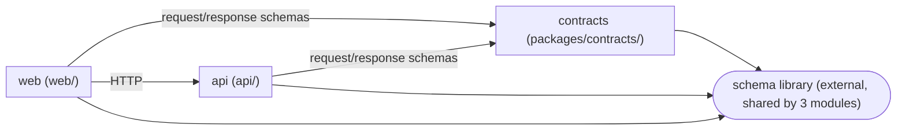

# Dependency Checker

Audit dependencies at two levels — **external** (third-party packages declared in each module's manifest) and **internal** (imports that cross module boundaries: workspace references, path aliases, relative imports) — and report a graph, sizes, and prioritized, actionable findings.

Always run all steps below and produce all output sections. A dependency report with a graph but no prioritization, or findings with no severity, is incomplete.

---

## Scope

Read the **Modules** table in root `AGENTS.md`. Every row is a module in scope; its `Path` is where to look for a manifest. Never hardcode module names or paths.

| Ecosystem | Manifest | Lockfile | Audit tool |
|-----------|----------|----------|------------|
| Node.js | `package.json` | `package-lock.json` / `pnpm-lock.yaml` / `yarn.lock` | `npm audit` / `pnpm audit` |
| Python | `pyproject.toml`, `requirements*.txt` | `uv.lock` / `poetry.lock` | `pip-audit` |
| Go | `go.mod` | `go.sum` | `govulncheck` |
| Rust | `Cargo.toml` | `Cargo.lock` | `cargo audit` |

Also check the repository root for a manifest (workspace root, tooling-only dependencies).

If the Modules table is empty and there is no manifest, report "no modules / no dependencies yet" — that is a valid result.

Treat "internal dependency" and "external dependency" as separate analyses; do not conflate them in the graph or the size table. Read accepted ADRs in `docs/decisions/architecture/` that constrain dependencies or module boundaries (allowed libraries, "module X must not import module Y") and use them as rules in Step 4.

---

## Step 1 — Discover dependencies

**External, per module:** read the manifest's runtime and dev dependencies. Note versions, and flag a package that appears in more than one module with different major versions (version drift).

**Internal, per module:** find how modules reference each other — workspace entries (`workspace:*`, path dependencies, `replace` directives), path aliases (e.g. `tsconfig.json` `paths`), and relative imports that cross a module `Path`. Record the direction of each edge (importer → imported) and count occurrences to gauge coupling strength.

Do not count tooling-only dev dependencies (test runner, linter, formatter, type checker) as architectural dependencies in the graph — list them in the size table if relevant to size, but exclude them from the Mermaid diagram.

---

## Step 2 — Draw the dependency graph

Produce one Mermaid `flowchart LR` (see the `mermaid-diagram` skill for syntax) with:

- One subgraph per module in scope, labeled with its name and path from the Modules table
- Edges between modules for internal dependencies, labeled with the mechanism or a short description (e.g. `types via shared package`)
- External dependencies only if they are large (>5MB installed) or shared across ≥2 modules — draw each as a single shared node with edges to each consuming module
- No edges for transitive dependencies — only direct imports

Example shape (module names are illustrative):



If the graph would exceed ~20 nodes, collapse leaf modules with only one edge into a "misc" note rather than omitting them silently — state what was collapsed.

---

## Step 3 — Size breakdown

For each module, produce a table of its heaviest **direct** dependencies by installed size, using the ecosystem's install location, e.g.:

```bash
du -sh <module path>/node_modules/<dep-name> 2>/dev/null                    # Node.js
du -sh <module path>/.venv/lib/python*/site-packages/<dep> 2>/dev/null      # Python
```

If dependencies are not installed for a module, report "not installed — install to size" rather than guessing.

Table format, one per module, sorted descending by size:

| Dependency | Version | Installed size | Used by (files) | dev-only? |
|---|---|---|---|---|
| `<dep>` | x.y | 12M | `<module path>/src/**` | no |

Then a **repo-wide total** and the single largest dependency across the repo.

---

## Step 4 — Prioritize findings and give recommendations

Classify every finding into exactly one severity tier. Do not invent additional tiers.

| Tier | Criteria |
|------|----------|
| **P0 — Fix soon** | Circular internal dependency; a module importing another module's internals instead of its public entry point; an import that violates an accepted ADR's boundary rule; a dependency with a known critical CVE (only claim this if you actually ran the audit tool) |
| **P1 — Should address** | Version drift (same package, different majors, across modules); a heavy dependency (>20MB) used for a trivial subset of its functionality; an unused dependency (declared but no matching import); **a new dependency with no ADR** (Step 5) |
| **P2 — Worth considering** | A dev dependency that could be a peer/optional dependency; duplicate functionality across modules (e.g. two date libraries); a tooling-only package installed in a module that doesn't need it |
| **Info** | Notable but not actionable — e.g. "module X intentionally has zero runtime deps per ADR-NNNN" |

For each finding: state the tier, the exact package(s)/file(s) involved, why it matters, and one concrete recommended action (e.g. "replace X with Y", "remove unused Z from `<module>/package.json`", "import via the public entry point instead of a relative cross-module path"). No vague advice — every recommendation names a specific dependency or file.

If a finding requires a destructive or hard-to-reverse action (removing a dependency, force-resolving a version), flag it as a **recommendation to confirm with the user**, not something to execute directly.

---

## Step 5 — New dependency = possible ADR trigger

Choosing a library is an architectural decision (AGENTS.md: until an accepted ADR fixes the stack, agents do not add dependencies on their own). For every dependency that is **new** — added in the current diff (`git diff $(git merge-base origin/main HEAD)` on the manifests) or proposed by the user ("should we add X?"):

1. Check `docs/decisions/architecture/` for an accepted ADR that covers it (names the library, or its category with an allowed list).
2. Covered → Info finding citing the ADR.
3. Not covered and the dependency is **runtime**, **cross-cutting** (HTTP framework, ORM, validation, logging, state management, auth) or **hard to replace later** → P1 finding: "draft an ADR with `status: proposed` via the `architecture-decisions` skill before adding". Include alternatives, size, maintenance status and licence as input for that ADR.
4. Small, local, dev-only tooling nothing else builds on → Info, no ADR needed — say so explicitly.

Never add, remove or upgrade a dependency yourself as part of this skill.

---

## Output Report

Structure the final output in exactly this order, with these headings:

1. **Scope** — which modules were analyzed (from the Modules table), and any skipped (with reason, e.g. not installed)
2. **Dependency Graph** — the Mermaid diagram from Step 2
3. **Size Breakdown** — per-module tables from Step 3, plus the repo-wide total and largest offender
4. **Findings & Priorities** — grouped by tier (P0 → P1 → P2 → Info), each with package/file, reason, and one concrete recommendation
5. **New dependencies & ADRs** — each new dependency with its covering ADR or "ADR needed" (Step 5)
6. **Summary** — 3-5 bullet takeaways a developer can act on today, ordered by tier

Do not omit a section even if empty — state "none found" explicitly so the report reads as complete rather than partial.

<!-- Every finding must carry an explicit severity; an unprioritized finding is treated as incomplete. -->
