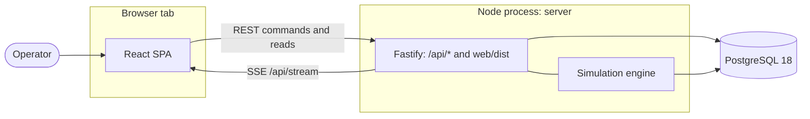
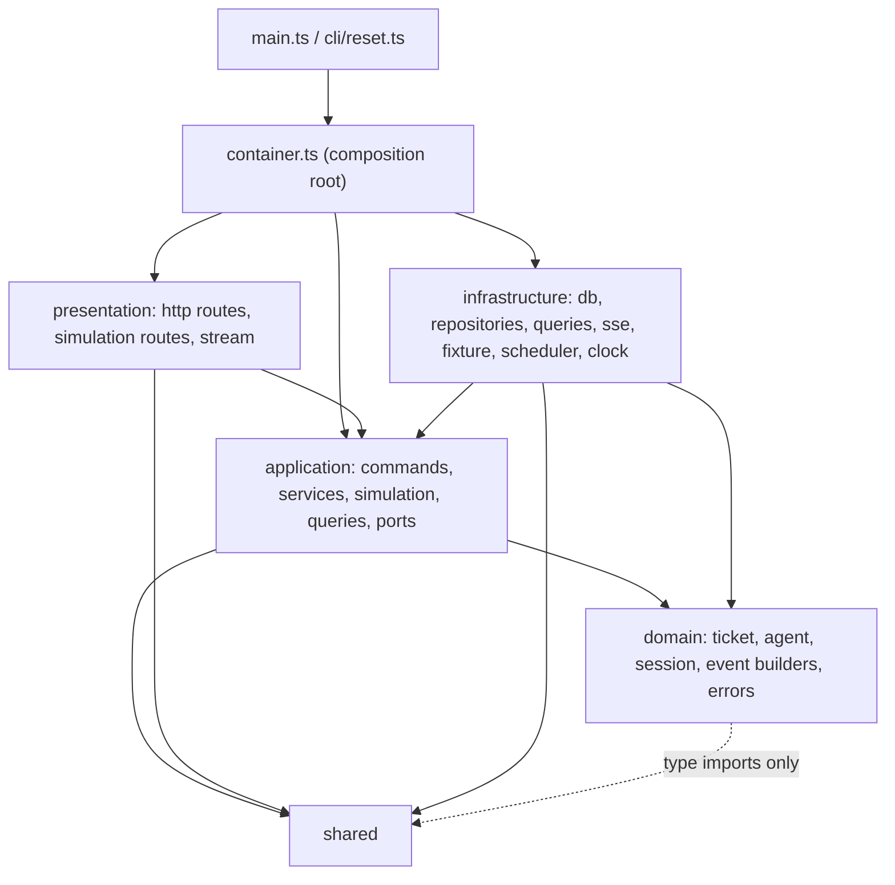
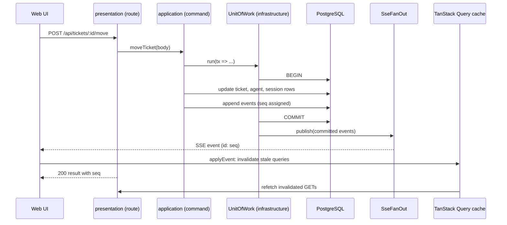
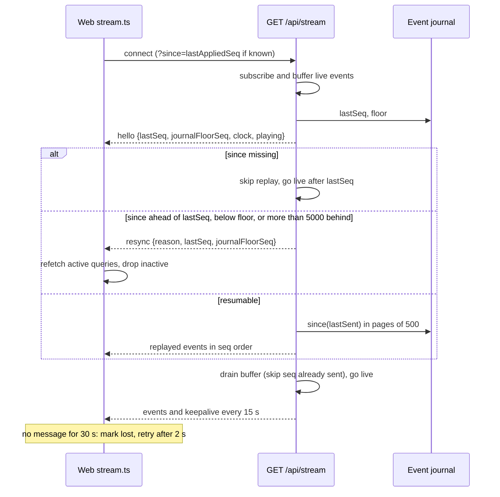

# Architecture

<!-- generated from: AGENTS.md, server/AGENTS.md, web/AGENTS.md, shared/AGENTS.md, server/src/container.ts, server/src/main.ts, server/src/presentation/http/app.ts, server/src/presentation/http/stream.ts, server/src/infrastructure/sse/fan-out.ts, server/src/infrastructure/db/schema.ts, web/src/api/stream.ts, web/src/api/eventCache.ts, web/src/app/routes.tsx, web/vite.config.ts, web/playwright.config.ts, compose.yaml, docs/decisions/architecture/README.md -->

Living description of how Agent Ops Center is built. The _why_ behind each choice lives in
[`../decisions/architecture/`](../decisions/architecture/README.md); behaviour and acceptance criteria live in
[`../specs/`](../specs/README.md). This page describes what is in the repository on `feat/mvp`.

Agents are simulated inside the server (ADR-0008). The MCP server (ADR-0006) and Claude Code hook
telemetry (ADR-0007) are `proposed` and deferred; neither exists in the code.

## System context

One operator uses a browser tab. The server is a single Node process that serves the JSON API, the SSE
stream and, when `web/dist` exists, the built SPA. All state is in one PostgreSQL database. There are no
other external systems.

The SPA sends commands and reads over REST and keeps one `EventSource` open to `/api/stream`. The
simulation engine runs in the same process as the HTTP layer and writes through the same command layer
(ADR-0008). In development, Vite serves the SPA on its own port and proxies `/api` to `127.0.0.1:3000`
(`web/vite.config.ts`); in the single-process setup, Fastify serves `web/dist` itself with a
history-fallback to `index.html` for non-`/api` GET requests (`server/src/presentation/http/app.ts`).
There is no CORS configuration because the browser always talks to one origin. The server binds to
`127.0.0.1` only (`server/src/infrastructure/config.ts`).

## Modules

Mirrors the Modules table in [`/AGENTS.md`](../../AGENTS.md).

| Module   | Responsibility                                                                                                                                                    | Depends on                                                 | Docs                                         |
| -------- | ----------------------------------------------------------------------------------------------------------------------------------------------------------------- | ---------------------------------------------------------- | -------------------------------------------- |
| `shared` | Zod schemas, inferred types, enums, the ticket transition table, health/cost/token-activity rules and stream message schemas. Consumed as source (no build step). | `zod` only                                                 | [`shared/AGENTS.md`](../../shared/AGENTS.md) |
| `server` | Fastify API, SSE stream, simulation engine, Drizzle/PostgreSQL persistence, `reset` CLI.                                                                          | `shared`, `fastify`, `drizzle-orm`, `pg`                   | [`server/AGENTS.md`](../../server/AGENTS.md) |
| `web`    | React 19 SPA: board, ticket, Mission Control, agent, usage and session-log screens.                                                                               | `shared`, `react`, `react-router`, `@tanstack/react-query` | [`web/AGENTS.md`](../../web/AGENTS.md)       |

`server` and `web` never import each other; they meet only through the contracts in `shared` (ADR-0002,
ADR-0010) and over HTTP.

### Contracts in `shared/src`

| File                        | Content                                                                                         |
| --------------------------- | ----------------------------------------------------------------------------------------------- |
| `primitives.ts`, `enums.ts` | ids, timestamps, status/stage/health/source enums                                               |
| `resources.ts`, `api.ts`    | resource shapes and request/response/query schemas                                              |
| `events.ts`, `stream.ts`    | the `Event` union (one schema per event type) and the `hello` / `resync` / `keepalive` messages |
| `errors.ts`                 | the error envelope                                                                              |
| `transitions.ts`            | the operator transition table applied by the move command                                       |
| `rules/`                    | health, cost and token-activity rules as runtime code                                           |
| `script.ts`                 | simulation script shapes                                                                        |

### Server layers (ADR-0010)

Dependencies point inward. `domain/` imports nothing outside itself except types from `shared`.
`application/` defines ports (`application/ports/`: `UnitOfWork`, repositories, `ReadQueries`,
`EventJournal`, `EventPublisher`/`EventSubscriber`, `Scheduler`, `SimClock`, `ServerLock`) and
`infrastructure/` implements them. `presentation/` never imports `infrastructure/` or `drizzle-orm`.
Only `container.ts` instantiates adapters and wires route plugins; `main.ts` does the startup sequence
(see below). `server/src/architecture.test.ts` enforces the layering rules.

| Layer                                 | Contents (as built)                                                                                                                 |
| ------------------------------------- | ----------------------------------------------------------------------------------------------------------------------------------- |
| `domain/`                             | `ticket`, `agent`, `session` rules; `event-builders`; `DomainRefusal`-style errors; ids, labels, time, token generation             |
| `application/commands/tickets/`       | `create-ticket`, `move-ticket`, `assign-ticket`, `request-changes`, `answer-ticket`                                                 |
| `application/services/`               | `ticket-work` (shared helpers such as `commitEvents`, `endOpenSession`, `freeAgent`)                                                |
| `application/simulation/`             | `step-agent`, `step-all`, `run-to-next-stage`, `play-control`, `scripts`, `agent-act`, `clock-advance`, `step-availability`, `prng` |
| `application/queries/`                | one read use case per endpoint (tickets, agents, overview, sessions, usage, events, model prices, simulation state, said-vs-did)    |
| `application/testing/`                | in-memory fakes used by unit tests                                                                                                  |
| `infrastructure/db/`                  | Drizzle schema, client, migrations, unit of work, snapshot reader, server advisory lock                                             |
| `infrastructure/repositories/`        | tickets, agents, sessions, events (journal), model prices, simulation state                                                         |
| `infrastructure/queries/`             | SQL read models behind the read ports                                                                                               |
| `infrastructure/sse/`                 | `SseFanOut` (in-process publish/subscribe)                                                                                          |
| `infrastructure/fixture/`             | fixture loader and `resetToFixture`                                                                                                 |
| `infrastructure/scheduler/`, `clock/` | interval scheduler; DB-backed simulation clock                                                                                      |
| `presentation/http/`                  | `app.ts`, error envelope, `validate.ts`, `as-of-seq.ts`, `routes/*`, `simulation/simulation-routes.ts`, `stream.ts`                 |

### HTTP surface

All routes are registered under `/api` (`server/src/presentation/http`).

| Method and path                                                                                 | Purpose                         |
| ----------------------------------------------------------------------------------------------- | ------------------------------- |
| `GET /healthz`                                                                                  | database liveness               |
| `GET /tickets`, `GET /tickets/:id`                                                              | board and ticket detail reads   |
| `POST /tickets`, `/tickets/:id/move`, `/assign`, `/request-changes`, `/answer`                  | operator commands               |
| `GET /agents`, `GET /agents/:id`, `GET /overview`                                               | Mission Control and agent reads |
| `GET /events`, `GET /sessions`, `GET /sessions/:id`, `GET /usage`, `GET /model-prices`          | feed, session log, usage reads  |
| `GET /simulation`, `POST /simulation/play`, `/pause`, `/step`, `/hold`, `/agents/:agentId/step` | simulation control              |
| `GET /stream`                                                                                   | SSE stream                      |

Read responses are snapshots carrying the journal sequence they reflect (`as-of-seq.ts`, consumed by the
web client as `asOfSeq`).

### Web layout (ADR-0011)

| Path                | Role                                                                                                                                             |
| ------------------- | ------------------------------------------------------------------------------------------------------------------------------------------------ |
| `web/src/api/`      | the only place that calls `fetch` or creates an `EventSource`: `client.ts`, `queries.ts`, `commands.ts`, `keys.ts`, `stream.ts`, `eventCache.ts` |
| `web/src/app/`      | router (`routes.tsx`), providers, header, connection banner, history, theme                                                                      |
| `web/src/ui/`       | presentational `controls`, `display`, `overlay` components                                                                                       |
| `web/src/lib/`      | formatting and label helpers                                                                                                                     |
| `web/src/features/` | `board`, `ticket`, `mission-control`, `agent`, `usage`, `session-log`, `console`, `moves`, `simulation`                                          |

Routes (`web/src/app/routes.tsx`): the index redirects to `/board`; `/tickets/:ticketId`, `/agents/:agentId`,
`/sessions/:sessionId`, plus `/board`, `/mission-control` and `/usage` (`routeInfo.ts`); anything else
renders a not-found page. Screens are lazy-loaded.

### Data model

PostgreSQL tables (`server/src/infrastructure/db/schema.ts`): `model_prices`, `tickets`, `agents`,
`sessions`, `session_log_entries`, `events`, `simulation_state`, `agent_sim_state`, `id_counters`.
Migrations are generated into `server/drizzle/` and applied at server start. `events` is the append-only
journal: `seq` is a generated identity column, rows carry `source`, `category`, `type`, optional
`agent_id` / `ticket_id` / `session_id`, a JSON `payload` and a `warn` flag. Its `type` must match
`<noun>.<verb>` and `source` / `category` are constrained to the shared enums. Current-state tables are
written in the same transaction as the events that describe the change (ADR-0009). The seed fixture
(`server/fixture/fixture.json`) holds 16 tickets, 6 agents, 121 sessions, 44 events and 3 model prices at
simulation clock `2026-10-24T14:32:00Z`.

## Data flow

### Startup

`main.ts` runs, in order: load `.env`, read config (`DATABASE_URL` required, `PORT` default 3000), connect,
run migrations, take a session-level PostgreSQL advisory lock, load the fixture when the database is
empty, build the container, listen on `127.0.0.1`. Any failure before listening exits non-zero. A second
server against the same database fails on the lock; `reset` refuses to run while the lock is held.

### Command to web cache

Each command runs inside one `UnitOfWork.run` call: a throw rolls back every row change and publishes
nothing, and events are handed to `SseFanOut` only after `COMMIT` (`application/ports/unit-of-work.ts`).
`moveTicket` first checks `expectedStatus` (stale state), then asks the shared transition table
(`operatorTransition`) whether the move is applied, refused, needs more input or needs confirmation, and
only then mutates state. Domain refusals are turned into the error envelope by `presentation/http/errors.ts`.
The simulation engine (`step-agent`, `step-all`, `run-to-next-stage`, the Play timer) calls the same unit
of work, so its events reach the stream exactly like operator commands.

On the web side, `eventCache.ts` maps every event type to the query families it affects (a
`satisfies Record<EventType, Handler>` table, so a new event type without a handler fails to compile). An
event invalidates a query only when that query's cached `asOfSeq` is lower than the event's `seq`;
`simulation.stepped` and `simulation.play_changed` patch the cached simulation state directly, and
journal-only types do not touch the feed queries.

### Stream resume and resync

The server subscribes to the fan-out before reading the journal and buffers commits that happen during
replay; each event is sent only if its `seq` is above the last one sent, so resume produces neither gaps nor
duplicates (`presentation/http/stream.ts`). The resume point is the `Last-Event-ID` header or the `since`
query parameter. `resync.reason` is one of `ahead`, `below_floor`, `too_far_behind`
(`MAX_REPLAY_BEHIND = 5000`). The client (`web/src/api/stream.ts`) keeps one `EventSource` per tab, closes
it on every error and reconnects itself with `?since=`, so the browser's native `Last-Event-ID`
reconnect is never used. Its status is `connecting` until replay reaches the `lastSeq` announced in
`hello`, then `connected`; silence for `KEEPALIVE_INTERVAL_MS * 2` (30 s) switches to `lost`, which shows
the connection banner. On first connect it invalidates every query whose snapshot predates `hello.lastSeq`.

## Cross-cutting concerns

| Concern                     | How it is handled                                                                                                                    | Decision                                                                                         |
| --------------------------- | ------------------------------------------------------------------------------------------------------------------------------------ | ------------------------------------------------------------------------------------------------ |
| Layering and DI             | Inward-only imports; adapters constructed only in `container.ts`                                                                     | [ADR-0010](../decisions/architecture/0010-onion-architecture-for-server.md)                      |
| Contracts                   | Zod schemas defined once in `shared`; no `z.object` in `server/src/presentation` or `web/src`                                        | [ADR-0002](../decisions/architecture/0002-typescript-pnpm-monorepo.md), ADR-0010                 |
| Transport                   | REST under `/api`, SSE for pushes, same origin, localhost bind                                                                       | [ADR-0004](../decisions/architecture/0004-fastify-http-api-with-sse-stream.md)                   |
| Persistence and consistency | One transaction per command; events appended in the same transaction; publish after commit                                           | [ADR-0009](../decisions/architecture/0009-postgres-drizzle-with-transactional-event-log.md)      |
| Simulation                  | Runs through the command layer, advances on demand (step, run-to-next-stage) or on a Play timer                                      | [ADR-0008](../decisions/architecture/0008-simulation-through-the-command-layer.md)               |
| Errors                      | One error envelope (`shared/src/errors.ts`); `DomainRefusal` mapped in `presentation/http/errors.ts`; startup failures exit non-zero | ADR-0004, ADR-0010                                                                               |
| Configuration               | `DATABASE_URL` and `PORT` read by the config loader only; `.env` loaded by `cli/load-env.ts`                                         | `.env.example`                                                                                   |
| Front-end state and styling | TanStack Query fed by the stream; CSS Modules over design tokens; status never shown by colour alone                                 | [ADR-0011](../decisions/architecture/0011-react-vite-spa-with-css-modules-and-tanstack-query.md) |
| Testing                     | Vitest unit and integration (real Postgres), RTL, Playwright against a real server                                                   | [ADR-0012](../decisions/architecture/0012-test-with-vitest-rtl-playwright-and-real-postgres.md)  |

### Testing layout

| Level       | Location                                                                                                   | Database                                                                |
| ----------- | ---------------------------------------------------------------------------------------------------------- | ----------------------------------------------------------------------- |
| Unit        | `*.test.ts(x)` beside the source (server uses in-memory fakes from `application/testing/`)                 | none                                                                    |
| Integration | `server/src/**/*.int.test.ts`, `server/test/**/*.int.test.ts`; Vitest `int` project, serial                | `agent_ops_test_<suffix>`, created by `server/test/int/global-setup.ts` |
| End to end  | `web/e2e/*.spec.ts`; one worker, one server per worker on a free port, `web/dist` rebuilt in `globalSetup` | `agent_ops_e2e_<suffix>`, recreated at start and dropped at teardown    |

`<suffix>` is `AGENT_OPS_TEST_DB_SUFFIX` (default `default`). Test code refuses to use the `agent_ops`
database. `docker/postgres-init/01-databases.sql` also creates `agent_ops_test` and `agent_ops_e2e` when the
Postgres volume is first initialised.
