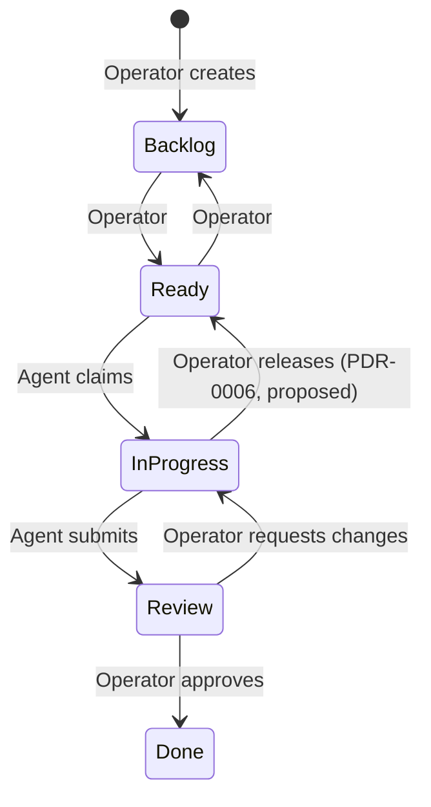

# Abstract Project Spec — Agent Ops: Agent Board + Mission Control

Oct 24, 2026 · @Ivan

## Мета і межі

**Agent Ops** — застосунок, у якому люди і AI-агенти працюють над спільним набором задач. Він має два екрани над одними й тими самими даними:

- **Agent Board** — Trello-подібна дошка: людина створює тікети, агенти беруть їх у роботу й надсилають апдейти, людина приймає результат.
- **Mission Control** — диспетчерська: у реальному часі показує, які агенти підключені, на якій стадії кожен і що він робить зараз.

Агенти підключаються до застосунку через MCP-сервер і самі повідомляють про свій прогрес. Окремо застосунок пасивно отримує телеметрію про те, які інструменти агент реально викликає.

Цей документ описує **що** має вміти продукт. Він є вхідними даними для UI-дизайну і подальшої реалізації, тому не фіксує стек, API чи структуру коду.

## Глосарій

Усі назви в продукті англійською; специфікація українською.

| Назва | Значення |
| --- | --- |
| `Agent Ops` | Продукт цілком |
| `Agent Board` | Екран-дошка з тікетами |
| `Mission Control` | Екран-диспетчерська агентів |
| `Ticket` | Одиниця роботи на дошці |
| `Agent` | Виконавець, що підключився до продукту: справжній AI-агент або симульований |
| `Operator` | Людина, яка ставить задачі, стежить за агентами і приймає роботу |
| `Ticket Status` | Колонка дошки: `Backlog`, `Ready`, `In Progress`, `Review`, `Done` |
| `Blocked` | Позначка на тікеті в роботі: агент не може продовжити без людини |
| `Agent Stage` | Етап роботи агента: `Idle`, `Planning`, `Implementing`, `Testing`, `Awaiting Review` |
| `Agent Health` | Стан звʼязку з агентом: `Online`, `Stale`, `Offline` |
| `Activity` | Будь-яка зафіксована подія: апдейт, зміна статусу, виклик інструмента, коментар |
| `Activity Feed` | Хронологічна стрічка подій одного тікета або одного агента |
| `Event Log` | Загальна жива стрічка всіх подій у Mission Control |
| `Agent Report` | Те, що агент сам повідомив про свою роботу |
| `Agent Telemetry` | Те, що продукт зафіксував про дії агента без його участі |
| `Simulation Mode` | Режим, у якому продуктом користуються симульовані агенти |

## Користувачі та ключові сценарії

У продукту два типи акторів. **Operator** працює через UI. **Agent** не має UI: він взаємодіє з продуктом лише через MCP, а Operator бачить результат цієї взаємодії на екранах.

| ID | Сценарій | Актор |
| --- | --- | --- |
| UC-01 | Створити тікет і зробити його доступним для агентів | Operator |
| UC-02 | Узяти доступний тікет у роботу | Agent |
| UC-03 | Повідомляти про етап і прогрес роботи над тікетом | Agent |
| UC-04 | Попросити допомоги, коли робота заблокована, і отримати відповідь | Agent, Operator |
| UC-05 | Здати роботу на рев'ю | Agent |
| UC-06 | Прийняти роботу або повернути її з коментарем | Operator |
| UC-07 | Побачити з одного погляду, що відбувається з усіма агентами | Operator |
| UC-08 | Розібратися, що конкретний агент робив і чи збігається це з тим, що він повідомляв | Operator |
| UC-09 | Показати або протестувати продукт без справжніх агентів | Operator |

## Вимоги: Agent Board

Дошка — основний робочий екран Operator: тут він ставить задачі, бачить, хто над чим працює, і приймає роботу.

**BRD-01. Колонки.** Дошка показує пʼять колонок у порядку `Backlog`, `Ready`, `In Progress`, `Review`, `Done`, кожна з кількістю тікетів.

- Дано порожню дошку, коли Operator відкриває її, тоді бачить пʼять порожніх колонок із лічильником 0 і підказку, як створити перший тікет.

**BRD-02. Створення тікета.** Operator створює тікет з полями: назва (обовʼязково), опис, acceptance criteria (список), пріоритет (`Low`, `Medium`, `High`). Новий тікет потрапляє в `Backlog` і отримує короткий ідентифікатор (`T-1`, `T-2`…).

- Дано порожню назву, тоді створити тікет неможливо.

**BRD-03. Картка тікета.** Картка показує: ідентифікатор, назву, пріоритет, агента-виконавця, його поточний `Agent Stage`, останній апдейт одним рядком і як давно він був. `Blocked`-тікет візуально виділено так, щоб його було видно з першого погляду.

**BRD-04. Переміщення тікетів.** Operator переміщує тікети між колонками лише за дозволеними переходами (див. «Життєвий цикл тікета»). Під час перетягування недоступні колонки позначено. Для кожного переміщення є альтернатива без drag & drop.

- Дано тікет у `Backlog`, коли Operator переносить його в `Ready`, тоді тікет стає доступним для агентів.
- Дано тікет у `Backlog`, тоді перенести його одразу в `Done` неможливо.
- Дано тікет в `In Progress`, тоді Operator не може сам перенести його в `Review`: це робить лише агент.

**BRD-05. Живі оновлення.** Дії агентів зʼявляються на дошці без перезавантаження сторінки. Картка, яку щойно змінив агент, коротко привертає увагу.

- Дано дошку, відкриту у двох вкладках, коли агент бере тікет, тоді в обох вкладках тікет переходить в `In Progress`.

**BRD-06. Деталі тікета.** Відкриття тікета показує опис, acceptance criteria, виконавця, поточну стадію та **Activity Feed**: усі події тікета в хронологічному порядку з часом і позначкою, хто їх створив (Operator, `Agent Report` чи `Agent Telemetry`).

**BRD-07. Рев'ю.** Для тікета в `Review` Operator бачить підсумок роботи від агента, посилання на результат (гілку або PR), якщо агент їх надав, і дві дії: `Approve` та `Request changes`. `Request changes` вимагає коментаря.

- Дано тікет у `Review`, коли Operator натискає `Approve`, тоді тікет переходить у `Done`, а агент звільняється.
- Дано тікет у `Review`, коли Operator повертає його з коментарем, тоді тікет повертається в `In Progress` до того ж агента, а агент бачить коментар.

**BRD-08. Розблокування.** Для `Blocked`-тікета Operator бачить причину від агента і може відповісти. Відповідь знімає позначку `Blocked` і стає доступною агенту.

**BRD-09. Фільтри.** Operator фільтрує дошку за агентом і може показати лише `Blocked`-тікети.

**BRD-10. Втрата зʼєднання.** Якщо зʼєднання з сервером втрачено, Operator бачить це явно, а дії, що змінюють дані, тимчасово недоступні.

## Вимоги: Mission Control

Mission Control відповідає на одне питання: що кожен агент робить прямо зараз і чи він ще на звʼязку. Дошка показує роботу, диспетчерська показує виконавців.

**MC-01. Зведення.** Над усім екраном — ключові показники: кількість агентів `Online`, кількість `Blocked`-тікетів, кількість тікетів у `Review` та інтенсивність подій за останню хвилину.

**MC-02. Картка агента.** Для кожного агента: імʼя, тип (справжній чи симульований), `Agent Health`, тікет, над яким він працює (з переходом до цього тікета), `Agent Stage`, інструмент, який він виконує зараз, і час останньої активності.

**MC-03. Прогрес стадій.** Картка агента показує послідовність стадій `Planning → Implementing → Testing → Awaiting Review` з виділеною поточною. Стан `Idle` відрізняється від усіх робочих стадій.

- Дано агента в `Implementing`, коли він повідомляє про перехід у `Testing`, тоді картка оновлюється без перезавантаження.

**MC-04. Поточна дія.** Коли агент починає виконувати інструмент (редагування файлу, команда, читання), картка показує, який саме, з коротким описом. Коли інструмент завершився, індикатор зникає; невдале завершення помітно відрізняється від успішного.

**MC-05. Стан звʼязку.** `Agent Health` визначається часом від останньої активності агента: `Online`, далі `Stale`, далі `Offline`. Будь-яка активність агента оновлює цей час. Пороги — відкрите питання.

- Дано агента, від якого довго немає активності, тоді Operator бачить, що він `Stale`, і може відрізнити це від `Offline`.

**MC-06. Event Log.** Жива стрічка всіх подій, найновіші зверху: час, агент, тип події, тікет, короткий опис. Фільтри: за агентом, за джерелом (`Operator`, `Agent Report`, `Agent Telemetry`) і за категорією (агенти, тікети, інструменти). Operator може призупинити прокрутку, не втрачаючи нових подій.

**MC-07. Деталі агента.** Відкриття агента показує всю історію його подій і список тікетів, над якими він працював.

**MC-08. Report vs Telemetry.** У деталях агента поруч на спільній осі часу видно, що агент **повідомляв** (`Agent Report`) і що він **робив** (`Agent Telemetry`). Розбіжність між ними має бути помітна без пояснень.

- Дано агента, що повідомив про `Testing`, але після цього не запускав жодної команди, тоді Operator бачить це, порівнюючи дві колонки.

**MC-09. Звʼязок екранів.** З Mission Control можна перейти на дошку з уже застосованим фільтром за вибраним агентом, і навпаки — з тікета до картки його агента.

## Вимоги: інтеграція агентів

Продукт отримує дані про агента двома каналами: `Agent Report` — те, що агент повідомляє сам через MCP-сервер, і `Agent Telemetry` — те, що продукт фіксує про дії агента без його участі. Обидва канали потрапляють в одну й ту саму історію подій і однаково відображаються на обох екранах.

### Agent Report (MCP)

**INT-01. Ідентичність.** Кожен агент має стабільний ідентифікатор, який задається під час його запуску, а не вигадується моделлю. Перша дія нового агента робить його видимим у Mission Control.

**INT-02. Можливості агента.** Через MCP-сервер агент може:

- переглянути тікети, доступні для роботи;
- узяти наступний доступний тікет або конкретний тікет;
- прочитати повні деталі тікета, включно з коментарями Operator;
- повідомити про свій `Agent Stage`;
- надіслати апдейт по тікету з необовʼязковим відсотком прогресу;
- позначити тікет як `Blocked` з причиною;
- здати тікет на рев'ю з підсумком і, за наявності, посиланням на гілку чи PR.

**INT-03. Межі агента.** Агент не може перевести тікет у `Done`, змінити чужий тікет або взяти другий тікет, поки перший у роботі. Таких можливостей в інтеграції просто немає, а не лише заборона.

**INT-04. Порядок вибору тікета.** Коли агент просить наступний тікет, спершу він отримує свій тікет, повернений з рев'ю, далі — тікети з `Ready` за пріоритетом, а при однаковому пріоритеті — найстаріший.

**INT-05. Зрозумілі відмови.** Коли дія агента недозволена (тікет уже взято, тікет не готовий, агент уже зайнятий), агент отримує відмову з причиною і підказкою, що робити далі.

**INT-06. Інструкція для агента.** Разом з інтеграцією постачається інструкція (skill), що описує цикл роботи агента: узяти тікет → планування → реалізація → тестування → рев'ю, з апдейтами на кожному кроці та блокуванням, коли агент застряг.

### Agent Telemetry

**INT-07. Пасивна фіксація дій.** Продукт фіксує початок і завершення кожного виклику інструмента агентом та завершення його ходу, без участі моделі.

**INT-08. Не заважає агенту.** Збій або недоступність продукту ніяк не впливає на роботу агента: він не блокується і не сповільнюється помітно.

**INT-09. Мінімум даних.** Телеметрія містить лише назву інструмента і короткий опис дії (наприклад, шлях до файлу або початок команди). Вміст файлів, diff, вивід команд і секрети не передаються.

**INT-10. Без дублювання.** Дії агента, які він уже повідомив через `Agent Report`, не дублюються в `Agent Telemetry`.

**INT-11. Лише запрошені агенти.** Сесії, яким не задано ідентифікатор агента, не потрапляють у продукт.

## Вимоги: режим симуляції

Симуляція дає змогу користуватися продуктом і показувати його без жодного справжнього агента.

**SIM-01. Симульовані агенти.** Operator може запустити кількох симульованих агентів. Вони поводяться як справжні, проходять повний цикл роботи над тікетами і відображаються з позначкою `Simulated`.

**SIM-02. Нештатні ситуації.** Симуляція вміє відтворювати: блокування тікета, невдалий виклик інструмента, агента, що перестав відповідати, і агента, чий `Agent Report` розходиться з `Agent Telemetry`.

**SIM-03. Відтворюваність.** Той самий сценарій симуляції можна запустити повторно з тим самим результатом.

**SIM-04. Стартові дані.** Продукт можна заповнити набором демонстраційних тікетів з різними пріоритетами, щоб дошка не була порожньою.

**SIM-05. Співіснування.** Симульовані і справжні агенти можуть працювати одночасно на одній дошці.

## Доменна модель

Усе, що відбувається в продукті, фіксується як подія в спільній історії. Поточний стан тікетів і агентів — наслідок цієї історії, тому обидва екрани завжди показують узгоджену картину.

### Ticket

| Атрибут | Значення |
| --- | --- |
| ID | Короткий ідентифікатор: `T-1`, `T-2`… |
| Title | Обовʼязкова назва |
| Description | Опис задачі |
| Acceptance Criteria | Список критеріїв приймання |
| Priority | `Low`, `Medium`, `High` |
| Status | `Backlog`, `Ready`, `In Progress`, `Review`, `Done` |
| Assignee | Агент, що працює над тікетом, або нікого |
| Blocked | Причина блокування від агента або нічого |
| Review Comment | Останній коментар Operator при поверненні з рев'ю |
| Activity Feed | Усі події тікета в хронологічному порядку |

### Agent

| Атрибут | Значення |
| --- | --- |
| ID і Name | Стабільний ідентифікатор і відображуване імʼя |
| Kind | `Real` або `Simulated` |
| Stage | `Idle`, `Planning`, `Implementing`, `Testing`, `Awaiting Review` |
| Health | `Online`, `Stale`, `Offline` |
| Current Ticket | Тікет у роботі або нічого |
| Current Tool | Інструмент, який агент виконує зараз, або нічого |
| Last Seen | Час останньої активності |

### Категорії подій

| Категорія | Приклади | Хто створює |
| --- | --- | --- |
| Ticket | створено, переміщено, взято в роботу, апдейт, заблоковано, розблоковано, здано на рев'ю, прийнято, повернуто | Operator, `Agent Report` |
| Agent | підключився, змінив стадію, відключився | `Agent Report` |
| Tool | інструмент почато, інструмент завершено, хід завершено | `Agent Telemetry` |

### Життєвий цикл тікета

> Відновлено з вбудованої діаграми (5 статусів, 7 переходів). Сьомий перехід (`In Progress → Ready`) запропоновано в PDR-0006 (proposed).

Агент не може сам закрити тікет, а Operator не може здати на рев'ю роботу, яку зробив агент. Будь-який інший перехід недозволений, і UI не дає його зробити.

## Нефункціональні вимоги

- **NFR-01. Реальний час.** Дія агента зʼявляється на обох екранах менш ніж за пів секунди в локальному середовищі.
- **NFR-02. Узгодженість.** Дошка і Mission Control ніколи не показують суперечливий стан того самого тікета чи агента, зокрема у кількох вкладках.
- **NFR-03. Збереження.** Після перезапуску продукту всі тікети, агенти та історія подій зберігаються.
- **NFR-04. Відновлення зʼєднання.** Після тимчасової втрати зʼєднання UI автоматично відновлюється і показує події, що сталися за цей час.
- **NFR-05. Лише локально.** Продукт працює на машині Operator і не потребує авторизації. Це обмеження явно вказано в UI.
- **NFR-06. Доступність.** Усі дії доступні з клавіатури, включно з переміщенням тікетів. Статуси, стадії і стан звʼязку не передаються лише кольором.
- **NFR-07. Масштаб.** Продукт комфортно працює щонайменше з 10 одночасними агентами і 100 тікетами.
- **NFR-08. Адаптивність.** Обидва екрани придатні до використання на ширині ноутбука; мобільна версія не обовʼязкова.

## Поза скоупом

- Запуск агентів з UI.
- Авторизація, кілька Operator, ролі й права.
- Ізоляція агентів у окремих робочих копіях і автоматичне створення PR.
- Облік токенів і вартості.
- Інтеграція з Jira, Linear чи GitHub Issues.
- Розгортання будь-де, крім локальної машини.

## Відкриті питання

- [ ] Які пороги для `Stale` і `Offline`, і чи вважати агента `Stale`, коли він довго виконує один інструмент (наприклад, тести)?
- [ ] Чи може Operator призначити тікет конкретному агенту, чи агенти завжди беруть роботу самі?
- [ ] Чи потрібен WIP-ліміт на колонку `In Progress`?
- [ ] Як показувати в Mission Control агентів, що давно `Offline`: приховувати чи архівувати?
- [ ] Чи потрібна Operator можливість зупинити агента або забрати в нього тікет (`release`), і як це бачить агент?
