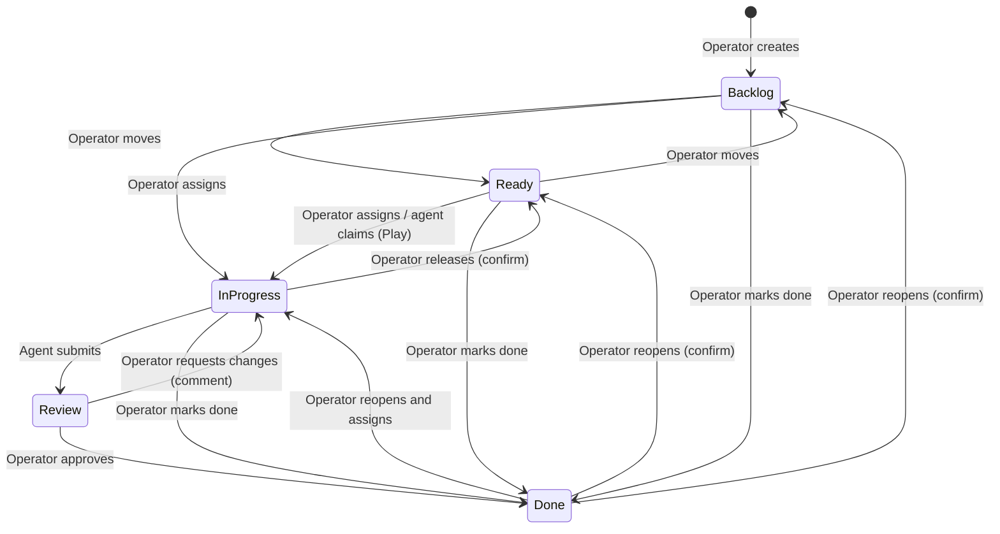
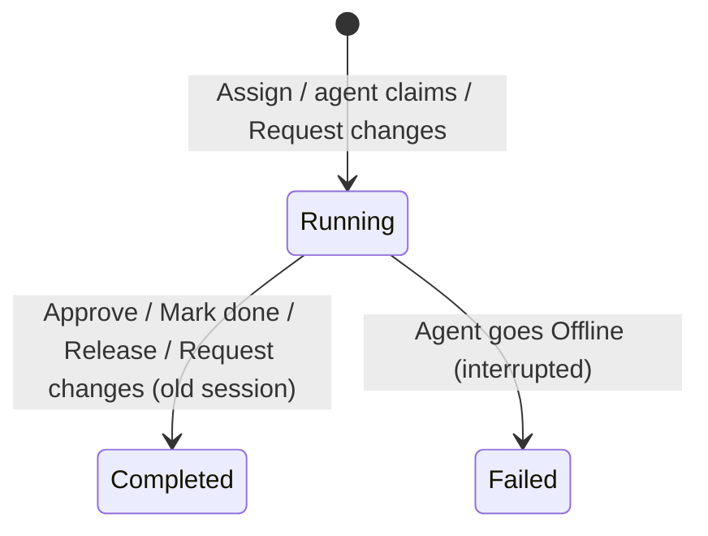

# Abstract Project Spec — Agent Ops: Agent Board + Mission Control

Oct 24, 2026 · @Ivan

## Мета і межі

**Agent Ops** — застосунок, у якому люди і AI-агенти працюють над спільним набором задач. Він має три екрани в основній навігації і три сторінки деталей над одними й тими самими даними:

- **Agent Board** (`01 Board`) — Trello-подібна дошка: людина створює тікети, призначає їх агентам або лишає агентам узяти самим, людина приймає результат.
- **Mission Control** (`02 Mission Control`) — диспетчерська: показує, які агенти на звʼязку, на якій стадії кожен і що він робить зараз.
- **Usage & Cost** (`03 Usage & Cost`) — облік токенів і вартості прогонів агентів: скільки коштує кожна сесія, агент, тікет і вид роботи.
- Сторінки деталей: **тікет** (зокрема `Agent console`), **агент** і **Session Log** — повний лог однієї сесії агента: що агент писав, які інструменти викликав і з яким результатом.

**MVP працює лише в режимі симуляції** (PDR-0008, proposed): усі агенти симульовані, зокрема ті, що в демонстраційних даних мають тип `Real`. `Usage & Cost` і `Session Log` працюють на `Mock Data`: живого збору токенів і логів від справжніх агентів у цій версії немає (PDR-0007, proposed).

**Нічого на екрані не змінюється саме по собі.** Симульований агент робить наступний крок лише тоді, коли Operator натискає `Next step` або `Run to next stage` в `Agent console` тікета. Автоматичне програвання симуляції (`Play`) — необовʼязковий режим, за замовчуванням вимкнений (SIM-06, SIM-07).

Підключення справжніх агентів через MCP-сервер і пасивна телеметрія їхніх дій (`Agent Telemetry` від справжніх агентів) — **наступна ітерація**; ці вимоги збережено в розділі «Наступна ітерація: інтеграція справжніх агентів».

Цей документ описує **що** має вміти продукт. Він є вхідними даними для UI-дизайну і подальшої реалізації, тому не фіксує стек, API чи структуру коду.

## Обмеження (Constraints)

Рішення, у межах яких написано цю специфікацію. Proposed-рішення чекають на підтвердження власника; специфікація вже написана відповідно до них.

- **PDR-0001** Record product decisions as PDRs (accepted) — продуктові рішення фіксуються як PDR; специфікація їм не суперечить.
- **PDR-0004** No WIP limit on In Progress in the MVP (proposed) — ліміту на `In Progress` немає; його обмежує лише правило «один тікет на агента» (SIM-09).
- **PDR-0006** Operator can release an In Progress ticket back to Ready (proposed) — `In Progress → Ready` з підтвердженням, агент отримує відмову з причиною (BRD-12).
- **PDR-0007** Usage & Cost and Session Log ship on mock data only (proposed) — усі цифри вартості й логи з `Mock Data`, кожен такий вид позначено `Mock`.
- **PDR-0008** MVP runs on simulated agents only (proposed) — MCP-сервер і `Agent Telemetry` справжніх агентів переходять у наступну ітерацію.
- **PDR-0009** Operator assigns tickets to free agents and moves tickets within lifecycle guards (proposed, supersedes PDR-0003) — вікно призначення агента і таблиця переходів Operator (BRD-04, BRD-11).
- **PDR-0010** Offline agents stay in the Mission Control grid, dimmed and sorted last (proposed, supersedes PDR-0005) — MC-10.
- **PDR-0011** Health thresholds with a capped tool grace and a heartbeat for waiting agents (proposed, supersedes PDR-0002) — MC-05.
- **ADR** — жодне accepted ADR, крім ADR-0001 (формат запису рішень), цю специфікацію не обмежує. Proposed ADR-0006 (MCP-сервер) і ADR-0007 (телеметрія через hooks) стосуються наступної ітерації.

## Прототип і специфікація

Клікабельний прототип (`docs/design/prototype/app.dc.html`) — еталон вигляду, текстів і поведінки, **крім** перелічених нижче місць. Тут прототип дозволяє те, що власник відхилив, і UI має йти за специфікацією, а не за прототипом:

| # | Що робить прототип | Що вимагає специфікація |
| --- | --- | --- |
| D-1 | Operator може перенести тікет з `In Progress` у `Review`; тікет отримує автопідсумок «Moved to Review by the Operator» | Заборонено: на рев'ю здає лише агент (BRD-04). Автопідсумку немає |
| D-2 | Будь-який тікет, що мав виконавця (зокрема з `Done`), можна перенести в `Review` | `Backlog`/`Ready`/`Done → Review` заборонено (BRD-04) |
| D-3 | `In Progress → Backlog` і `Review → Ready`/`Backlog` дозволено (з підтвердженням) | Заборонено. Звільнити тікет можна лише `In Progress → Ready` (BRD-12, PDR-0006) |
| D-4 | `Done → Backlog`/`Ready` без підтвердження | Повторне відкриття з `Done` потребує підтвердження (BRD-12) |
| D-5 | Призначення агента записує подію `Agent Report` «Claimed T-x» | Подія — `Operator` «assigned to X»; `Claimed` пише лише агент, що сам узяв тікет (BRD-11) |
| D-6 | Порожній період у `Usage & Cost` радить «press Play», хоча `Play` прихований | Текст не посилається на прихований елемент (CST-02) |
| D-7 | Заблокований агент шле сигнал раз на 18 с, агент на рев'ю — раз на 60 с, тож стан звʼязку блимає `Online`/`Stale`; інструмент тримає агента `Online` без обмеження | Сигнал частіше ніж раз на 30 с; інструмент тримає `Online` не довше 10 хв (MC-05) |
| D-8 | Вартість `$ TODAY` на картці агента без позначки `Mock` | Позначка `Mock` обовʼязкова (MOCK-01) |
| D-9 | Кнопки переходу між помилками в `Session Log` активні, коли помилок немає | Недоступні (LOG-06) |
| D-10 | Картки тікетів не отримують фокус з клавіатури | Отримують (NFR-06) |
| D-11 | Офлайн-агент з відкритою сесією лишає її `Running` | Сесія завершується як `Failed` (LOG-10) |
| D-12 | Повернення з рев'ю продовжує відкриту сесію агента | Повернення з рев'ю починає нову сесію (LOG-10) |
| D-13 | Агентів `alpha`/`bravo`/`charlie` позначено `REAL · CLAUDE CODE` | У MVP усі агенти симульовані; чи показувати позначку `Real` — відкрите питання |
| D-14 | Вікно `Assign`, коли всі зайняті, радить перенести тікет у `Review` | Порада не пропонує заборонених переходів (BRD-11) |
| D-15 | Перенесення з `Done` у `Backlog`/`Ready` має toast «moved to …», а нагадування під дошкою і в `C — Move` кажуть «Any column works» | Тексти описують лише дозволені переходи (BRD-04, BRD-14) |

## Глосарій

Усі назви в продукті англійською; специфікація українською.

| Назва | Значення |
| --- | --- |
| `Agent Ops` | Продукт цілком |
| `Agent Board` | Екран-дошка з тікетами |
| `Mission Control` | Екран-диспетчерська агентів |
| `Ticket` | Одиниця роботи на дошці |
| `Agent` | Виконавець роботи над тікетами. У MVP — завжди симульований; тип `Real`/`Simulated` збережено для відображення і наступної ітерації |
| `Operator` | Людина, яка ставить задачі, стежить за агентами і приймає роботу |
| `Ticket Status` | Колонка дошки: `Backlog`, `Ready`, `In Progress`, `Review`, `Done` |
| `Blocked` | Позначка на тікеті в роботі: агент не може продовжити без людини |
| `Agent Stage` | Етап роботи агента: `Idle`, `Planning`, `Implementing`, `Testing`, `Awaiting Review` |
| `Agent Health` | Стан звʼязку з агентом: `Online`, `Stale`, `Offline` |
| `Activity` | Будь-яка зафіксована подія: апдейт, зміна статусу, виклик інструмента, коментар. Не плутати з `Token Activity` |
| `Activity Feed` | Хронологічна стрічка подій одного тікета або одного агента (на сторінці тікета — розділ `Activity`) |
| `Move` | Дія Operator: перенести тікет в іншу колонку перетягуванням або кнопкою `Move to <колонка>` на сторінці тікета |
| `Assign` | Дія Operator: віддати тікет конкретному вільному агенту у вікні «Who takes T-x?»; тікет переходить в `In Progress` |
| `Release` | Дія Operator: забрати тікет `In Progress` в агента і повернути в `Ready` (з підтвердженням) |
| `Agent console` | Термінальний вид сесії агента на сторінці тікета з кнопками кроків |
| `Next step` | Кнопка в `Agent console`: агент робить рівно один крок |
| `Run to next stage` | Кнопка в `Agent console`: агент робить кроки, доки не змінить `Agent Stage` або не почне чекати на Operator |
| `Said vs did` | Таблиця на сторінці агента: що агент повідомив (`Agent Report`) поруч із тим, що він зробив (`Agent Telemetry`) |
| `Where the tokens went` | Таблиця в `Session Log`: токени й вартість сесії за `Token Activity` |
| `Token Activity` | Вид роботи, на яку пішли токени кроку: `Reasoning & replies`, `Reading code`, `Editing code`, `Running commands`, `Agent Ops (MCP calls)`, `Session context`. У UI — колонка `Activity` і розбивка `By activity` |
| `Back` | Кнопка `← BACK TO …` на сторінках деталей: повертає на попередній екран |
| `Toast` | Коротке повідомлення внизу екрана про результат дії Operator |
| `Theme` | Світла або темна тема інтерфейсу |
| `Event Log` | Загальна жива стрічка всіх подій у Mission Control |
| `Agent Report` | Те, що агент сам повідомив про свою роботу |
| `Agent Telemetry` | Те, що продукт зафіксував про дії агента без його участі (у MVP — дії симульованого агента з інструментами) |
| `Simulation Mode` | Режим, у якому продуктом користуються симульовані агенти. У MVP — єдиний режим |
| `Simulation Clock` | Час симуляції: рухається лише разом із кроками агентів, а не сам по собі |
| `Usage & Cost` | Екран обліку токенів і вартості прогонів |
| `Session` | Один прогін агента: від старту до завершення сесії (наприклад, одна сесія Claude Code). Привʼязаний до агента і, якщо є, до тікета |
| `Session Log` | Екран і зміст повного логу однієї `Session` |
| `Log Entry` | Один запис логу: повідомлення Operator, відповідь агента, виклик інструмента з результатом (успішний чи невдалий), зміна стадії, системна подія |
| `Token Usage` | Кількість токенів кроку або сесії: `Input`, `Output`, `Cache Read`, `Cache Write` |
| `Cost` | Вартість кроку або сесії в USD, порахована з `Token Usage` і цін моделі |
| `Mock Data` | Фіксований демонстраційний набір сесій, логів і цін замість живих даних |

## Користувачі та ключові сценарії

У продукту два типи акторів. **Operator** працює через UI. **Agent** не має UI: у MVP це симульований агент, який робить кроки, коли Operator натискає `Next step` / `Run to next stage` (або сам, якщо ввімкнено `Play`); у наступній ітерації справжній агент взаємодіятиме з продуктом через MCP. Operator бачить результат дій агента на екранах.

| ID | Сценарій | Актор |
| --- | --- | --- |
| UC-01 | Створити тікет і зробити його доступним для агентів | Operator |
| UC-02 | Узяти доступний тікет у роботу | Agent |
| UC-03 | Повідомляти про етап і прогрес роботи над тікетом | Agent |
| UC-04 | Попросити допомоги, коли робота заблокована, і отримати відповідь | Agent, Operator |
| UC-05 | Здати роботу на рев'ю | Agent |
| UC-06 | Прийняти роботу або повернути її з коментарем | Operator |
| UC-07 | Побачити з одного погляду, що відбувається з усіма агентами | Operator |
| UC-08 | Розібратися, що конкретний агент робив і чи збігається це з тим, що він повідомляв | Operator |
| UC-09 | Показати або протестувати продукт без справжніх агентів | Operator |
| UC-10 | Побачити, скільки токенів і грошей витрачено, і на що саме | Operator |
| UC-11 | Відкрити агента, вибрати його сесію і прочитати її повний лог | Operator |
| UC-12 | Призначити тікет конкретному вільному агенту | Operator |
| UC-13 | Покроково провести агента через роботу над тікетом і бачити кожен крок у консолі | Operator |
| UC-14 | Забрати тікет в агента або повторно відкрити завершений тікет | Operator |

## Вимоги: Agent Board

Дошка — основний робочий екран Operator: тут він ставить задачі, бачить, хто над чим працює, і приймає роботу.

**BRD-01. Колонки.** Дошка показує пʼять колонок у порядку `Backlog`, `Ready`, `In Progress`, `Review`, `Done` з номером (`01`…`05`) і кількістю тікетів у кожній. Над дошкою — зведення: `Tickets` (усього), `Agents working` (агенти з тікетом в `In Progress`), `■ Blocked`. У колонці тікети впорядковано за пріоритетом, далі за віком (найстаріший вище); у `Done` — останній змінений вище.

- Дано порожню колонку, тоді в ній написано: у `Backlog` — «Create a ticket to start», в інших — «Nothing here».
- Дано ввімкнений фільтр, під який у колонці нічого не підпадає, тоді в ній написано «Nothing matches the filter».

**BRD-02. Створення тікета.** Operator натискає `+ New ticket` і у вікні «New ticket» заповнює: назва (обовʼязково), опис, acceptance criteria (по одному в рядку), пріоритет (`High`, `Medium`, `Low`; за замовчуванням `Medium`). Вікно заздалегідь показує ідентифікатор («Goes to Backlog as T-N»). Новий тікет потрапляє в `Backlog` і отримує наступний короткий ідентифікатор (`T-1`, `T-2`…).

- Дано порожню назву, тоді створити тікет неможливо, а під полем зʼявляється «Title is required.».
- Дано створений тікет, тоді Operator бачить toast «T-N created in Backlog — move it to Ready for agents».

**BRD-03. Картка тікета.** Картка показує: ідентифікатор, пріоритет (три смужки і слово `HIGH`/`MEDIUM`/`LOW`), назву, а якщо над тікетом працює агент — шкалу стадій, імʼя агента, його `Agent Stage` (або `WAITING`, якщо агент уже не на цьому тікеті) і як давно тікет змінювався. Нижче — останній апдейт одним рядком. `Blocked`-тікет залито кольором уваги, має позначку `■ BLOCKED` і показує причину замість апдейту. Тікет у `Done` приглушений і не показує агента. Відкрити тікет можна кліком по картці або по назві.

**BRD-04. Переміщення тікетів.** Operator переміщує тікети перетягуванням або кнопками `Move to <колонка>` на сторінці тікета (альтернатива без drag & drop, NFR-06). Дозволені переходи і реакція на кожен — у таблиці нижче (PDR-0009, PDR-0006). Усі заборонені переходи однакові для перетягування і для кнопок: кнопка недоступна, а її підказка містить ту саму причину.

| Звідки \ Куди | `Backlog` | `Ready` | `In Progress` | `Review` | `Done` |
| --- | --- | --- | --- | --- | --- |
| `Backlog` | — | дозволено | вікно `Assign` (BRD-11) | ⊘ «Nobody worked on it yet — move it to In Progress first» | дозволено (`Mark done`) |
| `Ready` | дозволено | — | вікно `Assign` (BRD-11) | ⊘ «Nobody worked on it yet — move it to In Progress first» | дозволено (`Mark done`) |
| `In Progress` | ⊘ «Release it to Ready first» | підтвердження `Release` (BRD-12) | — | ⊘ «Only the agent submits work for review» | дозволено (`Mark done`) |
| `Review` | ⊘ «Approve it or request changes» | ⊘ «Approve it or request changes» | вікно `Request changes` з обовʼязковим коментарем (BRD-07) | — | дозволено (`Approve`, BRD-07) |
| `Done` | підтвердження повторного відкриття (BRD-12) | підтвердження повторного відкриття (BRD-12) | вікно `Assign` (BRD-11) | ⊘ «Reopen it first — only an agent submits for review» | — |

Під час перетягування дошка показує над кожною колонкою, що станеться: колонка, що приймає тікет, підсвічена і має підказку `↓ DROP — …` (наприклад `↓ DROP — READY FOR AGENTS`, `↓ DROP — PICK AN AGENT`, `↓ DROP — SEND BACK WITH COMMENT`, `↓ DROP — APPROVE`, `↓ DROP — MARK DONE`, `↓ DROP — RELEASE (CONFIRM)`, `↓ DROP — REOPEN (CONFIRM)`); колонка, що не приймає, приглушена і має підказку `⊘ <причина>` з таблиці. Над дошкою рядок «Moving T-x — highlighted columns accept it.».

- Дано тікет у `Backlog`, коли Operator переносить його в `Ready`, тоді тікет стає доступним для агентів і зʼявляється toast «T-x moved to Ready».
- Дано тікет в `In Progress`, тоді Operator не може сам перенести його в `Review`: це робить лише агент.
- Дано тікет в `In Progress`, коли Operator переносить його в `Done`, тоді агент звільняється (`Idle`), його сесія завершується як `Completed` (LOG-10), а в історії тікета є подія Operator «Moved In Progress → Done».
- Дано заборонений перехід, коли Operator відпускає тікет над колонкою, тоді тікет лишається на місці і зʼявляється toast «Can’t move T-x to <колонка>: <причина>».

**BRD-05. Живі оновлення.** Кожна зміна (дія Operator або крок агента) зʼявляється на дошці без перезавантаження сторінки. Картка, яку змінено щойно (протягом 7 с за `Simulation Clock`), має позначку `UPDATED` і виділену рамку; на сторінці тікета — позначку `■ JUST UPDATED`.

- Дано дошку, відкриту у двох вкладках, коли Operator призначає тікет агенту, тоді в обох вкладках тікет переходить в `In Progress`.

**BRD-06. Деталі тікета.** Сторінка тікета показує: ідентифікатор, пріоритет, статус, назву; розділи `A — Description`, `B — Acceptance criteria · N` (або «No acceptance criteria yet.»), `C — Move` з кнопками переходів (BRD-04), `D — Agent console` (CON-01…CON-06); бічну панель `Who is on it` (агент з типом і `Agent Health`, шкала стадій, поточний інструмент як у MC-04, кнопки `Open current session log` / `Open last session log` і `Agent page →`), `Sessions & cost` (CST-07) і `Activity` — усі події тікета (останні 30) з часом і позначкою джерела (`● Operator`, `■ Agent Report`, `◆ Agent Telemetry`).

- Дано тікет без агента, тоді `Who is on it` пояснює стан: у `Backlog` — «Nobody yet. Move it to Ready so an agent can pick it up.», у `Ready` — «Waiting for the next free agent — agents take Ready tickets by priority, then age.», у `Done` — «Finished.».
- Дано тікет, з якого агент уже перейшов на інший, тоді поточний інструмент показує «Finished here · <агент> has moved on».

**BRD-07. Рев'ю.** Для тікета в `Review` Operator бачить панель «Ready for review» («Submitted by <агент>»): підсумок роботи від агента, посилання на результат (`RESULT` — гілка або PR), якщо агент їх надав, і дві дії: `✓ Approve` та `↩ Request changes`. `Request changes` відкриває поле «Comment for <агент>» з обовʼязковим коментарем; перетягування `Review → In Progress` відкриває те саме у вікні «Send T-x back to <агент>».

- Дано тікет у `Review`, коли Operator натискає `Approve`, тоді тікет переходить у `Done`, агент звільняється (`Idle`) і зʼявляється toast «T-x approved — moved to Done».
- Дано тікет у `Review`, коли Operator повертає його з коментарем, тоді тікет повертається в `In Progress` до того ж агента, агент першим кроком читає коментар, а сторінка тікета показує «Returned from review · <коментар>».
- Дано порожній коментар, тоді повернути тікет неможливо і показано «A comment is required — tell the agent what to change.».

**BRD-08. Розблокування.** Для `Blocked`-тікета Operator бачить панель «■ Blocked — <агент> needs your answer» з питанням агента і обовʼязковим полем відповіді та кнопкою `Send answer & unblock`. Відповідь знімає позначку `Blocked`, агент читає її наступним кроком, а сторінка тікета показує «You answered · <відповідь>».

- Дано порожню відповідь, тоді розблокувати неможливо і показано «Write an answer before unblocking.».

**BRD-09. Фільтри.** Operator фільтрує дошку за агентом (`Agent`: усі або конкретний) і може показати лише `Blocked`-тікети (`Blocked only`). Коли фільтр увімкнено, над дошкою видно, який саме («Filter on: agent X, blocked only.»), і є кнопка `Clear filters`. Фільтри змінює лише Operator (NAV-04).

**BRD-10. Втрата зʼєднання.** Якщо зʼєднання з сервером втрачено, Operator бачить це явно, а дії, що змінюють дані, тимчасово недоступні. Вигляд цього стану ще не спроєктовано (див. «Відкриті питання»).

**BRD-11. Призначення агента (`Assign`).** Перенесення тікета в `In Progress` з `Backlog`, `Ready` або `Done` відкриває вікно «Who takes T-x?» з назвою тікета і списком усіх агентів (PDR-0009). Для кожного агента видно імʼя, тип і стан: вільний агент — `■ FREE · ONLINE` (або його `Agent Health` · `FREE`), зайнятий — `BUSY · <тікет> · <стадія>`. Зайняті агенти недоступні й стоять у кінці списку: агент працює лише над одним тікетом. Вибір агента переводить тікет в `In Progress`, агент переходить у `Planning` і починає нову сесію.

- Дано вибраного агента, тоді в історії тікета і в `Event Log` зʼявляється подія **Operator** «Moved <звідки> → In Progress · assigned to <агент>», а не `Agent Report` (D-5), і toast «T-x is In Progress — <агент> starts with Planning».
- Дано, що всі агенти зайняті, тоді вікно пояснює «Every agent is busy. Mark one of their tickets done or release it to Ready first.», а призначити нікого неможливо (D-14).
- Дано `Cancel`, тоді тікет лишається у своїй колонці.
- Дано тікет, що повертається з `Done` з коментарем рев'ю попереднього циклу, тоді призначення прибирає цей коментар із поточного стану тікета; в `Activity` він лишається.

**BRD-12. Підтвердження.** Дії, що забирають роботу в агента або відкривають завершену роботу, потребують підтвердження:

- **`Release`** (`In Progress → Ready`): вікно «Move T-x to Ready?» пояснює «<агент> is assigned to it. The agent stops working on T-x, gets a refusal with the reason on its next call, and becomes free for other work.» Дії: `Keep it with the agent` і підтвердження. Після підтвердження тікет без виконавця і без `Blocked`, агент стає `Idle`, на наступному кроці отримує відмову з причиною (SIM-11), його сесія завершується як `Completed` (LOG-10), подія Operator «Moved In Progress → Ready · released <агент>», toast «T-x moved to Ready — the agent is free again».
- **Повторне відкриття** (`Done → Backlog` або `Done → Ready`): вікно «Reopen T-x in <колонка>?» з поясненням, що тікет знову стане роботою без виконавця. Після підтвердження тікет без виконавця, подія Operator «Moved Done → <колонка>».
- Дано `Keep it with the agent` або закриття вікна, тоді нічого не змінюється.

**BRD-13. Відгук на дії.** Кожна дія Operator, що змінює дані, завершується toast-повідомленням унизу екрана, яке зникає приблизно через 3,4 с і оголошується допоміжним технологіям. Тексти: «T-x created in Backlog — move it to Ready for agents», «T-x moved to <колонка>», «T-x is In Progress — <агент> starts with Planning», «T-x approved — moved to Done», «T-x moved to Done», «T-x sent back to In Progress», «T-x unblocked — the agent continues», «T-x moved to Ready — the agent is free again», «T-x reopened in <колонка>», «Can’t move T-x to <колонка>: <причина>».

**BRD-14. Підказка під дошкою.** Під дошкою пояснено правила: перетягнути можна в будь-яку дозволену колонку; `In Progress` питає, хто з агентів бере тікет; забрати роботу в агента можна лише в `Ready` з підтвердженням; без миші — відкрити тікет і скористатися кнопками `Move`.

## Вимоги: Agent console

`Agent console` — розділ `D — Agent console` на сторінці тікета: сесія агента над цим тікетом у вигляді терміналу. Тут Operator бачить кожен крок агента повністю і саме тут рухає агента вперед (SIM-06).

**CON-01. Вигляд.** Консоль — темна терміналоподібна область моноширинним шрифтом в обох темах; найновіший рядок унизу, і консоль тримає прокрутку внизу, коли зʼявляються нові рядки. Над консоллю — рядок сесії: `<сесія> · <агент> · <модель> · <день і час старту> · N entries · $<вартість>` (з `so far`, якщо сесія `Running`). Консоль доступна з клавіатури і оголошується як лог.

**CON-02. Вкладки сесій.** Якщо над тікетом працювало кілька сесій, над консоллю є вкладки 5 найновіших сесій тікета; `Running`-сесію позначено `●`. За замовчуванням вибрано поточну `Running`-сесію агента на цьому тікеті, а якщо її немає — найновішу.

**CON-03. Рядки.** Кожен `Log Entry` сесії — рядок з часом, міткою виду і текстом:

- `operator` — повідомлення Operator (відповідь на блокування, коментар рев'ю), виділене;
- `system` — системна подія (старт сесії, відмова, кінець сесії), приглушена;
- `stage` — зміна стадії як розділювач `── PLANNING ──`;
- `agent` — відповідь агента і під нею рядок токенів;
- `$ tool` (успіх) або `✗ tool` (помилка, виділено кольором уваги і фоном) — назва інструмента й аргумент, під ними `→ <результат> · Ns`, рядок токенів і **повний** вивід інструмента без згортання.

Рядок токенів має вигляд `<input> in · <output> out · <cache read> cache · $<вартість кроку>`.

**CON-04. Кроки.** Поки тікет в `In Progress`, не `Blocked`, агент на ньому і в нього є що робити, над консоллю доступні `▸ NEXT STEP` і `▸▸ RUN TO NEXT STAGE` з підказкою «Agents only move when you step them». `Next step` робить рівно один крок агента; `Run to next stage` робить кроки, доки агент не змінить `Agent Stage`, не почне чекати на Operator (`Blocked`, `Review`) або не закінчить роботу, але не більше 40 кроків за одне натискання.

- Дано `Blocked`-тікет, тоді кнопок кроків немає, а підказка каже «Blocked — answer above to continue».
- Дано тікет у `Review`, тоді кнопок кроків немає, а підказка каже «Waiting for your review».
- Дано кнопку `Run to next stage`, коли агент змінює стадію, тоді кроки зупиняються і консоль показує новий розділювач стадії.

**CON-05. Останній рядок.** Для `Running`-сесії під останнім записом є рядок стану `▍ …`: «waiting for your answer above» (`Blocked`), «waiting for your review» (`Review`), «<інструмент> <аргумент> … running» (інструмент виконується), «waiting for the next step» (можна робити крок), «session open, agent is on other work» (сесія відкрита, а агент на іншому тікеті) або «idle».

**CON-06. Порожній стан і перехід.** Якщо над тікетом ще не працював жоден агент, замість консолі написано «No agent has worked on this ticket yet. Move it to In Progress and pick an agent — its console appears here.» Кнопка `FULL LOG →` відкриває `Session Log` вибраної сесії.

## Вимоги: навігація і оболонка

**NAV-01. Назад.** Кожна сторінка деталей (тікет, агент, сесія) має кнопку `← BACK TO <попередній екран>` (наприклад `← BACK TO BOARD`, `← BACK TO MISSION CONTROL`, `← BACK TO USAGE & COST` або ідентифікатор попереднього тікета, агента чи сесії). Вона веде на екран, з якого Operator прийшов, крок за кроком назад. Продукт памʼятає щонайменше 30 останніх переходів; якщо історії немає, `Back` веде на дошку.

- Дано перехід Board → T-12 → alpha → S-0412, коли Operator тричі натискає `Back`, тоді він по черзі бачить alpha, T-12 і Board.

**NAV-02. Хлібні крихти.** Поруч із `Back` — шлях до сторінки: для тікета `BOARD / <статус> / T-x`, для агента `MISSION CONTROL / <агент>`, для сесії `MISSION CONTROL / <агент> / <сесія>`; кожна частина шляху, крім останньої, веде на свій екран.

**NAV-03. Основна навігація.** Шапка на всіх екранах: знак продукту, пункти `01 Board`, `02 Mission Control`, `03 Usage & Cost` (з позначкою `MOCK`), перемикач теми і позначка `LOCAL · NO AUTH` (NFR-05). Активний пункт виділено; сторінка тікета належить до `Board`, сторінки агента і сесії — до `Mission Control`. Біля `Board` є позначка `N BLOCKED`, коли є хоча б один `Blocked`-тікет. Клік по пункту навігації очищує історію `Back`.

**NAV-04. Фільтри не змінюються самі.** Перехід між екранами, `Back` і дії агентів ніколи не змінюють фільтрів, періоду чи сортування, які Operator вибрав на дошці, в `Event Log` чи в `Usage & Cost`. Виняток — фільтри й пошук `Session Log` скидаються, коли Operator відкриває іншу сесію.

**NAV-05. Тема.** Operator перемикає світлу і темну тему (`◐ DARK` / `☀ LIGHT`). Усі екрани спроєктовано для обох тем; `Agent console` темна в обох.

## Вимоги: Mission Control

Mission Control відповідає на одне питання: що кожен агент робить прямо зараз і чи він ще на звʼязку. Дошка показує роботу, диспетчерська показує виконавців.

**MC-01. Зведення.** Над усім екраном — ключові показники: `■ Agents online` (`N/усього`), `■ Blocked →` (кількість `Blocked`-тікетів, веде на дошку), `In review →` (кількість тікетів у `Review`, веде на дошку) та `Events / min` — кількість подій за останню хвилину і мінідіаграма за останні 12 хвилин.

**MC-02. Картка агента.** Для кожного агента: імʼя, тип (`REAL · CLAUDE CODE` або `SIMULATED`), `Agent Health`, тікет, над яким він працює (ідентифікатор і назва з переходом до тікета, або «No ticket — waiting for work in Ready»), шкала стадій з підписами, поточна дія (MC-04), `SEEN <час>` від останньої активності, вартість сесій за сьогодні з позначкою `Mock` (MOCK-01) і посилання `LOG ↗` на поточну або останню сесію. Уся картка відкриває сторінку агента.

**MC-03. Прогрес стадій.** Картка агента показує послідовність стадій `PLAN · IMPL · TEST · REVIEW` (`Planning → Implementing → Testing → Awaiting Review`): поточна виділена, пройдені приглушені, майбутні порожні. Стан `Idle` — усі сегменти порожні, і він відрізняється від усіх робочих стадій.

- Дано агента в `Implementing`, коли він повідомляє про перехід у `Testing`, тоді картка оновлюється без перезавантаження.

**MC-04. Поточна дія.** Поле поточної дії на картці агента (і в `Who is on it` на сторінці тікета) має такі стани, у такому пріоритеті:

| Стан | Що видно |
| --- | --- |
| Інструмент виконується | `<інструмент> · running`, аргумент, тривалість `m:ss`, живий індикатор |
| Тікет `Blocked` | «Blocked — needs Operator», питання агента, як давно — залито кольором уваги |
| Останній інструмент невдалий | `<інструмент> · failed`, аргумент, `<час> AGO` — рамка й трикутник кольору уваги |
| Агент `Offline` | «No activity», «Last event <час> ago» |
| `Awaiting Review` | «Waiting for your review», «T-x is in Review» |
| Без тікета | «Idle», «Polling for the next Ready ticket» (або «Paused after release» одразу після `Release`) |
| Між інструментами | «Thinking», «Between tool calls» |

Невдале завершення інструмента помітно відрізняється від успішного не лише кольором.

**MC-05. Стан звʼязку.** `Agent Health` визначається часом від останнього сигналу агента (будь-яка його дія або heartbeat): `Online` — менше 30 с, `Stale` — від 30 с до 2 хв, `Offline` — від 2 хв (PDR-0011). Поки агент виконує інструмент, він лишається `Online`, але не довше 10 хв від старту інструмента; далі діють звичайні пороги. Агент, що чекає на Operator (`Blocked` або `Awaiting Review`), шле heartbeat частіше ніж раз на 30 с, тому лишається `Online`, доки heartbeat надходить. Час рахується за `Simulation Clock` (SIM-10). Значення порогів показано в UI (легенда стану звʼязку).

- Дано агента без сигналу 45 с і без інструмента, тоді Operator бачить `◐ STALE` і відрізняє це від `□ OFFLINE`.
- Дано агента, чий інструмент виконується 11 хв без іншого сигналу, тоді агент більше не `Online`.
- Дано заблокованого агента з heartbeat кожні 20 с, тоді він увесь час `Online`, без блимання `Stale`.

**MC-06. Event Log.** Стрічка всіх подій, найновіші зверху: час, позначка джерела (`●`/`■`/`◆`), агент (з переходом; для дій Operator — `you`), опис і тікет (з переходом). Події-попередження (блокування, невдалий інструмент, відмова) виділено кольором і вагою шрифту. Фільтри: за джерелом (`ALL`, `● OPERATOR`, `■ REPORT`, `◆ TELEMETRY`) і за категорією (`All`, `Agents`, `Tickets`, `Tools`). Показано 40 найновіших подій і кнопку `Show 40 more`. Кнопка `Ⅱ PAUSE` зупиняє стрічку: нові події не зʼявляються в списку, але не губляться — банер «PAUSED · N NEW EVENTS — RESUME ↑» показує їх кількість, а `▶ RESUME` або клік по банеру повертає живу стрічку.

**MC-07. Деталі агента.** Сторінка агента показує: імʼя, тип, `Agent Health` · `SEEN`, стадію; кнопки `T-x · open ticket` і `Open current session log` (якщо є); показники `Sessions · 7d`, `Tickets done`, `Tool calls · today` і `Cost · 7d (mock)` (веде на `Usage & Cost`); `Said vs did` (MC-08); `Sessions` (LOG-01) і `Tickets` — усі тікети, над якими агент працював, зі статусом і переходом.

**MC-08. Said vs did.** На сторінці агента таблиця `Said vs did` на спільній осі часу показує останні 16 подій агента: колонка `■ SAID — AGENT REPORT` (що агент повідомляв) і `◆ DID — AGENT TELEMETRY` (що він робив). Розбіжність підсвічено, над таблицею позначка `▲ N MISMATCH`, під таблицею — пояснення до двох останніх розбіжностей з проміжком часу.

Правило розбіжності: агент повідомив `Stage → Testing`, до наступного повідомлення про стадію (або до поточного моменту) минуло щонайменше 120 с, за цей час є хоча б одна подія `Agent Telemetry`, і жодна з них не є запуском команди (`Bash`). Пояснення: «Reported Testing, but ran no commands for N min — only reads and edits.».

- Дано агента, що повідомив про `Testing`, а потім 11 хв лише читав і редагував файли, тоді Operator бачить підсвічені рядки, `▲ 1 MISMATCH` і пояснення.
- Дано агента, що повідомив `Testing` і не мав жодної події телеметрії, тоді розбіжності немає (тиша — справа MC-05, а не MC-08).

**MC-09. Звʼязок екранів.** Переходи між екранами:

- `■ Blocked →` і `In review →` у зведенні Mission Control ведуть на дошку (без фільтра);
- картка агента і рядок `Event Log` ведуть до тікета і до сторінки агента; `LOG ↗` — до сесії;
- сторінка тікета веде до сторінки агента (`Agent page →`, імʼя в `Who is on it`) і до сесій (`Open current/last session log`, `Sessions & cost`, `FULL LOG →`);
- `Cost · 7d (mock)` на сторінці агента веде на `Usage & Cost` без фільтра;
- `Session Log` веде до агента і тікета.

**MC-10. Офлайн-агенти.** Агенти `Offline` лишаються в сітці Mission Control: їхні картки приглушені і стоять після всіх інших (PDR-0010). Окремої згорнутої секції немає; історія і сесії офлайн-агента доступні як завжди.

- Дано 6 агентів, з яких один `Offline`, тоді його картка остання в сітці і приглушена, а решта йдуть у звичайному порядку.

## Вимоги: Usage & Cost

Екран відповідає на питання: скільки коштує робота агентів і що саме стільки коштує. Усі цифри на ньому в цій версії беруться з `Mock Data`.

**CST-01. Зведення.** Над екраном — ключові показники за вибраний період, кожен з підрядком: `TOTAL COST` (підрядок — назва періоду), `TOKENS` (частка `Cache Read` у відсотках), `SESSIONS` (`N RUNNING NOW`) і `AVG / SESSION` (медіана вартості сесії).

**CST-02. Період.** Operator вибирає період: `TODAY`, `7 DAYS`, `30 DAYS` (за замовчуванням) або `ALL TIME`. Усі показники, розбивки і таблиця на екрані перераховуються під вибраний період; вибір періоду скидає пагінацію таблиці.

- Дано період без жодної сесії, тоді Operator бачить нулі і пояснення «No sessions in this period yet. Pick a longer period.» Пояснення не посилається на елементи, яких на екрані немає (D-6); якщо ввімкнено `Play` (SIM-07), воно може додати «or press Play to let the simulated agents work».

**CST-03. Динаміка.** Діаграма `Cost per day` завжди показує 30 стовпців — по одному на кожен з останніх 30 днів (`SEP 25` … `TODAY`), з віссю в USD і значенням піку (`PEAK`). Дні вибраного періоду виділено, решта приглушені; сьогоднішній стовпець має окрему позначку. Наведення на стовпець показує дату і вартість; для допоміжних технологій діаграма має текстовий опис з піком.

**CST-04. Розбивки.** Вартість розбита `By agent`, `By ticket` (зокрема рядок «No ticket»), `By model` і `By activity` (`Token Activity`). Кожна розбивка відсортована за вартістю, найдорожче зверху, показує вартість і частку від загальної суми (з тонкою смужкою частки). Розбивки за агентом, тікетом і моделлю показують 6 найдорожчих рядків; `By activity` показує всі види роботи. Рядок агента веде на сторінку агента, рядок тікета — на тікет, рядок моделі — фільтрує таблицю сесій за цією моделлю.

**CST-05. Таблиця сесій.** Таблиця сесій періоду з колонками `SESSION`, `AGENT`, `TICKET` (або `—`), `MODEL`, `STARTED`, `DURATION`, `STATUS` (`● RUNNING`, `■ DONE`, `▲ FAILED`), `INPUT`, `OUTPUT`, `CACHE R`, `CACHE W`, `COST`. За замовчуванням — найновіші зверху; клік по заголовку числової колонки сортує за нею за спаданням, повторний клік повертає сортування за часом. Фільтри: `Agent` і `Model`. Таблиця показує 12 рядків і кнопку `Show 12 more`; над таблицею — «N OF M · SORTED BY … · FILTERED». Зміна фільтра чи періоду повертає до 12 рядків.

**CST-06. Перехід до логу.** З рядка таблиці сесій (увесь рядок або ідентифікатор `S-xxxx →`) Operator відкриває `Session Log` цієї сесії.

**CST-07. Вартість у контексті.** Вартість видно й поза цим екраном, завжди з позначкою `Mock`: картка агента в Mission Control — вартість за сьогодні (`$ TODAY`); сторінка агента — `Cost · 7d (mock)` з переходом на `Usage & Cost` без фільтра; сторінка тікета — `Sessions & cost`: сумарна вартість і до 6 сесій тікета (ідентифікатор, агент, статус, вартість) з переходом до `Session Log` кожної, або «No agent session has touched this ticket yet.».

**CST-08. Розрахунок вартості.** `Cost` кроку = кількість токенів кожного типу × ціна цього типу для моделі сесії; `Cost` сесії = сума `Cost` її кроків. Ціни моделей входять у `Mock Data`; панель `Model prices` (з позначкою `MOCK`, USD за 1M токенів, колонки `IN`, `OUT`, `C·READ`, `C·WRITE`) показує, за якими цінами пораховано, а клік по моделі фільтрує таблицю сесій за нею.

- Дано сесію з 1 000 000 `Input`-токенів і ціною моделі $3 за мільйон, тоді внесок `Input` у `Cost` дорівнює $3.00.

**CST-09. Незавершені сесії.** Сесія, що ще триває, позначена як `● RUNNING`, а її вартість — як поточна, а не підсумкова: у таблиці з `*` і приміткою «* running session — cost so far, not final.», у `Session Log` — `COST SO FAR`.

## Вимоги: Session Log

`Session Log` показує, що агент робив протягом однієї сесії, крок за кроком. Це детальніший рівень, ніж `Agent Telemetry`: тут видно і текст агента, і вхід та результат кожного інструмента. У цій версії логи беруться з `Mock Data`.

**LOG-01. Список сесій агента.** Сторінка агента (MC-07) показує 10 найновіших його сесій, найновіші зверху: `SESSION`, `STARTED ↓`, `DURATION`, `TICKET`, `MODEL`, `STATUS`, `TOKENS`, `COST`, з позначкою `MOCK DATA` і підписом «Showing N of M sessions · all of them in Usage & Cost». Будь-яку сесію можна відкрити кліком по рядку.

**LOG-02. Заголовок сесії.** `Session Log` показує ідентифікатор сесії, агента (з переходом до сторінки агента), тікет (з переходом до тікета, або `none`), модель, час `<старт> – <кінець або now>`, тривалість і статус (`● RUNNING`, `■ DONE` для `Completed`, `▲ FAILED`). Під заголовком — клітинки `INPUT`, `OUTPUT`, `CACHE READ`, `CACHE WRITE` (кількість токенів і вартість кожного типу) і виділена клітинка `COST` (`COST SO FAR` для `Running`) з підписом «SUM OF N STEPS · MOCK PRICES». Для `Running`-сесії видно «SESSION STILL RUNNING — LATEST ENTRY AT THE BOTTOM».

**LOG-03. Записи логу.** Лог — хронологічна послідовність `Log Entry`, кожен із часом і одним із типів:

- `● OPERATOR` — повідомлення Operator (відповідь на блокування, коментар рев'ю);
- `◇ AGENT` — відповідь агента (текст) і її токени;
- виклик інструмента — `✓` або `▲`, назва, аргумент (наприклад, шлях до файлу або команда), результат, тривалість, токени і вивід;
- зміна стадії — `■ <СТАДІЯ>` з позначкою `AGENT REPORT`;
- системна подія — `— <текст>` (старт сесії з токенами контексту, відмова, кінець або переривання сесії).

Окремого типу «помилка» немає: помилка — це невдалий виклик інструмента або системний запис. Записи різних типів відрізняються між собою не лише кольором. Невдалий виклик інструмента помітно виділено рамкою і фоном.

**LOG-04. Токени по кроках.** Кожен запис, що коштує токенів (відповідь агента, кожен виклик інструмента, старт сесії із завантаженням контексту), показує свій `Token Usage` (`IN · OUT · CACHE R · CACHE W`) і вартість кроку. Сумарний `Token Usage` сесії дорівнює сумі її кроків (MOCK-03).

**LOG-05. Довгий вміст.** Вивід інструмента довший за 4 рядки згорнуто до 4 рядків з кнопкою `+ SHOW N MORE LINES` / `− COLLAPSE`. Код і вивід команд відображаються моноширинним шрифтом зі збереженими відступами і горизонтальною прокруткою.

**LOG-06. Навігація.** Operator фільтрує лог за типом запису — `ALL`, `MESSAGES`, `TOOL CALLS`, `▲ ERRORS`, `STAGES & SYSTEM`, кожен з кількістю записів, — шукає текст у логу (у тексті, назві інструмента, аргументі й виводі) і переходить між невдалими викликами інструментів кнопками `↑` / `↓` з лічильником `▲ ERROR K OF N`. Перехід циклічний (після останньої помилки — перша), скидає фільтр на `ALL` і виділяє поточну помилку.

- Дано лог без жодної помилки, тоді лічильник показує `NO ERRORS`, а кнопки `↑` / `↓` недоступні (D-9).
- Дано фільтр або пошук, під який нічого не підпадає, тоді Operator бачить «Nothing matches this filter.».

**LOG-07. Звʼязок зі стадіями.** Лог показує, коли агент повідомляв про зміну `Agent Stage`, а бічна панель `Stages in this session` перелічує стадії сесії з проміжками часу (`<старт> – <кінець або now>`), щоб записи можна було зіставити зі стадіями з Mission Control. Якщо стадій не було — «No stage reported in this session.».

**LOG-08. Where the tokens went.** Таблиця `Where the tokens went` розбиває токени сесії за `Token Activity`: `ACTIVITY`, `STEPS`, `INPUT`, `OUTPUT`, `CACHE R`, `CACHE W`, `COST`, `SHARE` — найдорожче зверху, з поясненням чотирьох типів токенів. Клік по рядку фільтрує лог: `Reasoning & replies` → `MESSAGES`, `Session context` → `STAGES & SYSTEM`, решта → `TOOL CALLS`.

**LOG-09. Most expensive steps.** Бічна панель `Most expensive steps` показує 5 найдорожчих кроків сесії: час, опис (інструмент і аргумент, текст відповіді або «Session context loaded»), вартість і смужку відносно найдорожчого.

**LOG-10. Межі сесії.** Сесія належить одному агенту і одному відрізку його роботи над тікетом:

- `Assign` або взяття тікета агентом починає нову сесію;
- сесія завершується як `Completed`, коли тікет перестає бути роботою агента: `Approve`, `Mark done`, `Release`;
- повернення з рев'ю (`Request changes`) починає нову сесію; якщо попередня ще відкрита, вона завершується як `Completed` (D-12);
- якщо агент стає `Offline` з відкритою сесією, сесія завершується як `Failed` із системним записом про переривання (D-11).

Чи завершує сесію сама здача на рев'ю, ще не вирішено (див. «Відкриті питання»): у `Mock Data` сесії агентів, що чекають на рев'ю, уже `Completed`, а в прототипі сесія лишається відкритою до рішення Operator.

## Вимоги: Mock Data

Поки живої інтеграції для токенів і логів немає, `Usage & Cost` і `Session Log` працюють на фіксованому демонстраційному наборі даних.

**MOCK-01. Позначка.** Кожен вид, що показує `Mock Data`, явно позначений, щоб Operator не сприйняв цифри як реальні витрати: `Usage & Cost` — смуга `MOCK DATA` з поясненням «Fixed demo set plus the simulated agents' live sessions — not real spend. Live token capture is not connected yet (PDR-0007).»; `Session Log` — `MOCK DATA · demo log, not a real session`; пункт навігації `03 Usage & Cost`, панель `Model prices`, `Sessions & cost` на тікеті, `Sessions` і `Cost · 7d (mock)` на сторінці агента і вартість `$ TODAY` на картці агента в Mission Control — позначка `MOCK` (D-8).

**MOCK-02. Покриття сценаріїв.** Стартовий набір (`docs/design/mock-data.md`) містить: 6 агентів (`alpha`, `bravo`, `charlie` з типом `Real` і `sim-1`, `sim-2`, `sim-3` з типом `Simulated` — у MVP усі симульовані), 3 моделі з різними цінами (`opus-5-5`, `sonnet-5-5`, `haiku-5-5`), 121 сесію за останні 30 днів (114 історичних і 7 сьогоднішніх), з яких 4 `Running`, 9 `Failed`, 19 без тікета, 10 з невдалими викликами інструментів; найдовша сесія має 23 записи; одна сесія (`S-0409`) має довгий вивід команди. Стани агентів на старті: один реалізує з розбіжністю `Said vs did`, один тестує з довгим інструментом, один вільний, один `Blocked`, один на рев'ю і `Stale` з невдалим останнім інструментом, один на рев'ю і `Offline`.

**MOCK-03. Узгодженість.** Агенти й тікети в `Mock Data` — ті самі, що на Agent Board і в Mission Control (зокрема зі стартових даних SIM-04), тож переходи між екранами ведуть у наявні тікети й агентів. Сесії, які створюють кроки симуляції, потрапляють у той самий набір і видні на всіх екранах. Сумарні токени сесії дорівнюють сумі токенів її кроків.

**MOCK-04. Відтворюваність.** Стартовий набір фіксований і детермінований: на чистому старті продукт завжди показує ті самі сесії, логи й цифри. Сесії, створені кроками симуляції, додаються до нього і зберігаються, як усі інші дані (NFR-03).

**MOCK-05. Заміна джерела.** Екрани не залежать від того, звідки беруться дані: перехід з `Mock Data` на живий збір не має змінювати поведінку, описану в CST- і LOG-вимогах.

## Вимоги: режим симуляції

Симуляція дає змогу користуватися продуктом і показувати його без жодного справжнього агента. **У MVP це єдиний режим** (PDR-0008, proposed).

**SIM-01. Симульовані агенти.** Симуляція містить набір симульованих агентів (на старті — 6 агентів з MOCK-02). Вони поводяться як справжні: проходять повний цикл роботи над тікетом (`Planning → Implementing → Testing → Awaiting Review`), викликають інструменти, надсилають апдейти, і їхні дії записуються як `Agent Report` і `Agent Telemetry`. Тип агента (`Real`/`Simulated`) береться з даних і лише відображається.

**SIM-02. Нештатні ситуації.** Симуляція вміє відтворювати: блокування тікета з питанням до Operator, невдалий виклик інструмента (агент після нього виправляє і повторює), агента, що перестав відповідати, і агента, чий `Agent Report` розходиться з `Agent Telemetry` (MC-08).

**SIM-03. Відтворюваність.** Та сама послідовність дій Operator і кроків від того самого стартового стану дає той самий результат.

**SIM-04. Стартові дані.** Продукт стартує з набором демонстраційних тікетів з різними пріоритетами в усіх колонках (`docs/design/mock-data.md`), щоб дошка не була порожньою.

**SIM-05. Співіснування.** У MVP усі агенти симульовані. Атрибут `Kind` зберігається, щоб у наступній ітерації справжні агенти могли працювати на тій самій дошці поруч із симульованими.

**SIM-06. Кроки на вимогу.** Нічого на екрані не змінюється само по собі. Симульований агент робить крок лише тоді, коли Operator натискає `Next step` або `Run to next stage` в `Agent console` тікета (CON-04), або коли ввімкнено `Play` (SIM-07). Без цих дій стан тікетів, агентів, `Agent Health`, «як давно» і `Simulation Clock` не змінюються.

- Дано відкритий Mission Control і вимкнений `Play`, коли Operator 10 хвилин нічого не робить, тоді жодна картка, лічильник чи стан звʼязку не змінюється.

**SIM-07. Автоматичне програвання.** Автоматичне програвання — необовʼязковий режим, **за замовчуванням вимкнений**. Коли режим доступний, шапка показує `Simulation`, `▶ PLAY` / `Ⅱ PAUSE`, `STEP` (один крок усіх агентів, недоступний під час програвання) і `Simulation Clock`. Під час програвання всі агенти роблять кроки самі; програвання призупиняється, поки відкрите вікно або Operator перетягує тікет.

**SIM-08. Самостійне взяття тікета.** Під час програвання (SIM-07) вільний агент сам бере тікет з `Ready`: спершу з найвищим пріоритетом, а при однаковому — найстаріший. Тоді в історії зʼявляється подія `Agent Report` «Claimed T-x», а агент переходить у `Planning`. Без програвання тікет з `Ready` потрапляє до агента лише через `Assign` (BRD-11).

**SIM-09. Межі агента.** Симульований агент працює лише над одним тікетом, не переводить тікет у `Done` і не змінює чужих тікетів. На рев'ю тікет здає лише агент: з підсумком і, за наявності, посиланням на результат.

**SIM-10. Час симуляції.** `Simulation Clock` рухається лише разом із кроками: кожен крок агента просуває його на фіксований інтервал. Від нього рахуються `Agent Health`, «як давно», `SEEN`, позначка `UPDATED` і `Events / min`. Крок одного агента не робить інших агентів `Stale`: агенти, що були `Online` і не перестали відповідати навмисно (SIM-02), зберігають сигнал.

- Дано агента `Online` в очікуванні рев'ю, коли Operator робить 20 кроків іншого агента, тоді перший агент лишається `Online`.
- Дано агента, що перестав відповідати (SIM-02), коли Operator робить кроки інших агентів, тоді він переходить у `Stale`, а потім в `Offline` за порогами MC-05.

**SIM-11. Відмова після `Release`.** У момент `Release` сесія агента над цим тікетом отримує системний запис про звільнення тікета Operator і завершується як `Completed` (LOG-10). На першому наступному кроці агента він отримує відмову з причиною: у `Event Log` і в історії тікета зʼявляється попередження `Agent Report` «Refused: T-x was released by Operator — stopping work on it», а якщо в агента вже відкрита нова сесія — у ній системний запис «agent-ops refused the update: T-x is no longer assigned to <агент>. Next: wait, then claim the next ticket.». До цього кроку агент `Idle` з поточною дією «Paused after release» і вже вільний для `Assign`.

## Доменна модель

Усе, що відбувається в продукті, фіксується як подія в спільній історії. Поточний стан тікетів і агентів — наслідок цієї історії, тому обидва екрани завжди показують узгоджену картину.

### Ticket

| Атрибут | Значення |
| --- | --- |
| ID | Короткий ідентифікатор: `T-1`, `T-2`… |
| Title | Обовʼязкова назва |
| Description | Опис задачі |
| Acceptance Criteria | Список критеріїв приймання |
| Priority | `Low`, `Medium`, `High` |
| Status | `Backlog`, `Ready`, `In Progress`, `Review`, `Done` |
| Assignee | Агент, що працює над тікетом, або нікого |
| Blocked | Причина блокування (питання агента) або нічого |
| Answer | Остання відповідь Operator на блокування або нічого |
| Review Summary | Підсумок роботи, з яким агент здав тікет на рев'ю, або нічого |
| Result Link | Посилання на результат (гілка або PR) від агента або нічого |
| Review Comment | Останній коментар Operator при поверненні з рев'ю |
| Last Update | Останній апдейт одним рядком і його час (за `Simulation Clock`) |
| Activity Feed | Усі події тікета в хронологічному порядку |

### Agent

| Атрибут | Значення |
| --- | --- |
| ID і Name | Стабільний ідентифікатор і відображуване імʼя |
| Kind | `Real` або `Simulated` (у MVP усі агенти фактично симульовані; `Kind` лише відображається) |
| Stage | `Idle`, `Planning`, `Implementing`, `Testing`, `Awaiting Review` |
| Health | `Online`, `Stale`, `Offline` — виводиться з `Last Seen` і `Current Tool` (MC-05) |
| Current Ticket | Тікет у роботі або нічого; не більше одного |
| Current Session | Відкрита сесія агента або нічого |
| Current Tool | Інструмент, який агент виконує зараз, з аргументом і часом старту, або нічого |
| Last Tool | Останній завершений інструмент і чи вдало він завершився |
| Last Seen | Час останнього сигналу (дія або heartbeat) |

### Session

| Атрибут | Значення |
| --- | --- |
| ID | Ідентифікатор сесії |
| Agent | Агент, що виконував сесію |
| Ticket | Тікет, над яким працювала сесія, або нічого |
| Model | Модель, на якій працював агент |
| Started / Ended | Початок і кінець; кінця немає, поки сесія `Running` |
| Status | `Running`, `Completed`, `Failed` |
| Token Usage | `Input`, `Output`, `Cache Read`, `Cache Write` — сума `Token Usage` її записів |
| Cost | Вартість у USD за цінами моделі — сума вартості її записів |
| Log | Послідовність `Log Entry` |

### Log Entry

| Атрибут | Значення |
| --- | --- |
| Time | Час запису |
| Type | `Operator`, `Agent`, `Tool`, `Stage`, `System` |
| Content | Текст повідомлення; для `Tool` — назва, аргумент, результат і вивід; для `Stage` — нова стадія |
| Status | Для `Tool`: успіх чи помилка, і тривалість |
| Token Usage | Для кожного запису, що коштує токенів (`Agent`, `Tool`, `System` старту сесії): `Input`, `Output`, `Cache Read`, `Cache Write` цього кроку |
| Token Activity | Для записів з `Token Usage`: `Reasoning & replies` (`Agent`), `Reading code` (`Read`, `Grep`), `Editing code` (`Edit`), `Running commands` (`Bash`), `Agent Ops (MCP calls)` (виклики інструментів продукту), `Session context` (`System` старту сесії) |

### Model Price

| Атрибут | Значення |
| --- | --- |
| Model | Назва моделі |
| Price | USD за мільйон токенів окремо для `Input`, `Output`, `Cache Read`, `Cache Write` |

### Категорії подій

| Категорія | Приклади | Хто створює |
| --- | --- | --- |
| Ticket | створено, переміщено, призначено агенту, звільнено (`Release`), повторно відкрито, відповідь на блокування, прийнято, повернуто з коментарем | Operator |
| Ticket | узято в роботу (лише під час `Play`, SIM-08), апдейт з відсотком, заблоковано, прочитано відповідь чи коментар, здано на рев'ю, відмова | `Agent Report` |
| Agent | змінив стадію, підключився, відключився | `Agent Report` |
| Tool | інструмент почато, інструмент завершено (успішно чи ні) | `Agent Telemetry` |

### Життєвий цикл тікета

> 5 статусів, 14 переходів між ними (PDR-0006, PDR-0009, proposed). Повна таблиця з реакцією на кожен і текстами відмов — у BRD-04.

Агент не може сам закрити тікет, а Operator не може здати на рев'ю роботу за агента. Не дозволено: `In Progress → Backlog`, `In Progress → Review` (Operator), `Review → Ready`, `Review → Backlog`, `Backlog/Ready/Done → Review`. UI не дає зробити заборонений перехід і пояснює причину.

### Життєвий цикл сесії

> Чи завершує сесію здача на рев'ю — відкрите питання (LOG-10).

## Граничні випадки

| Випадок | Очікувана поведінка | Вимога |
| --- | --- | --- |
| Порожній період у `Usage & Cost` | Нулі й пояснення без посилання на прихований `Play` (у прототипі — «press Play», D-6) | CST-02 |
| Усі агенти зайняті, Operator переносить тікет в `In Progress` | Вікно `Assign` пояснює, що робити; призначити неможливо; тікет лишається на місці | BRD-11 |
| Operator відпускає тікет над забороненою колонкою | Тікет на місці, toast з причиною | BRD-04 |
| `Release` тікета, агент якого `Offline` | Підтвердження те саме; тікет у `Ready`; відмова зʼявиться, коли агент зробить наступний крок (може ніколи) | BRD-12, SIM-11 |
| `Mark done` для `Blocked`-тікета | Дозволено; позначка `Blocked` знімається, агент звільняється, сесія `Completed` | BRD-04, LOG-10 |
| `Done → In Progress` для тікета з коментарем рев'ю попереднього циклу | Поточний коментар прибирається, в `Activity` лишається | BRD-11 |
| `Run to next stage`, а агент ніколи не змінює стадію | Зупинка не пізніше ніж за 40 кроків | CON-04 |
| `Run to next stage`, а агент блокується посеред стадії | Зупинка на блокуванні; кнопки кроків зникають | CON-04 |
| Тікет із кількома сесіями (повернення з рев'ю) | Вкладки 5 найновіших; за замовчуванням поточна `Running` | CON-02 |
| Тікет, над яким не працював жоден агент | Порожній стан консолі з підказкою | CON-06 |
| Лог без помилок | `NO ERRORS`, кнопки переходу недоступні | LOG-06 |
| Вивід інструмента рівно 4 рядки | Не згортається; згортання лише для довшого | LOG-05 |
| Агент виконує інструмент понад 10 хв | Перестає бути `Online` за звичайними порогами | MC-05 |
| Заблокований агент з heartbeat | `Online` без блимання `Stale` (у прототипі блимає, D-7) | MC-05 |
| Агент `Offline` з відкритою сесією | Сесія `Failed` із записом про переривання | LOG-10 |
| Агент `Offline` | Лишається в сітці, приглушений, останній | MC-10 |
| `Said vs did`: `Testing` без жодної події телеметрії | Не розбіжність | MC-08 |
| `Event Log` на паузі, коли надходять події | Банер з кількістю нових; після `Resume` усі на місці | MC-06 |
| `Event Log` має понад 40 подій | 40 найновіших і `Show 40 more` | MC-06 |
| `Back` без історії (сторінку відкрито першою) | Веде на дошку | NAV-01 |
| Історія переходів довша за 30 | Найстаріші переходи забуваються | NAV-01 |
| Фільтр на дошці, під який нічого не підпадає | «Nothing matches the filter» у кожній порожній колонці | BRD-01 |
| Тікет з назвою з самих пробілів | Вважається порожньою назвою | BRD-02 |
| Втрата зʼєднання | Явний стан, дії, що змінюють дані, недоступні; вигляд не спроєктовано | BRD-10, NFR-04 |

## Недовірені дані

Текст, який продукт показує, а не виконує: назви, описи й acceptance criteria тікетів, відповіді й коментарі Operator, тексти агентів, аргументи і вивід інструментів у логах, підсумки рев'ю та посилання на результат. У MVP усе це походить з `Mock Data` або від симуляції, але правило те саме, що для наступної ітерації зі справжніми агентами: такий текст завжди відображається як текст (без інтерпретації розмітки чи скриптів), посилання на результат не виконуються і не відкриваються автоматично, а інструкції всередині тексту агента чи виводу інструмента ніколи не стають діями продукту.

## Нефункціональні вимоги

- **NFR-01. Реальний час.** Результат дії Operator або кроку агента (`Next step`, кожен крок `Run to next stage` чи `Play`) зʼявляється на всіх відкритих екранах менш ніж за пів секунди в локальному середовищі.
- **NFR-02. Узгодженість.** Дошка і Mission Control ніколи не показують суперечливий стан того самого тікета чи агента, зокрема у кількох вкладках.
- **NFR-03. Збереження.** Після перезапуску продукту всі тікети, агенти та історія подій зберігаються.
- **NFR-04. Відновлення зʼєднання.** Після тимчасової втрати зʼєднання UI автоматично відновлюється і показує події, що сталися за цей час. Вигляд стану втрати і відновлення ще не спроєктовано (див. «Відкриті питання»).
- **NFR-05. Лише локально.** Продукт працює на машині Operator і не потребує авторизації. Це обмеження явно вказано в UI (`LOCAL · NO AUTH`).
- **NFR-06. Доступність.** Усі дії доступні з клавіатури, включно з переміщенням тікетів (кнопки `Move` на сторінці тікета). Кожна картка тікета отримує фокус з клавіатури і відкривається з неї (D-10). Вікна утримують фокус і закриваються з клавіатури; toast-повідомлення оголошуються допоміжним технологіям. Статуси, стадії, стан звʼязку, джерело події і помилки не передаються лише кольором — завжди є символ або слово. Інтерактивні елементи мають висоту щонайменше 40 px.
- **NFR-07. Масштаб.** Продукт комфортно працює щонайменше з 10 одночасними агентами і 100 тікетами, а `Session Log` — із сесією на 1 000 записів.
- **NFR-08. Адаптивність.** Усі екрани придатні до використання на ширині ноутбука; мобільна версія не обовʼязкова.

## Поза скоупом

- Запуск агентів з UI.
- Авторизація, кілька Operator, ролі й права.
- Ізоляція агентів у окремих робочих копіях і автоматичне створення PR.
- Живий збір токенів, вартості й логів сесій від справжніх агентів (поки лише `Mock Data`).
- Підключення справжніх агентів через MCP-сервер і `Agent Telemetry` справжніх агентів — наступна ітерація (див. окремий розділ, PDR-0008).
- WIP-ліміт на `In Progress` (PDR-0004).
- Бюджети, ліміти й алерти на вартість.
- Експорт звітів про вартість.
- Інтеграція з Jira, Linear чи GitHub Issues.
- Розгортання будь-де, крім локальної машини.

## Наступна ітерація: інтеграція справжніх агентів

> **Не входить у MVP** (PDR-0008, proposed). Вимоги INT-01…INT-11 збережено без змін, щоб не загубити їх: вони описують підключення справжніх агентів через MCP-сервер і пасивну телеметрію їхніх дій. У MVP ті самі правила для симульованих агентів задають SIM-08…SIM-11; `Agent Report` і `Agent Telemetry` симульованих агентів виглядають на екранах так само, як виглядатимуть події справжніх. Перед тим як ця частина повернеться в скоуп, потрібні окремі PDR і ADR (PDR-0007, PDR-0008).

Продукт отримує дані про агента двома каналами: `Agent Report` — те, що агент повідомляє сам через MCP-сервер, і `Agent Telemetry` — те, що продукт фіксує про дії агента без його участі. Обидва канали потрапляють в одну й ту саму історію подій і однаково відображаються на обох екранах.

### Agent Report (MCP)

**INT-01. Ідентичність.** Кожен агент має стабільний ідентифікатор, який задається під час його запуску, а не вигадується моделлю. Перша дія нового агента робить його видимим у Mission Control.

**INT-02. Можливості агента.** Через MCP-сервер агент може:

- переглянути тікети, доступні для роботи;
- узяти наступний доступний тікет або конкретний тікет;
- прочитати повні деталі тікета, включно з коментарями Operator;
- повідомити про свій `Agent Stage`;
- надіслати апдейт по тікету з необовʼязковим відсотком прогресу;
- позначити тікет як `Blocked` з причиною;
- здати тікет на рев'ю з підсумком і, за наявності, посиланням на гілку чи PR.

**INT-03. Межі агента.** Агент не може перевести тікет у `Done`, змінити чужий тікет або взяти другий тікет, поки перший у роботі. Таких можливостей в інтеграції просто немає, а не лише заборона.

**INT-04. Порядок вибору тікета.** Коли агент просить наступний тікет, спершу він отримує свій тікет, повернений з рев'ю, далі — тікети з `Ready` за пріоритетом, а при однаковому пріоритеті — найстаріший.

**INT-05. Зрозумілі відмови.** Коли дія агента недозволена (тікет уже взято, тікет не готовий, агент уже зайнятий), агент отримує відмову з причиною і підказкою, що робити далі.

**INT-06. Інструкція для агента.** Разом з інтеграцією постачається інструкція (skill), що описує цикл роботи агента: узяти тікет → планування → реалізація → тестування → рев'ю, з апдейтами на кожному кроці та блокуванням, коли агент застряг.

### Agent Telemetry

**INT-07. Пасивна фіксація дій.** Продукт фіксує початок і завершення кожного виклику інструмента агентом та завершення його ходу, без участі моделі.

**INT-08. Не заважає агенту.** Збій або недоступність продукту ніяк не впливає на роботу агента: він не блокується і не сповільнюється помітно.

**INT-09. Мінімум даних.** Телеметрія містить лише назву інструмента і короткий опис дії (наприклад, шлях до файлу або початок команди). Вміст файлів, diff, вивід команд і секрети не передаються.

**INT-10. Без дублювання.** Дії агента, які він уже повідомив через `Agent Report`, не дублюються в `Agent Telemetry`.

**INT-11. Лише запрошені агенти.** Сесії, яким не задано ідентифікатор агента, не потрапляють у продукт.

## Відкриті питання

### Закриті рішеннями власника (2026-10-24)

- [x] Які пороги для `Stale` і `Offline`, і чи вважати агента `Stale`, коли він довго виконує один інструмент? → 30 с / 2 хв; інструмент тримає `Online` не довше 10 хв; агент в очікуванні з heartbeat лишається `Online` (MC-05, PDR-0011).
- [x] Чи може Operator призначити тікет конкретному агенту? → Так, через `Assign`; під час `Play` агенти ще й беруть тікети самі (BRD-11, SIM-08, PDR-0009).
- [x] Чи потрібен WIP-ліміт на `In Progress`? → Ні (PDR-0004).
- [x] Як показувати агентів, що давно `Offline`? → У сітці, приглушені, в кінці (MC-10, PDR-0010).
- [x] Чи може Operator забрати тікет в агента (`release`), і як це бачить агент? → Лише `In Progress → Ready` з підтвердженням; агент отримує відмову з причиною на наступному кроці (BRD-12, SIM-11, PDR-0006).

### Відкриті

- [ ] Чи показувати в MVP позначку `REAL · CLAUDE CODE` для агентів з `Kind = Real`, якщо всі агенти фактично симульовані (D-13)? — власник.
- [ ] Чи завершує сесію сама здача на рев'ю, чи сесія лишається відкритою до рішення Operator (LOG-10)? `Mock Data` і прототип тут розходяться. — власник.
- [ ] Чи потрібне підтвердження для `In Progress → Done` (`Mark done` забирає роботу в агента без відмови)? Зараз — без підтвердження, як у прототипі. — власник.
- [ ] Як виглядає втрата і відновлення зʼєднання (BRD-10, NFR-04): банер, блокування дій, повідомлення про пропущені події? У прототипі цього стану немає. — дизайн.
- [ ] Де в UI показати легенду порогів стану звʼязку (MC-05, PDR-0011)? У прототипі її немає. — дизайн.
- [ ] Чи вмикається автоматичне програвання (SIM-07) у MVP перемикачем у UI, налаштуванням чи не вмикається взагалі? — власник.
- [ ] Чи може Operator додавати або прибирати симульованих агентів, чи набір агентів фіксований стартовими даними (SIM-01)? — власник.

### Наступна ітерація

- [ ] Коли настане жива інтеграція, звідки брати логи і токени (наприклад, транскрипти Claude Code) і як це узгодити з INT-09, яке забороняє передавати вміст файлів і вивід команд?
- [ ] Чи показувати в `Session Log` reasoning (thinking) агента, якщо джерело його надає?
