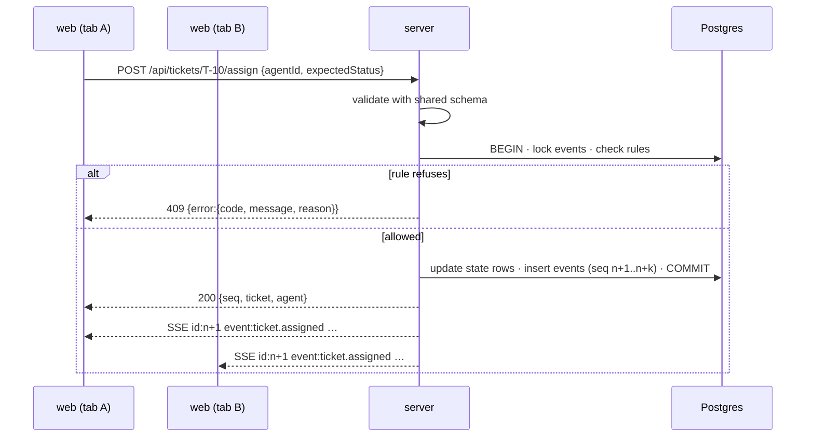
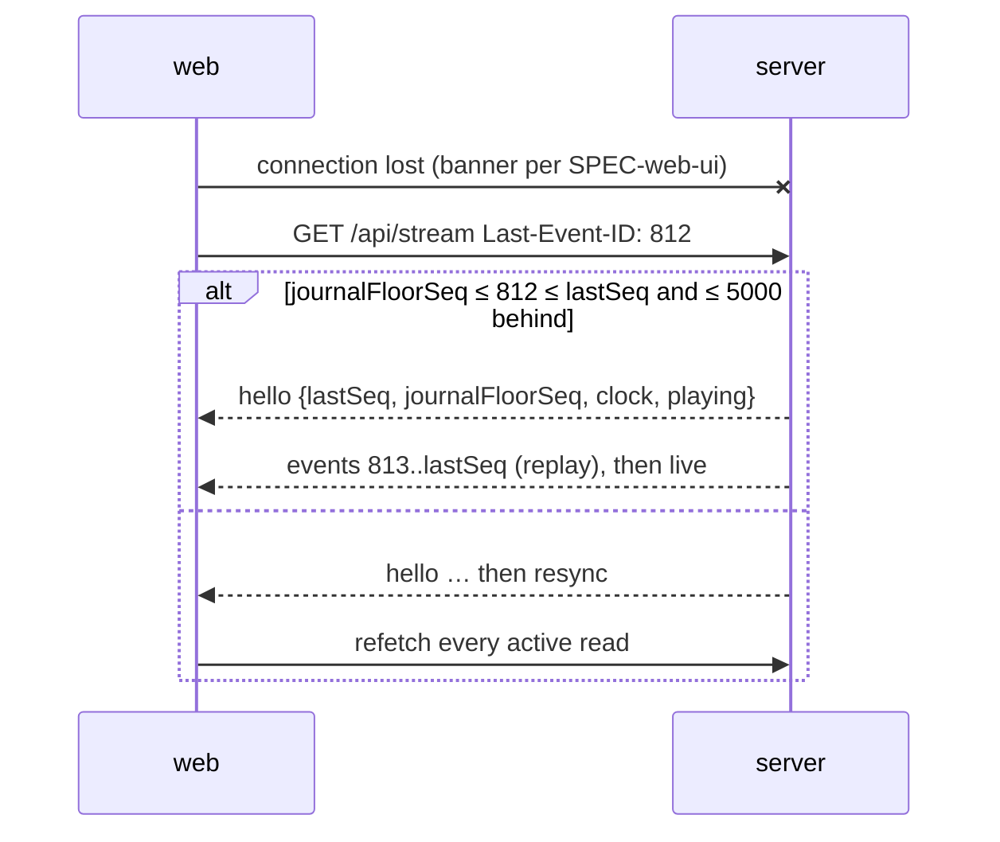

# Spec: Server API — domain commands, read API, live stream and simulation engine

Spec ID: `SPEC-server-api` · Supersedes: none · Parent: [`abstract-project-spec.md`](abstract-project-spec.md)
Sibling layer specs (written in parallel): `SPEC-database` ([`database.md`](database.md)),
`SPEC-web-ui` ([`web-ui.md`](web-ui.md)).

## Problem

The abstract spec describes what the Operator sees on the Board, Mission Control, Usage & Cost, the
ticket / agent / session pages and the Agent console. All of those screens show one shared state that
changes only when the Operator acts or steps a simulated agent. Today nothing defines **which
commands exist, which rules they enforce, what they return, which events they emit, how the
simulated agents behave step by step, how health and cost are computed, and how a browser stays live
and catches up after a disconnect**. Without that contract the web UI and the database layer would
each re-invent the rules (and disagree, breaking NFR-02).

This spec is the server layer of the MVP: the single place where every business rule lives, the HTTP
and SSE surface the web UI consumes, and the simulation engine that replaces real agents (PDR-0008).

## Goals

- One command per Operator intent, enforcing the full transition table of BRD-04 with the same
  refusal reasons for every client.
- Read endpoints that give each screen everything it needs, with health, cost and derived panels
  (Said vs did, Where the tokens went, …) computed on the server.
- One SSE stream of journal events with exact resume via `Last-Event-ID`.
- A deterministic, on-demand simulation engine (Next step, Run to next stage, optional Play) that
  drives simulated agents through the same commands and rules a real agent will use later.
- Load the fixed fixture on a clean start and reset to it from the terminal.
- One error format and one set of contract shapes, shared with the web UI.

## Non-goals

- MCP server, agent telemetry hooks, any channel from a real agent (INT-01…INT-11 — next iteration, PDR-0008).
- Live token / log capture (PDR-0007); all token numbers are fixture or simulation generated.
- Authentication, multiple Operators, roles (NFR-05).
- Adding or removing simulated agents at runtime; the 6 fixture agents are fixed.
- A reset action in the UI (reset is a terminal command only).
- Table, column, index and migration design — `SPEC-database`.
- Screens, layout, copy of toasts and labels, client-side filtering/search of a session log,
  sorting of Mission Control cards — `SPEC-web-ui`.
- WIP limits (PDR-0004), cost budgets, exports.

## Constraints

Accepted decisions:
- PDR-0001 Record product decisions as PDRs (accepted) — this spec must not contradict any PDR.
- ADR-0001 Record architecture decisions as MADR 4.0 (accepted) — format only.

Proposed decisions this spec is written against (owner-chosen 2026-10-24, awaiting formal acceptance):
- PDR-0004 No WIP limit (proposed) — the only capacity rule is one ticket per agent.
- PDR-0006 Operator can release an In Progress ticket back to Ready (proposed) — release needs confirmation; the agent gets a refusal on its next step.
- PDR-0007 Usage & Cost and Session Log ship on mock data only (proposed) — every cost and log response is marked as mock.
- PDR-0008 MVP runs on simulated agents only (proposed) — no endpoint is used by a real agent in the MVP.
- PDR-0009 Operator assigns and moves tickets within lifecycle guards (proposed, supersedes PDR-0003) — the transition table and the assign rules below.
- PDR-0010 Offline agents stay in the grid (proposed) — no agent or history is hidden or deleted because it is Offline.
- PDR-0011 Health thresholds with capped tool grace and heartbeat (proposed, supersedes PDR-0002) — 30 s / 120 s / 10 min; waiting agents heartbeat more often than every 30 s.
- ADR-0002 TypeScript pnpm monorepo with `web/`, `server/`, `shared/` (proposed) — contracts live in `shared/`.
- ADR-0004 Fastify HTTP API with one SSE stream (proposed) — REST commands, `GET` reads, one stream with `Last-Event-ID` resume mapped to `events.seq`.
- ADR-0008 Simulation through the command layer, on demand (proposed) — the simulator uses the same commands, a seeded PRNG and the Simulation Clock; auto-play off by default.
- ADR-0009 PostgreSQL + Drizzle with a transactional events table (proposed, supersedes ADR-0003) — every state change commits together with its event rows; `seq` follows commit order.
- ADR-0010 Onion architecture with Zod contracts in `shared/` (proposed) — every shape in *Contracts* exists once, in `shared/`.
- ADR-0011 Web stack (proposed) — the client consumes this API with TanStack Query and updates its cache from SSE events.
- ADR-0012 Testing strategy (proposed) — the ACs below are verified with Vitest unit tests and Postgres integration tests against a real Postgres.

## User stories

- US-1 As the Operator, I want every move I make on the board to be checked by one set of rules, so that drag & drop, the Move buttons and a second tab can never put a ticket in a state the spec forbids.
- US-2 As the Operator, I want to assign a ticket to a free agent, release it, reopen it, approve it, request changes and answer a blocked agent, so that I control the work.
- US-3 As the Operator, I want to step a simulated agent one action or one stage at a time and optionally let all agents play, so that nothing changes unless I ask for it.
- US-4 As the Operator, I want health, cost and derived panels to be computed the same way everywhere, so that two screens never disagree.
- US-5 As the Operator, I want every open tab to update within half a second and recover the events it missed after a disconnect, so that I can trust what I see.
- US-6 As a developer or demo presenter, I want the server to start from the same fixture every time and be reset to it from the terminal, so that demos and tests are reproducible.
- US-7 As the web UI (consumer), I want stable request, response, event and error shapes, so that I can render every screen and every refusal without guessing.

| Story | Covered by |
|---|---|
| US-1 | AC-5, AC-6, AC-10, AC-11, AC-12 |
| US-2 | AC-7, AC-9, AC-13 … AC-22 |
| US-3 | AC-43 … AC-57 |
| US-4 | AC-23 … AC-42 |
| US-5 | AC-57 … AC-62 |
| US-6 | AC-57, AC-63 … AC-67 |
| US-7 | AC-1 … AC-4, AC-8, AC-68 … AC-73 |

## Acceptance criteria (EARS)

Conventions: "the server" = the `server/` module; "commit" = the single transaction that writes state
rows and event rows (ADR-0009); "now" = the current Simulation Clock value; "feed event" = an event
whose type is marked *feed* in the event catalogue (Contracts §C5). Each AC lists the abstract-spec
requirements it traces to.

### A. Contract, validation and errors

- **AC-1** WHEN a request carries a body, path parameters or a query string, the server SHALL validate them against the request schema from the shared contract and, IF validation fails, THEN SHALL respond `400` with error code `validation_failed` and one `details` item per invalid field, without changing state or writing an event.
  _(traces: NFR-02, BRD-02 · observable: integration test posts an invalid body, gets 400 with field paths, and the events table row count is unchanged)_
- **AC-2** The server SHALL respond to every non-2xx outcome with the error envelope of Contracts §C3 and the HTTP status listed there for its code.
  _(traces: NFR-02 · observable: contract test asserts every error response parses with the shared error schema)_
- **AC-3** IF a path refers to a ticket, agent or session id that does not exist, THEN the server SHALL respond `404` with code `not_found` and a message naming the id.
  _(traces: NAV-01, MC-09 · observable: `GET /api/tickets/T-999` → 404 `not_found`)_
- **AC-4** WHEN a command succeeds, the server SHALL commit all its state changes and all its event rows in one transaction, and IF any part fails, THEN SHALL commit neither the state change nor any event.
  _(traces: NFR-02, NFR-03 · observable: integration test forces a failure after the state write; state and events are both unchanged)_
- **AC-5** IF a command is refused by a domain rule, THEN the server SHALL respond `409` with the refusal code from Contracts §C3 and, for a refused transition, the exact `reason` text from the transition table (Contracts §C4), without changing state or writing an event.
  _(traces: BRD-04, PDR-0009 · observable: every refused cell of the table is exercised by a test and returns its listed reason)_
- **AC-6** WHERE a ticket command carries `expectedStatus`, IF the ticket's current status differs from it, THEN the server SHALL refuse with `409` `stale_state` and the message "T-x is now in <status>." instead of applying the command to the new state.
  _(traces: NFR-02, BRD-05 · observable: two sequential moves with the same `expectedStatus`; the second gets `stale_state`)_

### B. Ticket commands

- **AC-7** WHEN the Operator creates a ticket with a title that is non-empty after trimming, the server SHALL store it in `Backlog` with the next identifier `T-<n>` (one greater than the highest ever issued), priority `medium` unless given, acceptance criteria as the non-empty trimmed lines supplied, and emit `ticket.created`.
  _(traces: BRD-02 · observable: create on the fixture returns `T-17`, status `backlog`, and a `ticket.created` event)_
- **AC-8** IF a create request has a title that is empty or only whitespace, THEN the server SHALL respond `400` `validation_failed` with a `details` item for `title` whose message is "Title is required.".
  _(traces: BRD-02, edge "title of spaces" · observable: create with `"   "` → 400 with that message)_
- **AC-9** WHEN the Operator moves a ticket `Backlog → Ready` or `Ready → Backlog`, the server SHALL change its status and emit `ticket.moved` with `from` and `to`.
  _(traces: BRD-04 · observable: move T-14 to Ready; status `ready`, event summary "Moved Backlog → Ready")_
- **AC-10** WHEN a move request names a target status, the server SHALL decide the outcome solely from the transition table of Contracts §C4 for the ticket's current status, so that the same pair gives the same result for drag & drop, Move buttons and any other client.
  _(traces: BRD-04, PDR-0009, NFR-06 · observable: table-driven test over all 20 from × to pairs)_
- **AC-11** IF a move request targets `In Progress` (from Backlog, Ready or Done) or asks `Review → In Progress`, THEN the server SHALL refuse with `409` `needs_input` and the reason "Pick an agent — use assign." or "A comment is required — use request changes." respectively, because those transitions need the assign or request-changes command.
  _(traces: BRD-04, BRD-11, BRD-07 · observable: move T-10 to `in_progress` → 409 `needs_input`)_
- **AC-12** IF a move request is a release (`In Progress → Ready`), a reopen (`Done → Backlog`, `Done → Ready`) or a mark-done from `In Progress`, and the request does not carry `confirmed: true`, THEN the server SHALL refuse with `409` `confirmation_required` and change nothing.
  _(traces: BRD-12, PDR-0006, Round-2 "In Progress → Done asks for confirmation" · observable: release without `confirmed` → 409; with it → 200)_
- **AC-13** WHEN the Operator releases a ticket (`In Progress → Ready`, confirmed), the server SHALL in one commit: set the ticket to `Ready` with no assignee and no Blocked question; append a `system` log entry "Ticket released by Operator" to the agent's open session and end that session as `completed`; set the agent to stage `idle` with no current ticket or tool, a pending refusal for this ticket and a 4-step cooldown; and emit `ticket.released` ("Moved In Progress → Ready · released <agent>").
  _(traces: BRD-12, SIM-11, LOG-10, PDR-0006 · observable: release T-12 on the fixture; alpha idle, S-0412 completed, `ticket.released` + `session.ended` events)_
- **AC-14** WHEN the Operator reopens a `Done` ticket into `Backlog` or `Ready` (confirmed), the server SHALL set the status, clear the assignee and emit `ticket.reopened` ("Moved Done → <to>").
  _(traces: BRD-12 · observable: reopen T-1 to Ready; assignee null, event present)_
- **AC-15** WHEN the Operator marks a ticket done (`Backlog`, `Ready` or confirmed `In Progress` → `Done`), the server SHALL set it to `Done`, clear its Blocked question, and IF an agent holds it, THEN SHALL set that agent `idle` with no ticket, end its open session on this ticket as `completed`, and emit `agent.stage_changed` to `idle`; the server SHALL emit `ticket.moved` ("Moved <from> → Done").
  _(traces: BRD-04, LOG-10, edge "Mark done of a Blocked ticket" · observable: mark T-8 done (blocked, sim-1); blocked cleared, sim-1 idle, S-0414 completed)_
- **AC-16** WHEN the Operator approves a ticket (`Review → Done`), the server SHALL set it to `Done`, set the holding agent `idle` with no ticket, end any session of that agent still open on this ticket as `completed`, and emit `ticket.approved` ("Approved T-x") and `agent.stage_changed` to `idle`.
  _(traces: BRD-07, LOG-10 · observable: approve T-7; sim-2 idle, ticket done)_
- **AC-17** WHEN the Operator requests changes on a `Review` ticket with a comment that is non-empty after trimming, the server SHALL move it to `In Progress` for the same agent, store the comment as the ticket's review comment, start a new `running` session for that agent on this ticket, queue "read the review comment, then report `implementing`" as the agent's next actions, and emit `ticket.changes_requested` ("Requested changes · “<comment>”") and `session.started`.
  _(traces: BRD-07, LOG-10, Round-2 "Request changes opens a new session" · observable: request changes on T-6; new S-0416 running for sim-3; next step of a responsive agent logs an `operator` entry with the comment)_
- **AC-18** IF a request-changes command has an empty or whitespace comment, THEN the server SHALL respond `400` `validation_failed` with a `details` item for `comment` whose message is "A comment is required — tell the agent what to change.".
  _(traces: BRD-07 · observable: request with `"  "` → 400 with that message)_
- **AC-19** WHEN the Operator assigns a ticket in `Backlog`, `Ready` or `Done` to an agent that holds no ticket, the server SHALL in one commit: clear the ticket's Blocked question and review comment; set it `In Progress` with that assignee; end any open ticket-less session of the agent as `completed`; start a new `running` session on this ticket with the agent's model and a `system` "Session started · <model>" entry carrying session-context tokens; set the agent to `planning` with the Planning script queued; refresh the agent's last-seen time unless the agent is unresponsive; and emit `ticket.assigned` with source `operator` and `payload.claim = false` ("Moved <from> → In Progress · assigned to <agent>"), `agent.stage_changed` to `planning` and `session.started` — and SHALL NOT emit any `agent_report` claim for it.
  _(traces: BRD-11, PDR-0009, LOG-10, D-5 · observable: assign T-10 to charlie; S-0415 completed, new session running on T-10, the only `ticket.assigned` has source `operator`)_
- **AC-20** IF an assign command names an agent that already holds a ticket (In Progress or Review), THEN the server SHALL refuse with `409` `agent_busy` and the reason "<agent> is busy with T-x — one ticket per agent.".
  _(traces: BRD-11, SIM-09, PDR-0009 · observable: assign T-10 to alpha → 409 `agent_busy`)_
- **AC-21** WHEN the Operator answers a Blocked ticket with an answer that is non-empty after trimming, the server SHALL clear the Blocked question, store the answer, queue "read the answer" as the holding agent's next action, and emit `ticket.unblocked` ("Answered <agent> · “<answer>”"); IF the ticket is not Blocked, THEN the server SHALL refuse with `409` `not_blocked`; IF the answer is empty, THEN the server SHALL respond `400` with the `answer` message "Write an answer before unblocking.".
  _(traces: BRD-08 · observable: answer T-8; next step of sim-1 logs an `operator` entry with the answer and emits `ticket.answer_read`)_
- **AC-22** WHEN any command or simulation step changes a ticket's status, assignee, Blocked question or last update, the server SHALL set the ticket's `updatedAt` to now.
  _(traces: BRD-03, BRD-05 · observable: after a move, `updatedAt` equals the simulation clock)_

### C. Read API

- **AC-23** WHEN the client lists tickets, the server SHALL return every ticket, ordered within each status by priority (high → low) then by creation order (oldest first), except `Done`, which SHALL be ordered by `updatedAt` newest first.
  _(traces: BRD-01 · observable: fixture list shows Ready as T-13 (high), T-11 (medium), T-10 (low))_
- **AC-24** WHEN the client requests one ticket, the server SHALL return the ticket, its newest 30 feed events (newest first) as `activity`, and summaries of all sessions that worked on it (newest first) with their cost.
  _(traces: BRD-06, CST-07, CON-02 · observable: `GET /api/tickets/T-12` returns S-0412 and S-0409 among sessions and ≤ 30 activity items)_
- **AC-25** WHEN the client lists events, the server SHALL return feed events only, newest first, at most `limit` (default 40, max 200) older than the optional `beforeSeq` cursor, filtered by optional `source`, `category`, `agentId` and `ticketId`, with `nextBeforeSeq` set when more exist.
  _(traces: MC-06, BRD-06 · observable: first page has 40 items; passing `nextBeforeSeq` returns the next 40 with no overlap)_
- **AC-26** WHEN the client requests the overview, the server SHALL return agents online / total, the number of Blocked tickets, the number of tickets in Review, and 12 per-minute counts of feed events for the last 12 Simulation-Clock minutes (oldest first, the last bucket being the current minute).
  _(traces: MC-01, SIM-10 · observable: on the fixture, online = 4 of 6 (alpha, bravo, charlie, sim-1), blocked = 1, review = 2)_
- **AC-27** WHEN the client lists agents or requests one agent, the server SHALL include for each agent its derived `health` (AC-36), current ticket, current tool, last tool, last-seen time, whether it is paused after a release, its mock cost for today, and a `step` object telling whether Next step is available and, if not, why (AC-45).
  _(traces: MC-02, MC-04, CON-04, CST-07 · observable: fixture sim-1 has `step.available = false`, reason "Blocked — answer above to continue")_
- **AC-28** WHEN the client requests an agent's page, the server SHALL return its KPIs (sessions started in the last 7 days, Done tickets it holds as assignee, tool calls in today's sessions, mock cost of the last 7 days), its Said-vs-did panel (AC-29), its 10 newest sessions with the total session count, and every ticket it has events for or is assigned to.
  _(traces: MC-07, LOG-01 · observable: alpha page lists 10 sessions and `sessionsTotal` ≥ 10)_
- **AC-29** WHEN the server builds Said vs did for an agent, it SHALL use the agent's last 16 `agent_report` and `agent_telemetry` feed events in time order, and SHALL mark a mismatch when an `agent.stage_changed` to `testing` is followed, before the agent's next stage report (or now), by a span of at least 120 s containing at least one `agent_telemetry` event and no `Bash` tool event; each mismatch SHALL produce a note "Reported Testing, but ran no commands for N min — only reads and edits." with its time span, and only the last 2 notes SHALL be returned with the total mismatch count.
  _(traces: MC-08, MOCK-02 · observable: fixture alpha returns `mismatchCount = 1` for 14:05–14:16; an agent reporting Testing with no telemetry returns 0)_
- **AC-30** WHEN the client requests a session, the server SHALL return its header (agent, ticket, model, start, end or null, status), every log entry in chronological order with its tokens, step cost and token activity, token totals and cost per token type, total cost, the "Where the tokens went" rows, the 5 most expensive steps, and the stages with their time spans.
  _(traces: LOG-02, LOG-03, LOG-04, LOG-07, LOG-08, LOG-09 · observable: S-0409 returns its 19 entries in order, the two failed tool calls flagged `ok: false`, and token totals equal to the sum of entries)_
- **AC-31** WHEN the server returns a tool log entry, it SHALL return the tool output in full, with line breaks and indentation unchanged, and SHALL NOT truncate it.
  _(traces: CON-03, LOG-05 · observable: S-0409 typecheck entry output equals the fixture text byte for byte)_

### D. Cost and usage

- **AC-32** The server SHALL compute the cost of a log entry as (input × price_in + output × price_out + cacheRead × price_cr + cacheWrite × price_cw) / 1 000 000 USD using the session model's price, and the cost of a session as the sum of its entries' costs, without rounding before presentation.
  _(traces: CST-08, LOG-04 · observable: unit test — 1 000 000 input tokens at $3/M contributes exactly 3.00)_
- **AC-33** The server SHALL return a session's token totals equal to the sum of its entries' tokens, for fixture and simulation sessions alike.
  _(traces: MOCK-03, LOG-04 · observable: property test over all fixture sessions)_
- **AC-34** WHILE a session is `running`, the server SHALL return its cost with `costIsFinal: false`.
  _(traces: CST-09 · observable: S-0412 returns `costIsFinal: false`)_
- **AC-35** WHEN the client requests usage for a period (`today`, `7d`, `30d` default, `all`), the server SHALL return, over sessions whose start day falls in the period (a day is a UTC calendar date; "today" is the date of the Simulation Clock, `7d` = today and the 6 days before, `30d` = today and the 29 days before): total cost; total tokens and the cache-read share; session count and the number running now; mean and median session cost (median = the element at index ⌊n/2⌋ of the ascending list); 30 daily cost points for the last 30 days (oldest first, each flagged whether it is in the period, today flagged); the peak daily cost; breakdowns by agent, by ticket (sessions without a ticket grouped as key `null`), by model — each the 6 most expensive — and by token activity — all activities — each row with cost and share of the period total.
  _(traces: CST-01, CST-02, CST-03, CST-04 · observable: `today` on the fixture counts 7 sessions, 4 running; `costPerDay` always has 30 points)_
- **AC-36** WHEN the client lists sessions, the server SHALL filter by period and optional `agentId` and `model`, sort by start time newest first by default or by one of `input`, `output`, `cacheRead`, `cacheWrite`, `cost` descending, and return `limit` rows (default 12, max 100) from `offset` with the total count.
  _(traces: CST-05, CST-06 · observable: `?period=30d&limit=12` returns 12 items and `total` = 121 on a clean fixture)_
- **AC-37** The server SHALL mark every usage, session and cost-bearing response with `dataSource: "mock"`.
  _(traces: MOCK-01, MOCK-05, PDR-0007 · observable: contract test on `/api/usage`, `/api/sessions`, `/api/sessions/:id`, `/api/model-prices`)_

### E. Health

- **AC-38** The server SHALL derive an agent's health at now as: `online` WHILE the agent has a running tool started less than 600 s ago; otherwise, with gap = now − lastSeenAt, `online` if gap < 30 s, `stale` if 30 s ≤ gap < 120 s, and `offline` if gap ≥ 120 s.
  _(traces: MC-05, PDR-0011 · observable: table-driven unit test at 29/30/119/120 s and a tool at 599/600 s)_
- **AC-39** WHEN the Simulation Clock advances, the server SHALL refresh last-seen to the new time for every responsive agent that was `online` before the advance and did not act in that step, and SHALL journal one `agent.heartbeat` event per such agent in the same commit, so that a waiting or idle agent never turns `stale` because other agents are stepped.
  _(traces: SIM-10, MC-05, PDR-0011 · observable: step alpha 20 times; sim-1 (blocked) stays online throughout and 20 `agent.heartbeat` events exist for sim-1, none of them in `GET /api/events`)_
- **AC-40** WHILE an agent is unresponsive (fixture `sim-3`) or already `stale`/`offline`, the server SHALL NOT refresh its last-seen on clock advances, so its health degrades by the thresholds of AC-38.
  _(traces: SIM-02, SIM-10 · observable: fixture sim-2 (stale) becomes offline after the clock passes lastSeen + 120 s)_
- **AC-41** WHEN a clock advance leaves an agent `offline` while it has a `running` session, the server SHALL append a `system` entry "Session interrupted — agent went Offline" and end the session as `failed` in the same commit.
  _(traces: LOG-10, D-11 · observable: assign a ticket to unresponsive sim-3 after its review ticket is approved; the next clock advance fails the new session)_
- **AC-42** WHEN a clock advance changes any agent's derived health, the server SHALL emit `agent.health_changed` with `from` and `to` in the same commit.
  _(traces: MC-05, NFR-01 · observable: sim-2 stale → offline produces one `agent.health_changed`)_

### F. Simulation engine

- **AC-43** WHILE Play is off, the server SHALL NOT change any state, advance the Simulation Clock or write any event except in response to a client command.
  _(traces: SIM-06, ADR-0008 · observable: idle server for 10 minutes; events max seq and clock unchanged)_
- **AC-44** WHEN the Operator requests Next step for an agent on a ticket, the server SHALL advance the Simulation Clock by exactly 6 s, perform exactly one action of that agent (AC-47), apply heartbeats and health effects (AC-39 … AC-42), emit `simulation.stepped`, and commit it all as one transaction.
  _(traces: CON-04, SIM-06, SIM-10 · observable: one Next step on alpha → clock +6 s, one `tool.finished`, one `simulation.stepped`)_
- **AC-45** IF Next step or Run to next stage is requested for an agent that is not on the named ticket, whose ticket is not `In Progress`, is Blocked, is unresponsive, or has no queued action and no running tool, THEN the server SHALL refuse with `409` `cannot_step` and the reason, respectively: "<agent> is no longer on T-x.", "Waiting for your review" (ticket in Review) / "T-x is not In Progress.", "Blocked — answer above to continue", "<agent> is not responding.", "<agent> has nothing left to do on T-x.".
  _(traces: CON-04, CON-05 · observable: step sim-1 on T-8 → 409 with "Blocked — answer above to continue")_
- **AC-46** WHEN the Operator requests Run to next stage, the server SHALL perform Next steps, each committed and published separately, until the agent's stage differs from the stage at the start, the agent waits for the Operator (Blocked, Review, or no ticket), the agent has nothing left to do, or 40 steps were taken, and SHALL return the number of steps and the stop reason.
  _(traces: CON-04, NFR-01, edge "Run to next stage never changes stage" · observable: run on alpha stops with `stage_changed` after reporting Testing; a loop test proves ≤ 40 steps)_
- **AC-47** WHEN a simulated agent acts, the server SHALL take the first applicable action in this order: (1) unresponsive → nothing; (2) pending refusal → the refusal of AC-52; (3) cooldown > 0 → decrement only; (4) running tool → finish it (AC-49); (5) ticket Blocked or in Review → heartbeat only; (6) no ticket → claim (AC-51) only in a simulation-wide step, else heartbeat; (7) otherwise → the next queued scripted action.
  _(traces: SIM-01, SIM-08, SIM-11, ADR-0008 · observable: unit tests per branch with an in-memory clock)_
- **AC-48** WHEN an agent's stage becomes `planning`, `implementing` or `testing`, the server SHALL append that stage's script to the agent's queue, using the scripts and per-ticket files, keywords and questions of the prototype (`plan()` and `files()` in `docs/design/prototype/app.dc.html`): Planning — Read the spec, Grep the keyword, a plan message, report Implementing; Implementing — Read and Edit file A, update 35 %, block with the ticket question IF the ticket is `high` priority and has not asked before, Edit file B, a message, update 70 %, report Testing; Testing — run the tests (failing IF the ticket number is odd), update 85 %, run the typecheck, a message, submit for review with a summary and result link `PR #<40+n> · feat/<keyword>`.
  _(traces: SIM-01, SIM-02, MOCK-02 · observable: scripted-run test of T-13 (high, odd) hits one block and one failed test)_
- **AC-49** WHEN a scripted tool action starts, the server SHALL record it as the agent's current tool and emit `tool.started`; WHEN the agent's next action finishes it, the server SHALL append a `tool` log entry with name, argument, result, duration (clock difference), output and tokens, set it as the last tool, and emit `tool.finished` or, if it failed, `tool.failed` with `warn: true` — after which the server SHALL queue "explain the failure, Edit file A, rerun the same command".
  _(traces: SIM-01, SIM-02, MC-04, LOG-03 · observable: failing `npm test` produces `tool.failed` (warn) and three extra queued actions)_
- **AC-50** WHEN an agent submits for review, the server SHALL set the ticket to `Review` with the summary and result link, clear its review comment, set the agent to `awaiting_review`, append the submit tool call and a stage entry to the session, end the session as `completed`, and emit `ticket.submitted`, `agent.stage_changed` and `session.ended`.
  _(traces: SIM-09, BRD-07, LOG-10, Round-2 "Submit ends the session as Completed" · observable: run T-9 to review; session completed, ticket review)_
- **AC-51** WHEN a simulation-wide step (Play tick or header Step) reaches a responsive agent with no ticket and no cooldown, the server SHALL let it claim the `Ready` ticket with the highest priority and, among equal priority, the oldest; set the ticket `In Progress` for it, start a session, set stage `planning`, and emit `ticket.assigned` with source `agent_report` and `payload.claim = true` ("Claimed T-x") and `agent.stage_changed`; IF no ticket is Ready, THEN the agent SHALL only heartbeat.
  _(traces: SIM-08, PDR-0009 · observable: on the fixture with Play, charlie claims T-13 first)_
- **AC-52** WHEN an agent with a pending refusal acts, the server SHALL emit `agent.refused` (warn, "Refused: T-x was released by Operator — stopping work on it"), append a `system` entry "agent-ops refused the update: T-x is no longer assigned to <agent>. Next: wait, then claim the next ticket." to the agent's open session if it has one, and clear the pending refusal.
  _(traces: SIM-11, BRD-12 · observable: release T-12, assign T-10 to alpha, step alpha → refusal entry in the new session)_
- **AC-53** The simulated agents SHALL NOT set a ticket to `Done`, change a ticket they do not hold, or hold more than one ticket.
  _(traces: SIM-09, INT-03 · observable: property test over random command sequences)_
- **AC-54** WHEN the Operator turns Play on, the server SHALL perform one simulation-wide step every 1.6 s (real time) until Play is turned off; the server SHALL start with Play off after every boot and after a reset, and a simulation-wide step SHALL advance the clock by 6 s once and let every agent act once in fixture order.
  _(traces: SIM-07, ADR-0008 · observable: play for ~5 s → 3 `simulation.stepped` events of mode `play`; restart → `playing: false`)_
- **AC-55** WHEN the Operator requests a single simulation-wide Step, the server SHALL perform exactly one simulation-wide step, and IF Play is on, THEN SHALL refuse with `409` `simulation_playing`.
  _(traces: SIM-07 · observable: header Step → one `simulation.stepped` of mode `step_all`)_
- **AC-56** WHILE at least one client hold is active (granted and not expired), the server SHALL skip Play ticks; a hold SHALL expire 15 s after it was last granted or renewed, and SHALL end when its client releases it.
  _(traces: SIM-07 "playing pauses while a dialog is open or a ticket is dragged" · observable: hold, wait 5 s with Play on → no steps; release → steps resume)_
- **AC-57** The server SHALL make the simulation deterministic: from the same starting data, the same sequence of commands SHALL produce the same events (types, payloads, `at`, ids) in the same order, except `realAt`; all randomness SHALL come from the seeded PRNG and all generated token counts SHALL be derived from the entry content and the Simulation Clock.
  _(traces: SIM-03, MOCK-04, ADR-0008 · observable: replay test compares two runs event by event)_

### G. Live stream

- **AC-58** WHEN a client opens the stream, the server SHALL first send a `hello` message with the last committed `seq`, the journal floor `seq`, the Simulation Clock and whether Play is on, then SHALL send every event — only after its transaction has committed, never for a rolled-back one — as one SSE message with `id: <seq>`, `event: <type>`, `data: <Event JSON>`, in strictly increasing `seq` order.
  _(traces: NFR-01, NFR-02, ADR-0004 · observable: stream test reads `hello`, issues a command, receives its events in order)_
- **AC-59** WHEN an event is committed, the server SHALL deliver it to every connected stream within 500 ms (p95, local machine).
  _(traces: NFR-01, BRD-05 · observable: timing test across two connected clients)_
- **AC-60** WHEN a client connects with `Last-Event-ID: N` (or `?since=N`), the server SHALL send every event with `seq > N` exactly once and in order, then continue live, with no gap and no duplicate at the hand-over.
  _(traces: NFR-04, ADR-0004, ADR-0009 · observable: disconnect, commit 5 events, reconnect with the last id → exactly those 5)_
- **AC-61** IF a client resumes from an `N` greater than the last committed `seq`, lower than `simulation_state.journal_floor_seq` (returned as `journalFloorSeq`; its history was wiped by a reset — no separate epoch exists), or more than 5 000 events behind, THEN the server SHALL send one `resync` message instead of replaying, and continue live.
  _(traces: NFR-04, MOCK-04 · observable: resume with `N = 999999` → `resync` reason `ahead`; resume with a pre-reset id → `resync` reason `below_floor`)_
- **AC-62** WHILE a stream is open, the server SHALL send an SSE comment at least every 15 s so that the client can detect a dead connection.
  _(traces: BRD-10, NFR-04 · observable: idle stream receives `:keepalive` within 15 s)_

### H. Fixture, persistence and reset

- **AC-63** WHEN the server starts on an empty database, the server SHALL apply migrations and load the committed fixture defined by `SPEC-database` (seed/fixture section): 6 agents, 16 tickets, 121 sessions with their logs, the seed events, 3 model prices, Simulation Clock 2026-10-24T14:32:00Z, next ticket number 17, next session number 416.
  _(traces: SIM-04, MOCK-02, MOCK-04 · observable: clean-start test counts each set)_
- **AC-64** WHEN the server starts on a database that already holds data, the server SHALL keep every ticket, agent, session, event and the Simulation Clock as they were, and start with Play off.
  _(traces: NFR-03 · observable: restart test compares a snapshot before and after)_
- **AC-65** WHEN the reset command is run from the terminal while the server is not running, it SHALL replace all data with the fixture so that every read is identical to a clean start except absolute `seq` and `realAt` values: `seq` SHALL continue past every previously issued value (never restart), so an old `Last-Event-ID` can never point at a new event, and `simulation_state.journal_floor_seq` SHALL be set to the first `seq` written after the reset (SPEC-database AC-39).
  _(traces: MOCK-04, NFR-04, Round-2 "reset is a server CLI/script" · observable: reset after a session of commands; all reads equal the clean-start snapshot modulo `seq`/`realAt`; `journalFloorSeq` = min new `seq` > max old `seq`)_
- **AC-66** IF the reset command is run while a server is connected to the same database, THEN it SHALL refuse with the message "Stop the server first", exit non-zero and change nothing.
  _(traces: MOCK-04, NFR-02 · observable: reset with the server up exits non-zero, data unchanged)_
- **AC-67** WHEN a simulation step creates or extends a session, the server SHALL include it in sessions lists, usage, agent and ticket reads exactly like fixture sessions.
  _(traces: MOCK-03, MOCK-04 · observable: after assigning T-10, `/api/usage?period=today` counts 8 sessions)_

### I. Runtime

- **AC-68** The server SHALL accept connections only on the loopback interface and SHALL require no authentication.
  _(traces: NFR-05 · observable: config test; request from a non-loopback address fails to connect)_
- **AC-69** IF the database becomes unreachable while the server is running and a request arrives, THEN the server SHALL respond `503` with code `db_unavailable` and keep running, and SHALL serve requests again once the database is back, without a restart.
  _(traces: NFR-03, BRD-10 · observable: stop Postgres, request → 503; start it, request → 200)_
- **AC-73** IF `DATABASE_URL` is missing or the database is unreachable when the server starts, THEN the server SHALL exit with a non-zero code and a message naming the problem and the host:port it tried, without the password, and SHALL NOT start listening (SPEC-database AC-5).
  _(traces: NFR-03, NFR-05, ADR-0009 · observable: start with the container stopped → non-zero exit, message contains host:port, no credentials)_
- **AC-70** WHEN a client requests `GET /api/healthz`, the server SHALL respond `200` with `{ ok: true, db: "up" }` when the database answers and `503` with `{ ok: false, db: "down" }` otherwise.
  _(traces: NFR-03 · observable: used by e2e start-up and by the UI connection check)_
- **AC-71** WHEN the server answers a `GET` read (every endpoint of §C6 except `/healthz` and `/stream`), it SHALL read the data in one consistent snapshot and return the highest `seq` that snapshot includes in the response header `X-As-Of-Seq`, so that a client resuming the stream from that `seq` receives exactly the changes missing from the response.
  _(traces: NFR-02, NFR-04, SPEC-database AC-29 · observable: read during concurrent commands; replay from `X-As-Of-Seq` applied to the response equals a fresh read)_
- **AC-72** IF a command's transaction is rejected by a database constraint, THEN the server SHALL roll it back and map the failure per Contracts §C3 "Constraint mapping" — a race the rules would have refused becomes the matching `409` refusal with its reason text, anything else becomes `500 internal` — and SHALL publish no event.
  _(traces: NFR-02, SPEC-database "Failure contract" · observable: two concurrent assigns of one agent → one 200, one 409 `agent_busy`; a forced invariant breach → 500 with a generic message)_

## Edge cases

- Two tabs assign the same agent to different tickets at once → commands are serialised; the second gets `agent_busy` → AC-20, AC-4.
- Two tabs move the same ticket from a stale view → the second gets `stale_state` → AC-6.
- A move to the column the ticket is already in → refused `transition_refused` "Already here" → AC-10 (table diagonal).
- Release of a ticket whose agent is Offline or unresponsive → same release; the refusal appears only if the agent ever acts again (unresponsive: never) → AC-13, AC-52.
- Release, then the agent is assigned a new ticket before its next step → its first step performs the refusal into the new session, the next step continues the new work → AC-52, AC-47.
- Mark done of a Blocked ticket → allowed, Blocked cleared, agent freed, session completed → AC-15.
- `Done → In Progress` of a ticket with a review comment from a previous cycle → the assign clears the current comment; the earlier `ticket.changes_requested` event remains → AC-19.
- Assign to an agent that has an open session with no ticket (fixture charlie, S-0415) → that session ends `completed`, a new one starts → AC-19.
- Assign or request changes for the unresponsive agent (sim-3) → allowed; the session opens and fails as interrupted at the next clock advance; the Operator can release the ticket → AC-19, AC-41.
- Request changes when the agent's previous session is still open → cannot happen after submit (AC-50 completes it); if it does (data from an older version), it is ended `completed` first → AC-17.
- Run to next stage on an agent that never changes stage → stops at 40 steps with `limit` → AC-46.
- Run to next stage on an agent that blocks mid-stage → stops with `waiting`; Next step is then refused → AC-46, AC-45.
- Next step requested while Play is on → allowed; commands are serialised with Play ticks → AC-44, AC-4.
- Header Step while Play is on → `simulation_playing` → AC-55.
- A tab crashes while holding → the hold expires after 15 s and Play resumes → AC-56.
- A running tool for more than 10 simulated minutes without other signal → health falls back to the thresholds → AC-38.
- Agent with a heartbeat while Blocked or in Review → stays online, no flapping (D-7) → AC-39.
- Usage period with no sessions → zeros, 30 zero-or-other-day points, empty breakdowns, `sessions: 0` → AC-35.
- Session with no costly entry → cost 0; Where the tokens went is empty; top steps empty → AC-30.
- Session with no stage entry → `stages: []` → AC-30.
- Session with 1 000 entries → returned in full within the budget of *Non-functional* → AC-30.
- Tool output of exactly 4 lines or longer → returned unchanged; collapsing is a UI concern (SPEC-web-ui) → AC-31.
- Event Log page beyond the oldest event → `items: []`, no `nextBeforeSeq` → AC-25.
- Client resumes after a reset or from a future id → `resync` → AC-61.
- Client resumes after a long absence (> 5 000 events) → `resync` instead of a flood → AC-61.
- Database restarts while the server runs → 503 during the outage, then normal → AC-69.
- Reset run while the server is up → refused → AC-66.
- Ticket title or text containing HTML, Markdown or prompt-like instructions → stored and returned verbatim → *Untrusted inputs*.
- Ticket text longer than the limits → 400 `validation_failed` → AC-1, Contracts §C6.
- Unknown fields in a command body → 400 `validation_failed` (strict schemas) → AC-1.
- Simulation Clock day boundary crosses midnight during a long play session → "today" moves with the clock; sessions keep the day of their start → AC-35.
- Assign to an agent that is Offline but responsive (e.g. sim-2 after approval) → allowed; the assignment counts as a signal, so it is online again → AC-19.
- Seed agent `sim-2` starts `stale` and never receives heartbeats → becomes offline after 12 clock advances; it has no open session, so nothing fails → AC-40, AC-41.

## Non-functional

Thresholds on a developer laptop, local Postgres, fixture data plus up to NFR-07 scale (10 agents,
100 tickets, a 1 000-entry session):

- **Latency.** Command endpoints p95 < 150 ms; read endpoints p95 < 300 ms; `GET /api/usage` and
  `GET /api/sessions/:id` (1 000 entries) p95 < 500 ms. Event delivery to all streams < 500 ms after
  commit (AC-59, NFR-01). Run to next stage (≤ 40 steps) completes < 4 s and streams each step as it commits.
- **Throughput.** At least 20 simultaneous stream connections without event loss (several tabs).
- **Payload limits.** Request body ≤ 64 KB; text limits per Contracts §C6; event pages ≤ 200 items;
  session page ≤ 100 items.
- **Security.** Loopback only, no auth (NFR-05). No CORS headers (the web app is same-origin through
  the dev proxy / static serving). Strict schemas reject unknown fields. Error responses never contain
  stack traces or SQL. `DATABASE_URL` only from the environment (ADR-0009).
- **Reliability.** No partial commits (AC-4). Server survives a database outage (AC-69). Events are
  never updated or deleted (ADR-0009).
- **Determinism.** Same seed and command sequence → same events (AC-57).
- **Accessibility.** Not applicable to this layer; refusal reasons are plain sentences the UI can
  announce verbatim (NFR-06 relies on them).

## Cross-module interactions

Modules (ADR-0002): `web/` (SPA), `server/` (this spec), `shared/` (contracts), plus PostgreSQL
(`SPEC-database`). No MCP or telemetry process in the MVP.

| From → To | What crosses | Failure contract |
|---|---|---|
| web → server | REST commands (`POST`) and reads (`GET`) with bodies/queries typed by `shared/` schemas | 400/404/409/503 with the error envelope; the UI shows the `message`/`reason` |
| server → web | One SSE stream: `hello`, journal events, `resync`, keepalive comments | stream drops → browser reconnects with `Last-Event-ID`; `resync` → client refetches all reads |
| server → Postgres | One transaction per command / step: state rows + event rows; reads | DB down → 503, nothing committed |
| shared → web, server | Zod schemas, enums, the transition table, the health rule, event catalogue | a contract change breaks both typechecks |
| terminal → server data | reset command | refuses while the server is up |

Command flow (one Operator command or one simulation step):



Reconnect flow:



### Dependencies on sibling specs

- **Dependency on SPEC-database** — persistence for: tickets, agents (incl. model, kind, last-seen,
  current tool, last tool), `agent_sim_state` (`silent` = unresponsive, `pending_refusal_ticket_id`,
  `cooldown_steps`, `script` per §C7 incl. the "asked before" ticket list), sessions, session log entries with per-entry tokens,
  model prices, the events journal with the columns of the shared Event (`seq`, `at`, `real_at`,
  `source`, `category`, `type`, `agent_id`, `ticket_id`, `session_id`, `payload`, `warn`), and the
  simulation state (clock, seed, journal floor `seq`, next ticket number, next session number). Event
  categories stay `ticket` / `agent` / `tool`; `agent_sim_state.script` holds the shape of §C7.
- **Dependency on SPEC-database** — the fixture content and its mapping from
  `docs/design/mock-data.md` and the prototype (`seed()`, `history()`, `todaySessions()`,
  `genLog()`), including mapping each prototype seed event to an event type of §C5.
- **Dependency on SPEC-web-ui** — the UI sends `confirmed: true` only after its confirmation dialog;
  takes a hold while a dialog is open or a ticket is dragged; shows `reason` / `message` verbatim;
  renders event `summary` text; sorts Offline agents last (MC-10); shows the connection banner and
  disables commands between a lost stream and the end of catch-up.

## Contracts

All shapes live once in `shared/` as Zod schemas with inferred types (ADR-0010). Field names are
camelCase. Timestamps are ISO-8601 UTC strings. Simulation time fields (`at`, `updatedAt`,
`startedAt`, …) are Simulation-Clock values; `realAt` is wall-clock. Money is a JSON number in USD,
unrounded. Ids: tickets `T-<n>`, sessions `S-<nnnn>` (4+ digits), agents are fixture slugs
(`alpha`, `bravo`, `charlie`, `sim-1`, `sim-2`, `sim-3`).

### C1. Enums

| Name | Values |
|---|---|
| `TicketStatus` | `backlog`, `ready`, `in_progress`, `review`, `done` |
| `Priority` | `high`, `medium`, `low` |
| `AgentStage` | `idle`, `planning`, `implementing`, `testing`, `awaiting_review` |
| `AgentHealth` | `online`, `stale`, `offline` |
| `AgentKind` | `real`, `simulated` (display only in the MVP) |
| `SessionStatus` | `running`, `completed`, `failed` |
| `LogEntryType` | `operator`, `agent`, `tool`, `stage`, `system` |
| `TokenActivity` | `reasoning_replies`, `reading_code`, `editing_code`, `running_commands`, `agent_ops`, `session_context`, `other` |
| `EventSource` | `operator`, `agent_report`, `agent_telemetry`, `system` |
| `EventCategory` | `ticket`, `agent`, `tool` |
| `Period` | `today`, `7d`, `30d`, `all` |
| `StepMode` | `step`, `to_next_stage` |
| `StepStop` | `single`, `stage_changed`, `waiting`, `no_work`, `limit` |

Display names (e.g. `In Progress`, `Awaiting Review`) are produced by the UI; refusal reasons and
event summaries already contain display names.

Token activity mapping (LOG-08, CST-04): `agent` entry → `reasoning_replies`; tool `Read`/`Grep` →
`reading_code`; `Edit` → `editing_code`; `Bash` → `running_commands`; tool whose name starts with
`agent-ops` → `agent_ops`; `system` entry "Session started…" → `session_context`; any other costly
entry → `other`.

### C2. Resources

```text
TokenUsage   { input: int≥0, output: int≥0, cacheRead: int≥0, cacheWrite: int≥0 }

Ticket {
  id: string, number: int, title: string, description: string,
  acceptanceCriteria: string[], priority: Priority, status: TicketStatus,
  assigneeId: string|null, blockedQuestion: string|null, answer: string|null,
  reviewSummary: string|null, resultLink: string|null, reviewComment: string|null,
  lastUpdate: { text: string, at: string } | null,
  createdAt: string, updatedAt: string
}

ToolRef      { name: string, arg: string, startedAt: string }
LastTool     { name: string, arg: string, ok: boolean, at: string }

Agent {
  id: string, name: string, kind: AgentKind, model: string,
  stage: AgentStage, health: AgentHealth, lastSeenAt: string,
  currentTicketId: string|null, currentSessionId: string|null, lastSessionId: string|null,
  currentTool: ToolRef|null, lastTool: LastTool|null,
  pausedAfterRelease: boolean,          // pending refusal (MC-04 "Paused after release")
  costTodayUsd: number,                 // mock (CST-07)
  step: { available: boolean, reason: string|null }   // AC-45 for its current ticket
}

SessionSummary {
  id: string, agentId: string, ticketId: string|null, model: string,
  startedAt: string, endedAt: string|null, status: SessionStatus,
  tokens: TokenUsage, costUsd: number, costIsFinal: boolean, entryCount: int
}

LogEntry {
  index: int,                           // 0-based position in the session
  at: string, type: LogEntryType,
  text: string|null,                    // operator / agent / system text
  stage: AgentStage|null,               // type = stage
  tool: { name: string, arg: string, ok: boolean, result: string,
          durationSec: int, output: string|null } | null,   // type = tool
  tokens: TokenUsage|null, costUsd: number|null, activity: TokenActivity|null
}

SessionDetail = SessionSummary & {
  dataSource: "mock",
  entries: LogEntry[],
  costByType: { input: number, output: number, cacheRead: number, cacheWrite: number },
  tokenActivity: { activity: TokenActivity, steps: int, tokens: TokenUsage,
                   costUsd: number, share: number }[],          // costUsd desc
  topSteps: { index: int, at: string, label: string, costUsd: number }[],   // ≤ 5, desc
  stages: { stage: AgentStage, from: string, to: string|null }[]
}

ModelPrice { model: string, inputPerM: number, outputPerM: number,
             cacheReadPerM: number, cacheWritePerM: number }

Event {
  seq: int (monotonic bigint, fits in JS number), at: string, realAt: string,
  source: EventSource, category: EventCategory, type: EventType,
  agentId: string|null, ticketId: string|null, sessionId: string|null,
  payload: object (per type, §C5, always includes summary: string), warn: boolean
}

SimulationState { clock: string, playing: boolean, held: boolean,
                  lastSeq: int, journalFloorSeq: int, stepSeconds: 6, playIntervalMs: 1600,
                  nextTicketId: string,           // "Goes to Backlog as T-N" (BRD-02)
                  healthThresholds: { staleAfterSec: 30, offlineAfterSec: 120,
                                      toolGraceSec: 600 } }   // legend (PDR-0011)

CommandResult { seq: int,               // last seq written by the command
                ticket?: Ticket, agent?: Agent, session?: SessionSummary }
```

`topSteps.label`: tool → "<name> <arg>", agent → the reply text, session start → "Session context loaded".

### C3. Error envelope

```text
ErrorResponse { error: { code: ErrorCode, message: string,
                         reason?: string,          // refusal text for UI (409)
                         details?: { path: string, message: string }[] } }   // 400
```

| `code` | HTTP | When |
|---|---|---|
| `validation_failed` | 400 | AC-1, AC-8, AC-18, AC-21 |
| `not_found` | 404 | AC-3 |
| `transition_refused` | 409 | refused cell of §C4 |
| `needs_input` | 409 | AC-11 |
| `confirmation_required` | 409 | AC-12 |
| `stale_state` | 409 | AC-6 |
| `agent_busy` | 409 | AC-20 |
| `not_blocked` | 409 | AC-21 |
| `cannot_step` | 409 | AC-45 |
| `simulation_playing` | 409 | AC-55 |
| `db_unavailable` | 503 | AC-69 |
| `internal` | 500 | anything unexpected; message is generic |

Constraint mapping (AC-72) — a database constraint (SPEC-database "Integrity constraints") that fires
inside a command means a concurrent command won the race or the server has a bug:

| Constraint (SPEC-database) | Mapped to |
|---|---|
| more than one active ticket for one agent (AC-17) | `409 agent_busy` with the AC-20 reason |
| second `running` session for one agent (AC-18) | `409 agent_busy` with the AC-20 reason |
| ticket id / session id counter collision (AC-15, AC-16, AC-23) | retry the command once, then `500 internal` |
| empty title (AC-20) | `400 validation_failed`, `title`: "Title is required." |
| unknown enum value, token-shape, FK or append-only violation (AC-21, AC-22, AC-24, AC-25, AC-31) | `500 internal` (server bug; logged) |
| any serialization / lock timeout | `409 stale_state` "Something changed meanwhile — try again." |

### C4. Operator transition table

Single source in `shared/`; the server enforces it, the UI uses it for drop hints and disabled Move
buttons (BRD-04). `kind` tells which command performs the transition.

| From \ To | backlog | ready | in_progress | review | done |
|---|---|---|---|---|---|
| backlog | refused "Already here" | `move` | `assign` | refused "Nobody worked on it yet — move it to In Progress first" | `mark_done` |
| ready | `move` | refused "Already here" | `assign` | refused "Nobody worked on it yet — move it to In Progress first" | `mark_done` |
| in_progress | refused "Release it to Ready first" | `release` (confirm) | refused "Already here" | refused "Only the agent submits work for review" | `mark_done` (confirm) |
| review | refused "Approve it or request changes" | refused "Approve it or request changes" | `request_changes` | refused "Already here" | `approve` |
| done | `reopen` (confirm) | `reopen` (confirm) | `assign` | refused "Reopen it first — only an agent submits for review" | refused "Already here" |

Shape: `Transition { kind: "move"|"assign"|"release"|"reopen"|"mark_done"|"approve"|"request_changes"|"refused", confirm: boolean, reason: string|null }`.

### C5. Event catalogue

`feed` = shown by `GET /api/events`, ticket `activity`, Said vs did and counted in Events/min.
Journal-only types still go through the stream. `summary` is the English display line. The
`summary` column below is the default for events the server creates; events loaded from the fixture
keep the prototype's text verbatim as their `summary` (e.g. the fixture `agent.heartbeat` reads
"Checked review status", not "Heartbeat").

| `type` | source | category | warn | feed | payload (besides `summary`) | `summary` |
|---|---|---|---|---|---|---|
| `ticket.created` | operator | ticket | – | ✓ | `ticket` | Created T-x |
| `ticket.moved` | operator | ticket | – | ✓ | `from`, `to` | Moved <From> → <To> |
| `ticket.assigned` | operator | ticket | – | ✓ | `from`, `agentId`, `sessionId`, `claim: false` | Moved <From> → In Progress · assigned to <agent> |
| `ticket.assigned` (self-claim, auto-play and fixture history) | agent_report | ticket | – | ✓ | `from: "ready"`, `agentId`, `sessionId`, `claim: true` | Claimed T-x |
| `ticket.released` | operator | ticket | – | ✓ | `agentId` | Moved In Progress → Ready · released <agent> |
| `ticket.reopened` | operator | ticket | – | ✓ | `to` | Moved Done → <To> |
| `ticket.approved` | operator | ticket | – | ✓ | `agentId` | Approved T-x |
| `ticket.changes_requested` | operator | ticket | – | ✓ | `comment`, `agentId`, `sessionId` | Requested changes · “<comment>” |
| `ticket.unblocked` | operator | ticket | – | ✓ | `answer`, `agentId` | Answered <agent> · “<answer>” |
| `ticket.updated` | agent_report | ticket | – | ✓ | `text`, `progress` (0–100) | Update · <text> · <progress>% |
| `ticket.blocked` | agent_report | ticket | ✓ | ✓ | `question` | Blocked · <question> |
| `ticket.answer_read` | agent_report | ticket | – | ✓ | – | Read Operator answer |
| `ticket.comment_read` | agent_report | ticket | – | ✓ | – | Read review comment |
| `ticket.submitted` | agent_report | ticket | – | ✓ | `reviewSummary`, `resultLink` | Submitted for review · <resultLink> |
| `agent.stage_changed` | agent_report | agent | – | ✓ | `from`, `to` | Stage → <To> |
| `agent.refused` | agent_report | agent | ✓ | ✓ | `reason` | Refused: T-x was released by Operator — stopping work on it |
| `agent.connected` | agent_report | agent | – | ✓ | – | Connected |
| `agent.heartbeat` | agent_report | agent | – | – | – | Heartbeat (AC-39) |
| `agent.health_changed` | system | agent | ✓ unless `to = online` | – | `from`, `to` | <agent> is <To> |
| `tool.started` | agent_telemetry | tool | – | ✓ | `tool`, `arg` | <tool> started · <arg> |
| `tool.finished` | agent_telemetry | tool | – | ✓ | `tool`, `arg`, `durationSec`, `result` | <tool> ok · <arg> |
| `tool.failed` | agent_telemetry | tool | ✓ | ✓ | `tool`, `arg`, `durationSec`, `result` | <tool> failed · <arg> · <result> |
| `session.started` | system | agent | – | – | `model` | Session S-x started |
| `session.ended` | system | agent | ✓ if failed | – | `status` | Session S-x <completed/failed> |
| `log.appended` | system | agent | – | – | `entry: LogEntry` | – |
| `simulation.stepped` | system | agent | – | – | `mode` (`step`/`step_all`/`play`), `clock`, `actedAgentIds` | – |
| `simulation.play_changed` | operator | agent | – | – | `playing` | – |

`agentId` / `ticketId` / `sessionId` columns of the Event are set whenever the event concerns them.
Agents are named in summaries by id. `simulation.stepped` is the last event of every step, so a
client can take `clock` from it. `simulation.*` events use category `agent` because the journal's
category set is fixed to `ticket` / `agent` / `tool` (SPEC-database); they are journal-only, so the
Event Log category filter never shows them. `payload.claim` is the only way to tell a self-claim from
an Operator assignment, together with `source` (D-5).

### C6. Endpoints

All under `/api`, JSON bodies, `200` unless stated. Every `POST` command returns `CommandResult`.

| Method & path | Request | Response | ACs |
|---|---|---|---|
| `GET /healthz` | – | `{ ok, db: "up"|"down" }` | AC-70 |
| `GET /simulation` | – | `SimulationState` | AC-54, AC-58 |
| `POST /simulation/play` | `{}` | `CommandResult` (+ `simulation.play_changed`) | AC-54 |
| `POST /simulation/pause` | `{}` | `CommandResult` | AC-54 |
| `POST /simulation/step` | `{}` | `CommandResult & { steps: 1 }` | AC-55 |
| `POST /simulation/hold` | `{ clientId: uuid, held: boolean }` | `{ held: boolean, expiresAt: string|null }` (no event) | AC-56 |
| `POST /simulation/agents/:agentId/step` | `{ ticketId, mode: StepMode }` | `CommandResult & { steps: int, stoppedBecause: StepStop }` | AC-44 … AC-46 |
| `GET /tickets` | – | `Ticket[]` (AC-23 order) | AC-23 |
| `POST /tickets` | `{ title ≤ 200, description? ≤ 10 000, acceptanceCriteria? ≤ 50 × ≤ 500, priority? }` | `201 CommandResult` | AC-7, AC-8 |
| `GET /tickets/:id` | – | `{ ticket, activity: Event[] (≤ 30), sessions: SessionSummary[], dataSource: "mock" }` | AC-24 |
| `POST /tickets/:id/move` | `{ to: TicketStatus, expectedStatus: TicketStatus, confirmed?: boolean }` | `CommandResult` | AC-9 … AC-16 |
| `POST /tickets/:id/assign` | `{ agentId, expectedStatus }` | `CommandResult` | AC-19, AC-20 |
| `POST /tickets/:id/request-changes` | `{ comment ≤ 4 000, expectedStatus? }` | `CommandResult` | AC-17, AC-18 |
| `POST /tickets/:id/answer` | `{ answer ≤ 4 000 }` | `CommandResult` | AC-21 |
| `GET /agents` | – | `Agent[]` (fixture order) | AC-27 |
| `GET /agents/:id` | – | `{ agent, kpis: { sessions7d, ticketsDone, toolCallsToday, cost7dUsd }, saidVsDid: { rows: { seq, at, said: string|null, did: string|null, mismatch: boolean }[], mismatchCount, notes: { from, to, text }[] }, sessions: SessionSummary[] (≤ 10), sessionsTotal, tickets: { id, title, status }[], dataSource: "mock" }` | AC-28, AC-29 |
| `GET /overview` | – | `{ agentsOnline, agentsTotal, blockedTickets, reviewTickets, eventsPerMinute: int[12], clock }` | AC-26 |
| `GET /events` | `?limit&beforeSeq&source&category&agentId&ticketId` | `{ items: Event[], nextBeforeSeq: int|null }` | AC-25 |
| `GET /sessions` | `?period=30d&agentId&model&sort=start|input|output|cacheRead|cacheWrite|cost&limit=12&offset=0` | `{ items: SessionSummary[], total, limit, offset, sort, dataSource: "mock" }` | AC-36 |
| `GET /sessions/:id` | – | `SessionDetail` | AC-30, AC-31 |
| `GET /usage` | `?period=30d` | `{ period, dataSource: "mock", kpis: { totalCostUsd, tokens, cacheReadShare, sessions, runningNow, avgCostUsd, medianCostUsd }, costPerDay: { date, inPeriod, isToday, costUsd }[30], peakUsd, breakdowns: { byAgent, byTicket, byModel, byActivity: { key: string|null, costUsd, share }[] } }` | AC-35 |
| `GET /model-prices` | – | `{ items: ModelPrice[], dataSource: "mock" }` | AC-37 |
| `GET /stream` | header `Last-Event-ID` or `?since=` | `text/event-stream` (§C8) | AC-58 … AC-62 |

`share` values are fractions 0…1 of the period total (UI formats percent).

### C7. Simulation script (`agent_sim_state.script`)

Opaque to the UI; versioned so a later shape can migrate it.

```text
AgentScript {
  version: 1,
  queue: ScriptAction[],          // next actions, head first (AC-47 step 7)
  askedTicketIds: string[],       // tickets on which the agent already blocked once (AC-48)
  prngState: int                  // Park–Miller state, seed from simulation_state.seed
}

ScriptAction =
  | { kind: "tool",    tool: "Read"|"Grep"|"Edit"|"Bash"|string, arg: string, fail: boolean }
  | { kind: "message", text: string }
  | { kind: "update",  progress: int(0..100), text: string }
  | { kind: "stage",   to: "implementing"|"testing" }
  | { kind: "block",   question: string }
  | { kind: "read_answer",  text: string }
  | { kind: "read_comment", text: string }
  | { kind: "submit",  summary: string, resultLink: string }
```

Silence, cooldown and the pending refusal are separate `agent_sim_state` columns (SPEC-database),
not part of the script. Fixture scripts are the prototype `queue` arrays converted to this shape.

### C8. Stream messages

```text
event: hello                          (no id)
data: { lastSeq, journalFloorSeq, clock, playing }

id: <seq>
event: <Event.type>
data: <Event JSON>

event: resync                         (no id)
data: { reason: "ahead" | "below_floor" | "too_far_behind", lastSeq, journalFloorSeq }

: keepalive                            (comment, ≤ every 15 s)
```

## Untrusted inputs

- **Operator text** — ticket title, description, acceptance criteria, answers, review comments: stored
  and returned verbatim as plain strings; never interpreted as markup, commands or queries; length-limited
  (§C6); parameterised persistence only.
- **Agent and tool text** — replies, questions, summaries, result links, tool arguments and outputs from
  the fixture and the simulator scripts: data only. The server never fetches a result link, never
  executes a tool argument and never acts on instructions inside agent or tool text. Event `summary`
  strings embed such text verbatim; the UI must render them as text (SPEC-web-ui).
- **Stream resume input** — `Last-Event-ID` / `since` are parsed as non-negative integers; anything else
  is treated as absent.
- Next iteration: real agents will send text over MCP and hooks; the same rule applies and the
  INT-09 allow-list will be enforced at that boundary.

## Open questions

Owner instruction: take the recommended default; each item below is already written into the spec
with that default and can be overridden later.

- [x] Time zone — UTC; fixture anchor 2026-10-24T14:32:00Z; day buckets are UTC dates of the
  Simulation Clock (aligned with SPEC-database).
- [x] Heartbeats — journaled as `agent.heartbeat` on every clock advance, hidden from feeds by type
  (aligned with SPEC-database).
- [x] Self-claims — `ticket.assigned` with source `agent_report` and `claim: true`, for fixture
  history and auto-play alike (extends SPEC-database §4.5 to live claims).
- [NEEDS CLARIFICATION: Event types added beyond the Round-2 list — `ticket.updated`,
  `ticket.answer_read`, `ticket.comment_read`, `agent.refused`, `agent.connected`,
  `agent.health_changed`, `simulation.stepped`, `simulation.play_changed` (category `agent`)] —
  default: adopt as in §C5; the journal's `type` column is free text, so no schema change. — team lead.
- [NEEDS CLARIFICATION: Do Operator commands advance the Simulation Clock?] — default: no; they are
  stamped with the current clock, only steps advance it (as in the prototype). — owner.
- [NEEDS CLARIFICATION: Assigning a ticket to the unresponsive agent (sim-3)] — default: allowed; the
  session fails as interrupted at the next clock advance. Alternative: disable unresponsive agents in
  the Assign dialog. — owner.
- [NEEDS CLARIFICATION: Play tick interval] — default 1.6 s real time per simulation-wide step
  (prototype value); not configurable in the UI. — owner.
- [NEEDS CLARIFICATION: Text length limits] — default: title 200, description 10 000, 50 acceptance
  criteria × 500, answer / comment 4 000 characters. — owner.
- [NEEDS CLARIFICATION: Reset while the server runs] — default: refused with "Stop the server first"
  (AC-66, SPEC-database AC-40); the presenter stops the server, resets, starts it; open tabs resume
  below the journal floor and receive `resync`. — owner.
- [NEEDS CLARIFICATION: Health of agents that are neither stepped nor heartbeating because Play is
  off] — default: health is evaluated only at Simulation-Clock time, so nothing changes while
  nobody steps (SIM-06); this is intended. — owner.
