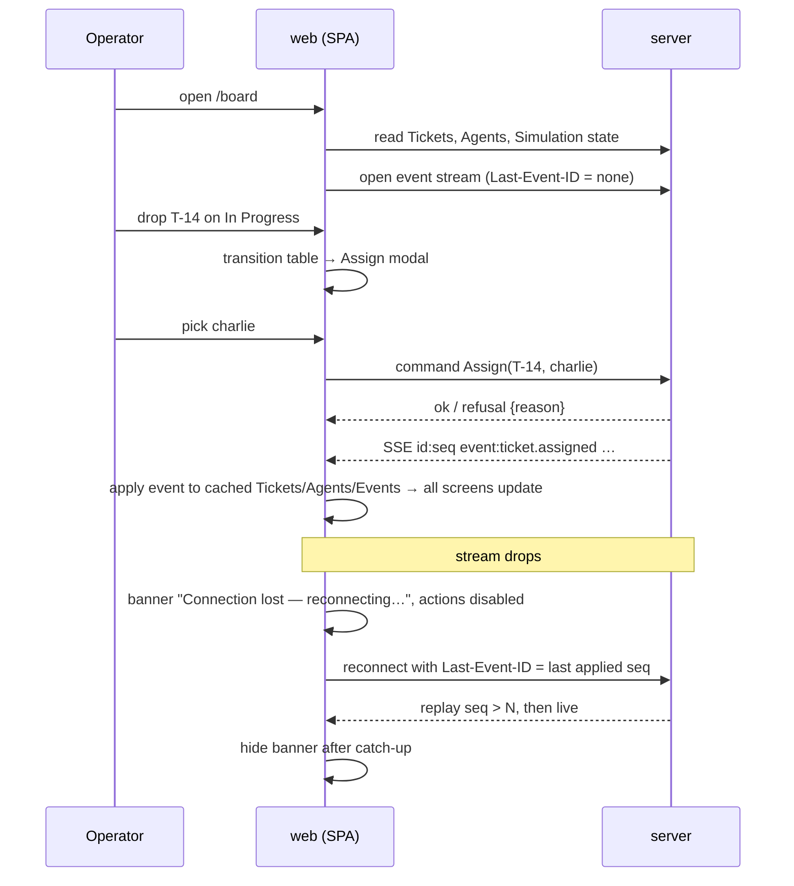

# Spec: Web UI — Agent Board, Mission Control, Usage & Cost, detail pages

Spec ID: `SPEC-web-ui` · Supersedes: none · Product source of truth:
[`abstract-project-spec.md`](abstract-project-spec.md) (requirement IDs `BRD-*`, `CON-*`, `NAV-*`, `MC-*`,
`CST-*`, `LOG-*`, `MOCK-*`, `SIM-*`, `NFR-*`, deviations `D-1`…`D-15`). Sibling layer specs written in
parallel: [`server-api.md`](server-api.md) (`SPEC-server-api`) and [`database.md`](database.md)
(`SPEC-database`).

## Problem

The Operator needs one browser UI over the MVP's simulated agents: create and route work, step agents
through it, see who is doing what, and read what each run cost and did. The abstract spec says **what**
the product does; the prototype (`docs/design/prototype/app.dc.html`) shows **how it looks** — but the
prototype allows moves the owner rejected (D-1…D-15), lacks several states (loading, error, connection
lost, not found, health legend), and runs on local state instead of a server. This spec pins down the
web layer only: routes, screens, component states and copy, interactions, keyboard and a11y, and how
each screen reads server data and reacts to live events — so the web module can be planned and built
against `SPEC-server-api` without re-reading the prototype.

## Goals

- Every screen and modal of the prototype, with its layout, copy and states, specified against
  `docs/design/components.md` and `docs/design/tokens.css`.
- The Operator transition table (BRD-04) enforced identically for drag & drop and for the `Move` buttons.
- Live updates from the single event stream on every open screen, in every tab, with no local timers
  changing what is shown (SIM-06).
- Explicit loading, empty, error, not-found and connection-lost states.
- Keyboard-complete, WCAG 2.1 AA UI in light and dark themes.

## Non-goals

- Endpoint paths, request/response fields, event payload fields, health or cost computation, simulation
  rules — owned by `SPEC-server-api`. Tables, columns, seed content — owned by `SPEC-database`.
- Real agents, MCP, Agent Telemetry from real agents (PDR-0008) — the UI shows simulated agents only.
- Adding or removing agents, resetting seed data from the UI (reset is a server script — Round-2 decision).
- Authentication, multiple Operators, roles (NFR-05).
- Mobile layout (NFR-08); export; cost budgets/alerts; editing or deleting tickets after creation.
- An in-board keyboard "pick up and move" mode (the keyboard alternative is the ticket page `Move`
  buttons, BRD-04/NFR-06) — see Open questions.
- Filters persisted in the URL or across reloads (demo ticket T-10 describes this; it is mock content,
  not a requirement).

## Constraints

All records below were accepted by the owner on 2026-10-24 (ADR-0006/0007 stay proposed and are out of scope).

- PDR-0001 Record product decisions as PDRs (accepted) — the UI spec does not contradict any PDR.
- PDR-0004 No WIP limit on In Progress (accepted 2026-10-24) — the UI never refuses a move for column capacity.
- PDR-0006 Operator can release an In Progress ticket back to Ready (accepted 2026-10-24) — release only to Ready,
  always via the confirm modal.
- PDR-0007 Usage & Cost and Session Log ship on mock data only (accepted 2026-10-24) — every mock view carries a
  `MOCK` label (MOCK-01).
- PDR-0008 MVP runs on simulated agents only (accepted 2026-10-24) — no UI for connecting real agents.
- PDR-0009 Operator assigns tickets and moves them within lifecycle guards (accepted 2026-10-24) — transition table
  below; refused moves are refused the same way for drag and buttons, with the reason shown; assignment
  is shown as an Operator event.
- PDR-0010 Offline agents stay in the Mission Control grid, dimmed and sorted last (accepted 2026-10-24).
- PDR-0011 Health thresholds 30 s / 120 s, tool grace capped at 10 min, heartbeat for waiting agents
  (accepted 2026-10-24) — thresholds are shown to the Operator (health legend).
- ADR-0002 TypeScript pnpm monorepo with `web/`, `server/`, `shared/` (accepted 2026-10-24) — the UI consumes
  contract types from `shared/` only, never from `server/`.
- ADR-0004 Fastify REST commands + one SSE stream with `Last-Event-ID` resume (accepted 2026-10-24) — the UI reads
  resources, sends commands, and follows exactly one event stream; reconnect resumes from the last seen
  `seq`.
- ADR-0008 Simulation inside the server through the command layer, advancing on demand, auto-play off by
  default (accepted 2026-10-24) — the UI only *requests* steps/play; it never simulates.
- ADR-0009 PostgreSQL + transactional event log, `events.seq` drives feeds and resume (accepted 2026-10-24) — the
  UI orders feeds by `seq`.
- ADR-0011 Web stack: React 19 + Vite SPA, client-side routing, CSS Modules over
  `docs/design/tokens.css`, server-state cache updated/invalidated by stream events (being drafted,
  supersedes ADR-0005).
- ADR-0012 Testing: Vitest, React Testing Library, Playwright e2e (being drafted) — every `AC-N` below
  is written to be checkable by a component test or an e2e test.

## User stories

- **US-1** As the Operator, I want to create tickets and see all work in five columns, so that I know
  what is waiting, running, in review and done. (UC-01)
- **US-2** As the Operator, I want to move tickets by drag & drop or by buttons, with refused moves
  explained, so that I route work without breaking the lifecycle. (UC-12, UC-14)
- **US-3** As the Operator, I want to pick which free agent takes a ticket, so that work reaches an agent
  while agents only move on demand. (UC-12)
- **US-4** As the Operator, I want to step an agent and watch every step in a console on the ticket page,
  so that I control the pace of the simulation. (UC-13, UC-09)
- **US-5** As the Operator, I want to answer blocked agents and approve or return submitted work, so that
  agents can continue. (UC-04, UC-06)
- **US-6** As the Operator, I want one screen with every agent's health, stage and current action plus a
  live event log, so that I see at a glance what is happening. (UC-07)
- **US-7** As the Operator, I want an agent page comparing what the agent said with what it did, plus
  its sessions and tickets, so that I can audit it. (UC-08)
- **US-8** As the Operator, I want token and cost totals by period, agent, ticket, model and activity,
  so that I see what the work costs. (UC-10)
- **US-9** As the Operator, I want to read a session's full log with filters, search and error jumps, so
  that I understand one run step by step. (UC-11)
- **US-10** As the Operator, I want Back, breadcrumbs and stable filters, so that I never lose my place.
- **US-11** As the Operator, I want to see when the connection is lost and have the UI catch up on its
  own, so that I never act on stale data.
- **US-12** As a keyboard or screen-reader user, I want every action reachable and every state described
  without colour, so that I can use the product fully.
- **US-13** As the Operator, I want light and dark themes, so that I can work in either.
- **US-14** As the Operator, I want an optional auto-play with a visible simulation clock, so that I can
  let a demo run by itself.

## Routes and screens

Browser routes (client-side; owned by this spec). Detail pages belong to a primary nav item for the
active-state highlight.

| Route | Screen | Nav item | Abstract spec |
|---|---|---|---|
| `/` | redirects to `/board` | — | — |
| `/board` | Agent Board | `01 Board` | BRD-01…BRD-14 |
| `/tickets/:ticketId` (e.g. `/tickets/T-12`) | Ticket page incl. Agent console | `01 Board` | BRD-06…BRD-08, CON-01…CON-06, CST-07 |
| `/mission-control` | Mission Control | `02 Mission Control` | MC-01…MC-06, MC-09, MC-10 |
| `/agents/:agentId` | Agent page | `02 Mission Control` | MC-07, MC-08, LOG-01 |
| `/usage` | Usage & Cost | `03 Usage & Cost` | CST-01…CST-09 |
| `/sessions/:sessionId` (e.g. `/sessions/S-0412`) | Session Log | `02 Mission Control` | LOG-02…LOG-09 |
| any other path | Not found | none | — |

### Server data used per screen

Resources and commands are named, not addressed; their shapes and endpoints are defined in
[`server-api.md`](server-api.md) → *Contracts* §C2 (resources), §C6 (endpoints), §C8 (stream messages).

| Screen | Reads (resources, server-api §C2/§C6) | Sends (commands, server-api §C6) |
|---|---|---|
| App shell | `SimulationState` (clock, playing, held, lastSeq, journalFloorSeq, nextTicketId, healthThresholds 30 / 120 / 600 s), Tickets (blocked count for the nav badge), stream `hello` | Play, Pause, Step (simulation-wide), Hold |
| Board | Tickets (all, server order), Agents (all) | Create ticket, Move (`move` / `release` / `reopen` / `mark_done` / `approve` kinds), Assign, Request changes |
| Ticket | Ticket detail (`ticket`, `activity` ≤ 30 feed events newest first, `sessions` newest first), the assignee Agent (incl. `step`), `SessionDetail` of the selected console session, Agents (for Assign) | Move, Assign, Request changes, Answer, agent Step (`mode` `step` / `to_next_stage`), Hold |
| Mission Control | Overview (agents online/total, blocked, review, `eventsPerMinute[12]`), Agents, Tickets (ids, titles), Events (feed, `limit` 40, `beforeSeq` paging, `source` / `category` filters) | — |
| Agent | Agent page (`agent`, `kpis`, `saidVsDid` rows + `mismatchCount` + `notes`, `sessions` ≤ 10 + `sessionsTotal`, `tickets`) | — |
| Usage & Cost | Usage for a period (`kpis`, `costPerDay[30]`, `peakUsd`, `breakdowns`), Sessions list (`period`, `agentId`, `model`, `sort`, `limit` 12, `offset`), ModelPrices | — |
| Session Log | `SessionDetail` (header, `entries`, `costByType`, `tokenActivity`, `topSteps`, `stages`) | — |

## Acceptance criteria (EARS)

Each AC lists the abstract-spec IDs it traces to and how it is observed. "The UI" = the web application.

### App shell and navigation

- **AC-1** The UI shall show the header on every route: brand block `AGENT OPS` (ink fill, 2×2 square mark
  with one `--attn` square) linking to `/board`, primary nav `01 Board`, `02 Mission Control`,
  `03 Usage & Cost` with a dashed `MOCK` tag on the third, the Simulation panel (AC-6), the theme toggle
  and the label `LOCAL · NO AUTH`. _(traces: NAV-03, NFR-05, MOCK-01; observable: header snapshot on each route)_
- **AC-2** The UI shall mark the nav item of the current route with `aria-current="page"`, weight 600 and
  a 3 px ink underline, treating ticket pages as `Board` and agent and session pages as
  `Mission Control`. _(traces: NAV-03; observable: component test per route)_
- **AC-3** WHILE at least one ticket is `In Progress` and `Blocked`, the UI shall show an `--attn` badge
  `N BLOCKED` on `01 Board`, with N equal to that count. _(traces: NAV-03; observable: badge count equals the board's `■ Blocked` KPI)_
- **AC-4** WHEN the Operator clicks a primary nav item or the brand block, the UI shall open that screen
  and clear the Back history. _(traces: NAV-03; observable: after nav click, Back on the next detail page reads `← BACK TO <that screen>`)_
- **AC-5** WHEN the Operator activates the theme toggle, the UI shall switch between light and dark tokens
  on every screen; the toggle reads `◐ DARK` in light theme and `☀ LIGHT` in dark theme and has the
  accessible name "Toggle dark mode". _(traces: NAV-05; observable: `data-theme` flips; e2e screenshot in both themes)_
- **AC-6** The UI shall show a Simulation panel in the header: label `Simulation`, a `▶ PLAY` / `Ⅱ PAUSE`
  toggle with `aria-pressed`, a `STEP` button and the Simulation Clock as `hh:mm:ss` with a square dot
  (`--live` while playing, `--muted` while paused); auto-play is shown as paused after every page load
  unless the server reports it playing. _(traces: SIM-07, SIM-10; observable: panel reflects Simulation state; default paused after server boot)_
- **AC-7** WHEN the Operator presses `▶ PLAY`, `Ⅱ PAUSE` or `STEP`, the UI shall send the Play, Pause or
  Step-all command and update the panel from the resulting Simulation state, not optimistically.
  _(traces: SIM-07; observable: e2e — STEP advances the clock once; panel changes only after the event arrives)_
- **AC-8** WHILE auto-play is on, the UI shall disable `STEP` with the reason "Pause to step manually".
  _(traces: SIM-07; observable: STEP `aria-disabled` and reason exposed while playing)_
- **AC-9** WHILE a modal is open or a card is being dragged, the UI shall hold the simulation with the
  Hold command (`held: true`, a client id stable for the tab), renew the hold at least every 10 s (the
  server lets a hold expire 15 s after its last renewal), and release it (`held: false`) when the
  interaction ends; it does not toggle Play itself. _(traces: SIM-07, server-api AC-56; observable: e2e — with Play on, the Simulation Clock does not advance while the Assign modal is open for 30 s, and advances again after Cancel)_
- **AC-10** The UI shall show `← BACK TO <previous screen>` and a breadcrumb on every ticket, agent and
  session page; the label is `BOARD`, `MISSION CONTROL`, `USAGE & COST` or the id of the previous ticket,
  agent or session. _(traces: NAV-01, NAV-02; observable: label matches the page visited before)_
- **AC-11** WHEN the Operator activates Back, the UI shall open the previous entry of the in-app visit
  history and remove it from the history; IF the history is empty, THEN the UI shall open `/board`.
  _(traces: NAV-01; observable: e2e Board → T-12 → alpha → S-0412, Back ×3 shows alpha, T-12, Board)_
- **AC-12** The UI shall keep at most the 30 most recent visits in the in-app history, dropping the
  oldest, and shall not add a visit when the target route equals the current one. _(traces: NAV-01; observable: unit test on 31 visits)_
- **AC-13** The UI shall render breadcrumbs as `BOARD / <STATUS> / T-x` on ticket pages,
  `MISSION CONTROL / <agent>` on agent pages and `MISSION CONTROL / <agent> / <session>` on session pages,
  with every part except the last as a link to its screen. _(traces: NAV-02; observable: link targets in component test)_
- **AC-14** The UI shall never change the board filters, Event Log filters, Usage & Cost period, filters,
  sort or page size as a result of navigation, Back or any incoming event; only an Operator action on
  that control changes it. _(traces: NAV-04; observable: e2e — set filters, navigate away and back, run steps; filters unchanged)_
- **AC-15** WHEN the Operator opens a different session than the one last shown, the UI shall reset the
  Session Log type filter to `ALL`, clear the search, collapse all expanded outputs and reset the error
  cursor to the first error. _(traces: NAV-04, LOG-06; observable: component test)_
- **AC-16** WHEN the Operator opens an unknown path, the UI shall show "Page not found." with a link
  `Go to Board`. _(traces: —; observable: e2e on `/nope`)_
- **AC-17** WHEN the Operator opens a ticket, agent or session id that does not exist, the UI shall show
  "<Ticket|Agent|Session> <id> doesn't exist." with `← BACK TO BOARD` (ticket) or
  `← BACK TO MISSION CONTROL` (agent, session). _(traces: —; observable: e2e on `/tickets/T-999`)_

### Toasts and command feedback

- **AC-18** WHEN a command sent by the Operator succeeds, the UI shall show its toast (bottom centre,
  ink box, mono 12 px) in an `aria-live="polite"` region for 3.4 s; a newer toast replaces an older one.
  Toast texts: «T-x created in Backlog — move it to Ready for agents», «T-x moved to <column>»,
  «T-x is In Progress — <agent> starts with Planning», «T-x approved — moved to Done», «T-x moved to Done»,
  «T-x sent back to In Progress», «T-x unblocked — the agent continues», «T-x moved to Ready — the agent is
  free again», «T-x reopened in <column>». _(traces: BRD-13; observable: component test per command)_
- **AC-19** IF the Operator drops a card on, or activates a `Move` button for, a refused transition, THEN
  the UI shall leave the ticket where it is, send no command and show the toast
  «Can’t move T-x to <column>: <reason>» with the reason from the transition table. _(traces: BRD-04, BRD-13; observable: no network request; toast text)_
- **AC-20** IF the server refuses a command, THEN the UI shall leave its view unchanged until the next
  event and show «Can’t move T-x to <column>: <text>» for moves or «Couldn’t <action>: <text>» for
  other commands, where <text> is the error envelope's `reason` if present, else its `message`
  (server-api §C3); a `400` with `details` shows each detail message under its field instead.
  _(traces: BRD-04; observable: e2e with a stale tab assigning an agent already taken in another tab → «… alpha is busy with T-12 — one ticket per agent.»)_
- **AC-21** IF a command cannot reach the server, THEN the UI shall show «Couldn’t reach the server — try
  again.» and keep any text the Operator typed. _(traces: BRD-10; observable: e2e with server stopped)_
- **AC-22** WHILE a command is in flight, the UI shall disable the control that sent it (and both console
  step buttons for a step command) so it cannot be sent twice. _(traces: NFR-02; observable: double click sends one request)_

### Live updates, loading, errors, connection

- **AC-23** The UI shall follow exactly one event stream per tab and apply every received Event in `seq`
  order to all open screens, so that the result of any Operator command or agent step is visible without
  reload. _(traces: BRD-05, NFR-01, NFR-02; observable: e2e — two tabs, assign in one, the other shows In Progress)_
- **AC-24** The UI shall treat the `X-As-Of-Seq` header of every read (server-api AC-71) as the `seq`
  that read already includes, apply to that data only Events with a higher `seq`, and ignore any Event
  whose `seq` it has already applied. _(traces: NFR-02, NFR-04; observable: unit test — a read with `X-As-Of-Seq: 50` plus streamed events 49…52 applies only 51 and 52; a duplicate is ignored)_
- **AC-25** The UI shall derive every relative time ("ago", `SEEN`, `UPDATED`, durations of running
  tools and sessions, `Events / min`) from the Simulation Clock reported by the server and never from the
  browser clock, so that nothing on screen changes while no step happens. _(traces: SIM-06, SIM-10; observable: e2e — Mission Control open 10 min with Play off; DOM unchanged)_
- **AC-26** The UI shall show `Agent Health` exactly as reported by the server and shall not compute it.
  `Agent.health` comes from the server (server-api AC-38, §C2). _(traces: MC-05; observable: code review + test with a mocked Agents response)_
- **AC-27** WHILE a screen's initial data is loading, the UI shall show the screen frame (header, title,
  section headings) with the label `LOADING…` (mono, `--muted`) in each data region, and no partial
  numbers. _(traces: —; observable: component test with a pending request)_
- **AC-28** IF a screen's initial data cannot be loaded, THEN the UI shall show "Couldn’t load <screen> —
  the server is not responding." with a `Retry` button that reloads that data. _(traces: BRD-10; observable: e2e with server stopped before load)_
- **AC-29** WHEN the event stream reports an error, or no message (including `keepalive`) has arrived for
  30 s (twice the server's 15 s keepalive, server-api AC-62), the UI shall treat the stream as lost and
  show within 2 s a full-width top banner below the header, `role="status"`, ink fill, mono text
  «Connection lost — reconnecting…». _(traces: BRD-10, NFR-04; observable: e2e — kill the server; banner appears; a stalled proxy test shows it after 30 s)_
- **AC-30** WHILE the connection-lost banner is shown, the UI shall disable every data-changing control
  (create, move, assign, release, reopen, approve, request changes, answer, step, play/pause/step-all)
  with the reason «Reconnecting — actions are paused», and keep navigation, filters, sorting, search and
  theme working on the data already shown. _(traces: BRD-10; observable: e2e — controls `aria-disabled`; Back still works)_
- **AC-31** WHEN the stream reconnects, the UI shall resume with `Last-Event-ID` = the last applied
  `seq`, take Simulation Clock and Play state from the `hello` message, apply every replayed
  Event in order, and hide the banner once it has applied every Event up to the `hello` message's
  `lastSeq`. _(traces: NFR-04, ADR-0004, server-api AC-58, AC-60; observable: e2e — events produced during the outage appear after reconnect, none twice)_
- **AC-32** WHEN the stream sends `resync` (reason `ahead`, `below_floor` after a reset, or
  `too_far_behind`), the UI shall refetch every resource of the open screen, discard cached data of
  other screens, and continue live. _(traces: NFR-04, server-api AC-61, §C8; observable: e2e after the reset script — open tab shows the clean fixture)_
- **AC-33** WHEN a ticket changes, the UI shall mark its card `UPDATED` (blue square + label, `--live`
  border and 1 px ring) and its ticket page `■ JUST UPDATED`, WHILE the ticket's last change is at most
  7 s of Simulation Clock old. _(traces: BRD-05; observable: marker present after a step, gone after ≥2 more steps of 6 s)_
- **AC-34** The UI shall never clear text the Operator is typing (new-ticket form, answer, review comment,
  log search) because of an incoming Event. _(traces: NFR-02; observable: type in answer field, run steps in another tab; text stays)_

### Agent Board

- **AC-35** The Board shall show the title `Board`, KPIs `Tickets` (all tickets), `Agents working`
  (agents holding an `In Progress` ticket) and `■ Blocked` (in `--attn-ink`), then five columns in the
  order `Backlog`, `Ready`, `In Progress`, `Review`, `Done`, each with its number `01`…`05`, name and a
  big count of the cards it currently shows; the `Done` column has a `--bg-sub` background. _(traces: BRD-01; observable: seed data shows 16 · 3 · 1 and counts 3/3/3/2/5)_
- **AC-36** The Board shall order cards by priority (High, Medium, Low) then oldest first, and in `Done`
  by last change, newest first. _(traces: BRD-01; observable: seed Ready column reads T-13, T-11, T-10)_
- **AC-37** WHEN a column shows no card, the Board shall show a dashed box with «Nothing matches the filter»
  if any board filter is on, else «Create a ticket to start» in `Backlog` and «Nothing here» elsewhere.
  _(traces: BRD-01; observable: component test for the three texts)_
- **AC-38** The Board shall render each card with: id; priority as three 3 px bars of height 5/8/11 px
  (filled = level) plus `HIGH`/`MEDIUM`/`LOW`; the `UPDATED` or `■ BLOCKED` flag; the title as a link;
  and, while the ticket has an assignee and is not `Done`, a 4-segment stage stepper, the agent id, the
  agent's stage in capitals — or `WAITING` if the agent is no longer on this ticket — and the age of the
  last change (`12S`, `4M`, `2H`); then the last update in one line. _(traces: BRD-03; observable: seed T-12 card snapshot)_
- **AC-39** WHILE a ticket is `In Progress` and `Blocked`, the Board shall fill its card with `--attn`,
  text `--on-attn`, show `■ BLOCKED` and the agent's question instead of the last update. _(traces: BRD-03; observable: T-8 card)_
- **AC-40** The Board shall show `Done` cards muted on a transparent background, without agent, stepper
  or last update. _(traces: BRD-03; observable: T-1 card)_
- **AC-41** The Board shall make each card a single keyboard focus stop that opens the ticket page on
  Enter, and also open it on a click anywhere on the card. _(traces: BRD-03, NFR-06, D-10; observable: Tab reaches each card once; Enter opens `/tickets/T-x`)_
- **AC-42** The Board shall offer an `Agent` select (`All agents` + every agent id) and a `Blocked only`
  checkbox; with a filter on, the Board shall show only tickets assigned to that agent and/or
  `In Progress` + `Blocked` tickets, the hint line «Filter on: agent <id>, blocked only.» (only the parts
  that apply) and a `Clear filters` button that resets both. _(traces: BRD-09; observable: component test)_
- **AC-43** WHEN the Operator activates `+ New ticket`, the UI shall open the New ticket modal
  (AC-88). _(traces: BRD-02; observable: modal opens, focus in Title)_
- **AC-44** The Board shall show under the columns: «Drag a card to a highlighted column. Moving to
  In Progress asks which agent takes it; work leaves an agent only by releasing it to Ready, with
  confirmation. Only the agent submits for review. Without a mouse: open a ticket and use its Move
  buttons.» _(traces: BRD-14, D-15; observable: text present; no "any column")_

### Moves: the Operator transition table

The single source for drag hints, `Move` buttons, modals and refusals (BRD-04, PDR-0009, PDR-0006,
Round-2 "In Progress → Done asks for confirmation"). Refusal reasons are shown verbatim; in drag hints
they are upper-cased after `⊘ `.

| From \ To | Backlog | Ready | In Progress | Review | Done |
|---|---|---|---|---|---|
| **Backlog** | — | move · hint `↓ DROP — READY FOR AGENTS` | Assign modal · `↓ DROP — PICK AN AGENT` | ⊘ «Nobody worked on it yet — move it to In Progress first» | move (Mark done) · `↓ DROP — MARK DONE` |
| **Ready** | move · `↓ DROP — BACK TO BACKLOG` | — | Assign modal · `↓ DROP — PICK AN AGENT` | ⊘ «Nobody worked on it yet — move it to In Progress first» | move (Mark done) · `↓ DROP — MARK DONE` |
| **In Progress** | ⊘ «Release it to Ready first» | Release confirm · `↓ DROP — RELEASE (CONFIRM)` | — | ⊘ «Only the agent submits work for review» | Mark-done confirm · `↓ DROP — MARK DONE (CONFIRM)` |
| **Review** | ⊘ «Approve it or request changes» | ⊘ «Approve it or request changes» | Request-changes modal · `↓ DROP — SEND BACK WITH COMMENT` | — | Approve · `↓ DROP — APPROVE` |
| **Done** | Reopen confirm · `↓ DROP — REOPEN (CONFIRM)` | Reopen confirm · `↓ DROP — REOPEN (CONFIRM)` | Assign modal · `↓ DROP — PICK AN AGENT` | ⊘ «Reopen it first — only an agent submits for review» | — |

- **AC-45** The UI shall decide allowed, modal and refused moves for drag & drop and for `Move` buttons
  from the shared transition table (server-api §C4, identical to the table above; the drop hints are
  UI copy), shall never send a command for a refused cell, shall send `confirmed: true` only from the
  confirm button of its modal, and shall send with every move, assign and request-changes command the
  ticket status it was showing as `expectedStatus`. _(traces: BRD-04, PDR-0009, D-1, D-2, D-3; observable: table-driven unit test over all 20 cells)_
- **AC-46** WHEN the Operator starts dragging a card, the Board shall show the card at 35 % opacity with a
  dashed border, the hint line «Moving T-x — highlighted columns accept it.», and above every other column
  either its `↓ DROP — …` hint (column `--bg-sub` + 1 px `--live` inset ring, hint in `--live`) or its
  `⊘ <REASON>` hint (column at 40 % opacity, hint `--muted`); the card's own column shows no hint.
  _(traces: BRD-04; observable: e2e drag T-12 shows RELEASE (CONFIRM) over Ready and ⊘ over Backlog/Review)_
- **AC-47** WHILE a dragged card is over an accepting column, the Board shall thicken that column's ring
  to 3 px. _(traces: BRD-04; observable: style on dragover)_
- **AC-48** WHEN the Operator drops a card on an accepting column, the UI shall perform the cell's
  reaction: send the move command for "move" cells, or open the cell's modal. _(traces: BRD-04; observable: e2e per reaction type)_
- **AC-49** WHEN the Operator drops a card outside any column or on its own column, the UI shall do
  nothing. _(traces: BRD-04; observable: no request, no toast)_
- **AC-50** The UI shall make every card draggable, including `Done` cards (D-4 table allows
  Done → Backlog / Ready / In Progress), unless a filter hides it. _(traces: BRD-04; observable: drag T-1 to Ready opens Reopen confirm)_
- **AC-51** WHEN a move from Backlog or Ready to Ready, Backlog or Done succeeds, the UI shall show
  «T-x moved to <column>». _(traces: BRD-04, BRD-13; observable: drag T-14 to Ready)_

### Modals

Common to every modal: 50 % black scrim, square panel with title row, body and action row,
`role="dialog"` (`role="alertdialog"` for confirmations), `aria-modal="true"`, labelled by its title.

- **AC-52** WHILE a modal is open, the UI shall keep keyboard focus inside it, close it on Escape and on
  `Cancel` / the keep-action without changing anything, and return focus to the control that opened it.
  _(traces: NFR-06, BRD-11, BRD-12; observable: RTL/e2e focus test per modal)_
- **AC-53** IF the ticket a modal acts on changes status while the modal is open (another tab, auto-play),
  THEN the UI shall close the modal and show «T-x changed in the meantime — check its new state.»
  _(traces: NFR-02; observable: e2e with two tabs)_
- **AC-54** WHEN a move to In Progress from Backlog, Ready or Done is requested, the UI shall open
  «Who takes T-x?» with the ticket title under it and one row per agent (id, kind label, state note):
  free agents first with `■ FREE · ONLINE` (or `◐ STALE · FREE` / `□ OFFLINE · FREE`), then busy agents
  disabled at 40 % opacity with `BUSY · <ticket> · <STAGE>`; under the list: «An agent works on one ticket
  at a time, so busy agents are greyed out. The chosen agent moves to Planning and starts a session.»;
  action `Cancel`. _(traces: BRD-11, PDR-0009; observable: seed shows charlie first, five busy rows after)_
- **AC-55** WHEN the Operator picks a free agent in the Assign modal, the UI shall send Assign, close the
  modal and show «T-x is In Progress — <agent> starts with Planning». _(traces: BRD-11; observable: e2e; Activity shows the Operator event «Moved <from> → In Progress · assigned to <agent>», not «Claimed»)_
- **AC-56** IF every agent is busy, THEN the Assign modal shall show, as `role="alert"` in `--attn-ink`,
  «Every agent is busy. Mark one of their tickets done or release it to Ready first.», and offer no
  pickable row. _(traces: BRD-11, D-14; observable: component test; text has no "Review")_
- **AC-57** WHILE the Assign modal is open, the UI shall update agent rows live as agents become free or
  busy. _(traces: NFR-02; observable: release in another tab enables the row)_
- **AC-58** WHEN In Progress → Ready is requested, the UI shall open the alertdialog «Move T-x to Ready?»
  with «<agent> is assigned to it. The agent stops working on T-x, gets a refusal with the reason on its
  next call, and becomes free for other work.» and actions `Keep it with the agent` and primary
  `Release ticket`; on confirm the UI shall send Release and toast «T-x moved to Ready — the agent is free
  again». _(traces: BRD-12, PDR-0006; observable: e2e on T-12)_
- **AC-59** WHEN In Progress → Done is requested, the UI shall open the alertdialog «Mark T-x done?» with
  «<agent> is working on it. The agent stops, its session ends as Completed, and it becomes free for
  other work.» (plus « The block is cleared.» if the ticket is Blocked) and actions
  `Keep it with the agent` and primary `Mark done`; on confirm the UI shall send Mark done and toast
  «T-x moved to Done». _(traces: BRD-04, LOG-10, Round-2 decision; observable: e2e on T-8)_
- **AC-60** WHEN Done → Backlog or Done → Ready is requested, the UI shall open the alertdialog «Reopen T-x
  in <column>?» with «The ticket becomes unassigned work again. Its history and sessions stay.» and
  actions `Keep it in Done` and primary `Reopen ticket`; on confirm the UI shall send Reopen and toast
  «T-x reopened in <column>». _(traces: BRD-12, D-4; observable: e2e on T-1)_
- **AC-61** WHEN Review → In Progress is requested by drag, the UI shall open «Send T-x back to <agent>»
  with the required field «What should change? *», the note «The ticket returns to In Progress for the
  same agent, who reads this comment first.» and actions `Cancel` and primary `Send back`. _(traces: BRD-07; observable: e2e drag T-7 to In Progress)_

### Ticket page

- **AC-62** The ticket page shall show the badges `<id>`, priority (`▮▮▮ HIGH`, `▮▮ MEDIUM`, `▮ LOW`),
  status as `0N <STATUS>` in ink fill and, per AC-33, `■ JUST UPDATED`; then the title (44 px, bold).
  _(traces: BRD-06; observable: T-12 snapshot)_
- **AC-63** The ticket page shall show `A — Description` (or «No description.» when empty) and
  `B — Acceptance criteria · N` as a numbered list `01`, `02`… or «No acceptance criteria yet.».
  _(traces: BRD-06; observable: T-15 shows «No acceptance criteria yet.»)_
- **AC-64** WHILE the ticket is `In Progress` and `Blocked`, the ticket page shall show, above the
  sections, the panel «■ Blocked — <agent> needs your answer» (attn header) with the agent's question in
  quotes, the required field «Your answer *» (placeholder «The agent reads this on its next step») and
  primary `Send answer & unblock`. _(traces: BRD-08; observable: T-8)_
- **AC-65** WHEN the Operator sends a non-empty answer, the UI shall send Answer & unblock, clear the
  field and toast «T-x unblocked — the agent continues»; IF the answer is empty or whitespace, THEN the UI
  shall send nothing and show «Write an answer before unblocking.» as `role="alert"`. _(traces: BRD-08; observable: component test)_
- **AC-66** WHILE the ticket is in `Review`, the ticket page shall show the panel «Ready for review» ·
  «Submitted by <agent>» with the agent's summary (or «No summary provided.»), the result line
  `RESULT <branch or PR>` when provided, and actions primary `✓ Approve` and `↩ Request changes`.
  _(traces: BRD-07; observable: T-7)_
- **AC-67** WHEN the Operator activates `✓ Approve`, the UI shall send Approve and toast «T-x approved —
  moved to Done». _(traces: BRD-07; observable: e2e on T-7)_
- **AC-68** WHEN the Operator activates `↩ Request changes`, the review panel shall replace its actions
  with the required field «Comment for <agent> *» (placeholder «What should change before this can be
  approved?»), the note «The ticket returns to In Progress for the same agent, who reads this comment on
  its next step.» and actions primary `Send back to <agent>` and `Cancel`. _(traces: BRD-07; observable: component test)_
- **AC-69** WHEN a non-empty review comment is sent (inline or from the modal of AC-61), the UI shall send
  Request changes and toast «T-x sent back to In Progress»; IF the comment is empty or whitespace, THEN
  the UI shall send nothing and show «A comment is required — tell the agent what to change.» as
  `role="alert"`. _(traces: BRD-07; observable: component test for both entry points)_
- **AC-70** WHILE the ticket is `In Progress` with a review comment from its latest return, the ticket
  page shall show «Returned from review · <comment>»; WHILE the ticket has an Operator answer, it shall
  show «You answered · <answer>». _(traces: BRD-07, BRD-08; observable: after AC-65/AC-69)_
- **AC-71** The ticket page shall show `C — Move` with one button per other column — `Move to Backlog`,
  `Move to Ready`, `Move to In Progress…` (`Move to In Progress` without ellipsis from Review),
  `Move to Review`, `Move to Done` — whose reaction follows the transition table; a refused button is
  `aria-disabled`, stays focusable, shows 40 % opacity and exposes its refusal reason as its accessible
  description and as a visible tooltip on hover and focus. _(traces: BRD-04, NFR-06, PDR-0009; observable: T-12 → Review button announces «Only the agent submits work for review»)_
- **AC-72** The ticket page shall show under the Move buttons: «In Progress asks which agent takes the
  ticket. Work leaves an agent only by releasing it to Ready, with confirmation. Only the agent submits
  for review.» _(traces: BRD-14, D-15; observable: text present; no "Any column works")_
- **AC-73** The ticket page aside shall show `Who is on it`: with an assignee — agent id (26 px link to
  the agent page), kind label, health badge, stage stepper with labels `PLAN · IMPL · TEST · REVIEW`, the
  current-action box (AC-97) — or «Finished here» / «<agent> has moved on» if the agent is on another
  ticket — then `Open current session log` (primary, with a `--live` square) when the agent has a
  `Running` session on this ticket, else `Open last session log` when any session exists, and
  `Agent page →`. _(traces: BRD-06, MC-04, MC-09; observable: T-12 and T-1)_
- **AC-74** WHILE the ticket has no assignee, `Who is on it` shall read «Nobody yet. Move it to Ready so an
  agent can pick it up.» (Backlog), «Waiting for the next free agent — agents take Ready tickets by
  priority, then age.» (Ready) or «Finished.» (Done). _(traces: BRD-06; observable: T-14, T-10, reopened ticket)_
- **AC-75** The ticket page aside shall show `Sessions & cost` with a `MOCK` tag, the total cost of all
  the ticket's sessions, and up to 6 newest sessions as rows `<id> · <agent> · <status> · <cost>` linking
  to their Session Log, or «No agent session has touched this ticket yet.». _(traces: CST-07, MOCK-01; observable: T-12 lists S-0412 and S-0409)_
- **AC-76** The ticket page aside shall show `Activity` with the legend `● OPERATOR  ■ REPORT  ◆ TELEMETRY`
  and the ticket's newest 30 Events in chronological order (oldest of the 30 at top), each with `hh:mm:ss`,
  the source mark with its source name as accessible label, and the event text (AC-105).
  _(traces: BRD-06; observable: T-7 feed)_

### Agent console (ticket page, section `D — Agent console`)

- **AC-77** WHILE the ticket has at least one session, the console shall show: session tabs for the
  ticket's 5 newest sessions (`role="tab"`, `●` after a `Running` one); `▸ NEXT STEP`, primary
  `▸▸ RUN TO NEXT STAGE` (AC-82) and `FULL LOG →` to the selected session's Session Log; the meta line
  `<session> · <agent> · <model> · <today|Mon D> <hh:mm> · N entries · $<cost>` (+ ` so far` if
  `Running`); and the terminal area. _(traces: CON-01, CON-02, CON-06; observable: T-12 shows tabs S-0412 ●, S-0409)_
- **AC-78** The console shall select by default the agent's `Running` session on this ticket, else the
  newest session, and keep the Operator's tab choice per ticket while the app stays open. _(traces: CON-02; observable: component test)_
- **AC-79** The console shall render the terminal in `--console-*` colours in both themes, mono 12.5 px,
  oldest line at top and newest at the bottom, as `role="log"` with label «Agent console» and
  `tabindex="0"`. _(traces: CON-01, NAV-05; observable: same colours in light and dark)_
- **AC-80** The console shall render each LogEntry as a row `hh:mm:ss · <tag> · <text>`: `operator`
  (white, weight 500); `system` (console-muted); `stage` as `── PLANNING ──` in `--console-stage` with
  top spacing; `agent` text with a token line under it; `$ tool` (`--console-ok` tag) or `✗ tool`
  (`--console-err` tag and text, faint error background) with `<tool>  <argument>`, the line
  `→ <result> · Ns`, a token line and the **full** output in a pre-formatted block with horizontal
  scroll. Token line: `<in> in · <out> out · <cache read> cache · $<step cost>`. _(traces: CON-03; observable: S-0409 rendering; failed Bash rows differ by tag text, not only colour)_
- **AC-81** WHILE the selected session is `Running`, the console shall show a tail line `▍ <state>`:
  «waiting for your answer above» (Blocked), «<tool> <argument> … running» (tool running), «waiting for
  the next step» (step possible), «session open, agent is on other work» (agent on another ticket),
  else «idle». _(traces: CON-05; observable: T-8 tail; T-12 tail)_
- **AC-82** WHILE the ticket is `In Progress`, its agent is on it (`currentTicketId` = this ticket) and
  the agent's `step.available` is true (server-api §C2, AC-45), the console shall show `▸ NEXT STEP` and
  `▸▸ RUN TO NEXT STAGE` and the hint «Agents only move when you step them». _(traces: CON-04, SIM-06; observable: T-12 shows both buttons)_
- **AC-83** WHILE the ticket is `Blocked`, the console shall hide the step buttons and show «Blocked —
  answer above to continue»; WHILE the ticket is in `Review`, it shall hide them and show «Waiting for your
  review», regardless of whether the session has already ended. _(traces: CON-04, LOG-10; observable: T-8, T-7)_
- **AC-84** IF the ticket is `In Progress`, not `Blocked`, its agent is on it and `step.available` is
  false, THEN the console shall hide the step buttons and show the agent's `step.reason` verbatim (e.g.
  «sim-3 is not responding.», «alpha has nothing left to do on T-12.»). _(traces: CON-04, server-api AC-45; observable: a ticket assigned to the unresponsive sim-3)_
- **AC-85** WHEN the Operator activates `▸ NEXT STEP` or `▸▸ RUN TO NEXT STAGE`, the UI shall send Next
  step or Run to next stage for that agent and append the resulting LogEntries to the console as their
  Events arrive. _(traces: CON-04, SIM-06; observable: e2e — one entry per Next step; run stops at a new stage divider)_
- **AC-86** WHEN new lines arrive WHILE the console is scrolled to the bottom, the console shall stay at
  the bottom; IF the Operator has scrolled up, THEN it shall keep the scroll position and show a
  `↓ NEW LINES` button that scrolls to the bottom. _(traces: CON-01; observable: e2e scroll test)_
- **AC-87** WHILE the ticket has no session, the console section shall show «No agent has worked on this
  ticket yet. Move it to In Progress and pick an agent — its console appears here.» _(traces: CON-06; observable: T-14)_

### New ticket modal

- **AC-88** The New ticket modal shall show the title «New ticket», the label «Goes to Backlog as T-N»
  with the next id, the fields `Title *` (focused on open), `Description`, `Acceptance criteria` (help
  «One criterion per line.»), `Priority` as a segmented `HIGH / MEDIUM / LOW` defaulting to `MEDIUM`, and
  actions `Cancel` and primary `Create ticket`; Enter in Title submits. T-N is `SimulationState.nextTicketId`
  (server-api §C2). The fields accept at most the server limits (server-api §C6: title 200, description
  10 000, at most 50 criteria of 500 characters) and say so when the limit is reached. _(traces: BRD-02; observable: component test)_
- **AC-89** IF the title is empty or whitespace on submit, THEN the modal shall stay open, send nothing,
  mark Title `aria-invalid` and show «Title is required.» under it as `role="alert"`; the error clears as
  soon as the Operator types. _(traces: BRD-02; observable: component test)_
- **AC-90** WHEN a valid ticket is submitted, the UI shall send Create ticket with the trimmed title,
  description, one acceptance criterion per non-empty line and the priority, close the modal, reset the
  form and toast «T-N created in Backlog — move it to Ready for agents». _(traces: BRD-02; observable: e2e — new card at the right place in Backlog)_

### Mission Control

- **AC-91** Mission Control shall show the title `Mission Control` and KPIs `■ Agents online` (`N/total`),
  `■ Blocked →` (`--attn-ink`, link to `/board`), `In review →` (link to `/board`) and `Events / min` with
  a 12-bar sparkline of the last 12 Simulation-Clock minutes (newest bar `--live`) labelled «Events per
  minute, last 12 minutes». _(traces: MC-01, MC-09; observable: seed shows 4/6 · 1 · 2)_
- **AC-92** Mission Control shall show in its header the health legend «■ ONLINE · ◐ STALE after 30 s ·
  □ OFFLINE after 2 min · a running tool keeps an agent Online for up to 10 min», with the numbers taken
  from `SimulationState.healthThresholds` (server-api §C2). _(traces: MC-05, PDR-0011; observable: legend text equals server values)_
- **AC-93** Mission Control shall show one card per agent in a grid, each with: id (22 px link), kind
  label (`REAL · CLAUDE CODE` or `SIMULATED`, from data), health badge (`■ ONLINE` ink, `◐ STALE`
  `--attn-ink`, `□ OFFLINE` `--muted`), the ticket as `<id> <title>` link or «No ticket — waiting for work
  in Ready», a labelled stage stepper, the current-action box (AC-97), and a footer
  `SEEN <ago>` · `$<x.xx> TODAY` with a dashed `MOCK` tag · `LOG ↗` to the current or last session.
  _(traces: MC-02, MC-03, MOCK-01, D-8, D-13; observable: alpha card snapshot)_
- **AC-94** WHEN the Operator clicks anywhere on an agent card outside its inner links, the UI shall open
  the agent page; the ticket link opens the ticket and `LOG ↗` opens the session. _(traces: MC-02, MC-09; observable: e2e)_
- **AC-95** Mission Control shall keep `Offline` agents in the grid, dimmed (`--bg-sub`, 75 % opacity)
  and after all other agents, otherwise in the server's agent order. _(traces: MC-10, PDR-0010; observable: seed — sim-3 last and dimmed)_
- **AC-96** The stage stepper shall show `PLAN · IMPL · TEST · REVIEW` with the current segment ink,
  passed segments `--muted`, future segments `--line`, current label weight 500; `Idle` shows all
  segments empty; a visually hidden «Stage: <stage>» gives the stage to assistive tech. _(traces: MC-03; observable: charlie vs alpha)_
- **AC-97** The current-action box shall show the first matching state: tool running — ink border,
  `--live` square, `<tool> · running`, argument, `m:ss`; Blocked — attn fill, «Blocked — needs Operator»,
  the question, its age; last tool failed — `--attn-ink` border on `--attn-bg`, triangle mark,
  `<tool> · failed`, argument, `<ago> AGO`; Offline — dashed, hollow square, «No activity», «Last event
  <ago> ago»; Awaiting Review — dashed, «Waiting for your review», «T-x is in Review»; no ticket — dashed,
  «Idle» (or «Paused after release» right after a release) and «Polling for the next Ready ticket»;
  otherwise «Thinking», «Between tool calls». _(traces: MC-04; observable: seed shows all six states across six agents)_
- **AC-98** WHILE auto-play is on and a tool is running, the running square shall pulse; with Play off or
  with reduced motion, it shall not animate. _(traces: SIM-06, NFR-06; observable: CSS under `prefers-reduced-motion`)_
- **AC-99** Mission Control shall show the `Event Log` aside (label «Newest first») listing the newest
  40 Events matching the filters, newest at top, each row `hh:mm:ss` · source mark (accessible label =
  source name) · agent link or `you` for Operator events · event text (AC-105) · ticket id link; warning
  Events (`warn`) in `--attn-ink`, weight 500. _(traces: MC-06; observable: seed top row «Edit started · src/stream/sse.ts»)_
- **AC-100** The Event Log shall offer the source filter `ALL`, `● OPERATOR`, `■ REPORT`, `◆ TELEMETRY`
  (segmented, `aria-pressed`) and the `Category` select `All`, `Agents`, `Tickets`, `Tools` (Event
  `category` `agent`, `ticket`, `tool`). _(traces: MC-06; observable: component test)_
- **AC-101** WHEN more Events match than are shown, the Event Log shall show `Show 40 more`, which adds the
  next 40 older matching Events. _(traces: MC-06; observable: seed has 44 events, 43 of them in the feed (`agent.heartbeat` is hidden) → button visible, 3 more after click)_
- **AC-102** WHEN the Operator activates `Ⅱ PAUSE`, the Event Log shall stop inserting new rows, switch
  the button to `▶ RESUME` (`aria-pressed="true"`) and, as soon as new Events arrive, show the banner
  button «PAUSED · N NEW EVENTS — RESUME ↑»; activating either shall insert every held Event and resume.
  _(traces: MC-06; observable: e2e — pause, step 3 times, banner N=events produced, resume shows all)_
- **AC-103** The Event Log, the ticket Activity, Said vs did and `Events / min` shall show only *feed*
  event types (server-api §C5, column `feed`); WHEN a non-feed Event arrives on the stream —
  `agent.heartbeat`, `agent.health_changed`, `session.started`, `session.ended`, `log.appended`,
  `simulation.stepped`, `simulation.play_changed` (all of category `agent`) — the UI shall use it only to update cached state
  (agent health, sessions, console and Session Log entries, Simulation Clock, Play state) and shall not
  insert it into any feed or count it. _(traces: MC-06, MC-01; observable: unit test feeds every §C5 type and checks which become rows)_

### Event text

- **AC-104** The UI shall render Event source marks as `●` Operator (`operator`), `■` Agent Report
  (`agent_report`) and `◆` Agent Telemetry (`agent_telemetry`, `--muted`), each with its source name as
  accessible label. No feed type has source `system` (§C5); IF one ever arrives, THEN the UI shall
  render it with the mark `—` and the label «System», visible under `ALL` only. _(traces: MC-06, BRD-06; observable: unit test)_
- **AC-105** The UI shall render an Event's text as its `payload.summary` verbatim, as plain text, and
  shall not compose event text itself; IF `summary` is missing, THEN it shall show the event `type`.
  The Event Log `Category` select maps `Agents` → `agent`, `Tickets` → `ticket`, `Tools` → `tool`;
  there is no other category. An agent self-claim and an Operator assignment are both
  `ticket.assigned`; the UI tells them apart only by `source` (`agent_report` vs `operator`) and
  `payload.claim`, and shows each with its own summary («Claimed T-x» vs «Moved <From> → In Progress ·
  assigned to <agent>»). _(traces: MC-06, BRD-11, SIM-08, SIM-11, D-5; observable: table-driven unit test over the feed types below)_

Feed types the UI shows, with the server's summary (server-api §C5 is authoritative; listed here for
review and tests):

| Event type | Source | Category | Warn | Summary |
|---|---|---|---|---|
| `ticket.created` | operator | ticket | – | Created T-x |
| `ticket.moved` | operator | ticket | – | Moved <From> → <To> |
| `ticket.assigned` (`claim: false`) | operator | ticket | – | Moved <From> → In Progress · assigned to <agent> |
| `ticket.assigned` (`claim: true`, auto-play self-claim and fixture history) | agent_report | ticket | – | Claimed T-x |
| `ticket.released` | operator | ticket | – | Moved In Progress → Ready · released <agent> |
| `ticket.reopened` | operator | ticket | – | Moved Done → <To> |
| `ticket.approved` | operator | ticket | – | Approved T-x |
| `ticket.changes_requested` | operator | ticket | – | Requested changes · “<comment>” |
| `ticket.unblocked` | operator | ticket | – | Answered <agent> · “<answer>” |
| `ticket.updated` | agent_report | ticket | – | Update · <text> · <progress>% |
| `ticket.blocked` | agent_report | ticket | ✓ | Blocked · <question> |
| `ticket.answer_read` | agent_report | ticket | – | Read Operator answer |
| `ticket.comment_read` | agent_report | ticket | – | Read review comment |
| `ticket.submitted` | agent_report | ticket | – | Submitted for review · <resultLink> |
| `agent.stage_changed` | agent_report | agent | – | Stage → <To> |
| `agent.refused` | agent_report | agent | ✓ | Refused: T-x was released by Operator — stopping work on it |
| `agent.connected` | agent_report | agent | – | Connected |
| `tool.started` | agent_telemetry | tool | – | <tool> started · <arg> |
| `tool.finished` | agent_telemetry | tool | – | <tool> ok · <arg> |
| `tool.failed` | agent_telemetry | tool | ✓ | <tool> failed · <arg> · <result> |

Hidden (non-feed, state only, all category `agent`): `agent.heartbeat` (incl. the fixture's «Checked review status»), `agent.health_changed`,
`session.started`, `session.ended`, `log.appended`, `simulation.stepped`, `simulation.play_changed`.

### Agent page

- **AC-106** The agent page shall show the id (72 px), badges `<kind>`, `<health> · SEEN <ago>` and the
  stage badge `0N <STAGE>` (`00 IDLE` … `04 AWAITING REVIEW`), the buttons `<T-x> · open ticket` (when it
  holds a ticket) and primary `Open current session log` (when it has a `Running` session), and KPIs
  `Sessions · 7d`, `Tickets done`, `Tool calls · today`, `Cost · 7d (mock)` — the last a link to
  `/usage` without filters. _(traces: MC-07, MC-09, MOCK-01; observable: alpha page)_
- **AC-107** The agent page shall show `Said vs did` with «What <agent> reported next to what its tools
  actually did — latest N events.», a table with columns `TIME`, `■ SAID — AGENT REPORT`,
  `◆ DID — AGENT TELEMETRY` over the agent's newest 16 Agent Report and Agent Telemetry Events on one time
  axis, mismatch rows on `--attn-bg` with the DID text in `--attn-ink`, the badge `▲ N MISMATCH` when
  N ≥ 1, and under the table the notes of the two most recent mismatches as «▲ <hh:mm>–<hh:mm> <text>».
  Rows, `mismatch` flags, `mismatchCount` and the notes come from the agent page's `saidVsDid`
  (server-api AC-29, §C6); the UI does not compute mismatches. _(traces: MC-08; observable: seed alpha shows ▲ 1 MISMATCH 14:05–14:16)_
- **AC-108** The agent page shall show `Sessions` with a dashed `MOCK DATA` tag, «Click a session to read
  its full log», a table of the 10 newest sessions with columns `SESSION`, `STARTED ↓`
  (`aria-sort="descending"`), `DURATION`, `TICKET` (or `—`), `MODEL`, `STATUS`, `TOKENS`, `COST`, every row
  opening the Session Log, and under it «Showing N of M sessions · all of them in Usage & Cost».
  _(traces: LOG-01, MOCK-01; observable: alpha shows 10 of M)_
- **AC-109** The agent page shall show `Tickets` — every ticket the agent worked on, as `<id> <title>
  <STATUS>` rows linking to the ticket. _(traces: MC-07; observable: alpha lists T-12, T-1, T-3, T-5)_

### Usage & Cost

- **AC-110** Usage & Cost shall show the striped `MOCK DATA` banner «Fixed demo set plus the simulated
  agents' live sessions — not real spend. Live token capture is not connected yet (PDR-0007).», the
  title `Usage & Cost` and the period segmented control `TODAY`, `7 DAYS`, `30 DAYS`, `ALL TIME`
  defaulting to `30 DAYS`. _(traces: MOCK-01, CST-02; observable: snapshot)_
- **AC-111** WHEN the Operator picks a period, the UI shall recompute every KPI, breakdown and the
  sessions table for it and reset the table to 12 rows. _(traces: CST-02, CST-05; observable: e2e)_
- **AC-112** Usage & Cost shall show KPIs `TOTAL COST` (sub-line = period name, e.g. `LAST 30 DAYS`),
  `TOKENS` (sub `N% CACHE READ`), `SESSIONS` (sub `N RUNNING NOW`), `AVG / SESSION` (sub
  `MEDIAN $x.xx`). _(traces: CST-01; observable: seed 30 DAYS shows 121 sessions, 4 running now)_
- **AC-113** IF the period has no session, THEN Usage & Cost shall show zero KPIs and «No sessions in this
  period yet. Pick a longer period, or press Play to let the simulated agents work.» (without the
  «or press Play…» part while auto-play is on). _(traces: CST-02, D-6; observable: component test with empty aggregates)_
- **AC-114** Usage & Cost shall show `Cost per day` («USD · last 30 days · selected period in ink»,
  `PEAK $x.xx`) as 30 bars for the 30 Simulation-Clock days ending today, days in the period in ink,
  others `--line`, today's bar with a `--live` top edge, a 4-step USD axis, 4 date labels (first day,
  two intermediate, `TODAY`) derived from the Simulation Clock, a hover tooltip `<Mon D|Today> · $x.xx`,
  and the accessible description «Cost per day over the last 30 days, peak $x.xx». _(traces: CST-03; observable: seed labels SEP 25 / OCT 4 / OCT 14 / TODAY)_
- **AC-115** Usage & Cost shall show `Model prices` with a `MOCK` tag, «USD per 1M tokens. Every cost in
  the app = tokens × these prices.» and a table `MODEL`, `IN`, `OUT`, `C·READ`, `C·WRITE` (2 decimals);
  WHEN the Operator clicks a model row, the UI shall set the sessions table's Model filter to it.
  _(traces: CST-08; observable: click sonnet-5-5 → Model filter = sonnet-5-5)_
- **AC-116** Usage & Cost shall show breakdowns `By agent`, `By ticket` (incl. «No ticket»), `By model`
  and `By activity`, each labelled «Cost · share», sorted by cost descending, each row `name · $cost ·
  N%` with a 3 px share bar; agent, ticket and model breakdowns show their 6 costliest rows, `By activity`
  shows all; agent rows open the agent, ticket rows open the ticket, model rows set the Model filter;
  «No ticket» and activity rows are not links. _(traces: CST-04; observable: component test)_
- **AC-117** Usage & Cost shall show `Sessions` with the note «N OF M · SORTED BY <START TIME|INPUT|OUTPUT|
  CACHE READ|CACHE WRITE|COST>» (+ ` · FILTERED`), `Agent` and `Model` selects, and a table with columns
  `SESSION` (`S-xxxx →`), `AGENT`, `TICKET` (or `—`), `MODEL`, `STARTED`, `DURATION`, `STATUS`
  (`● RUNNING` `--live`, `■ DONE`, `▲ FAILED` `--attn-ink`), `INPUT`, `OUTPUT`, `CACHE R`, `CACHE W`,
  `COST`, newest first, 12 rows then `Show 12 more`, and the footnote «* running session — cost so far,
  not final.» with `*` after running sessions' cost. _(traces: CST-05, CST-09; observable: seed table)_
- **AC-118** WHEN the Operator clicks a numeric column header (`INPUT`…`COST`, buttons with `aria-sort`),
  the table shall sort by it descending and show `↓` after it; a second click shall return to start-time
  order. _(traces: CST-05; observable: component test)_
- **AC-119** WHEN the Operator changes the Agent or Model filter, the table shall reset to 12 rows.
  _(traces: CST-05; observable: component test)_
- **AC-120** WHEN the Operator clicks a session row or its `S-xxxx →` link, the UI shall open its Session
  Log. _(traces: CST-06; observable: e2e)_

### Session Log

- **AC-121** The Session Log shall show a striped breadcrumb bar with Back, `MISSION CONTROL / <agent> /
  <session>` and «MOCK DATA demo log, not a real session»; the label `Session log`, the id (56 px), and,
  WHILE `Running`, «SESSION STILL RUNNING — LATEST ENTRY AT THE BOTTOM» in `--live`; then `Agent`
  (link), `Ticket` (link or `none`), `Model`, `Time` (`<Today|Mon D> hh:mm – <hh:mm|now>`), `Duration`,
  `Status`. _(traces: LOG-02, MOCK-01; observable: S-0412)_
- **AC-122** The Session Log shall show cells `INPUT`, `OUTPUT`, `CACHE READ`, `CACHE WRITE` (tokens and
  their cost each) and an ink-filled `COST` cell (`COST SO FAR` while `Running`) with «SUM OF N STEPS ·
  MOCK PRICES». _(traces: LOG-02, LOG-04, CST-09; observable: sum of step costs equals the COST cell)_
- **AC-123** The Session Log shall show `Where the tokens went` («by kind of work · N steps with
  tokens»), the four-token explanation «Input — new text the model reads (file contents, command
  output). Output — what it writes (replies, edits). Cache read — context reused from earlier turns,
  cheap. Cache write — context stored for reuse, mostly at session start.», and a table `ACTIVITY`,
  `STEPS`, `INPUT`, `OUTPUT`, `CACHE R`, `CACHE W`, `COST`, `SHARE` sorted by cost; WHEN the Operator
  clicks a row, the log filter shall switch to `MESSAGES` (Reasoning & replies), `STAGES & SYSTEM`
  (Session context) or `TOOL CALLS` (others). _(traces: LOG-08; observable: component test)_
- **AC-124** The Session Log shall offer type filters `ALL`, `MESSAGES`, `TOOL CALLS`, `▲ ERRORS`,
  `STAGES & SYSTEM`, each with `· <count>`, and a search field «Search in log» matching
  case-insensitively the entry text, tool name, argument and output; IF nothing matches, THEN it shall
  show «Nothing matches this filter.». _(traces: LOG-06; observable: component test)_
- **AC-125** WHILE the session has N ≥ 1 failed tool calls, the Session Log shall show `▲ ERROR K OF N`
  (attn fill) with `↑` (Previous error) and `↓` (Next error); WHEN either is activated, the UI shall move
  cyclically to the previous/next failed call, reset the type filter to `ALL`, clear the search, scroll
  to it and ring it with 3 px `--attn`. _(traces: LOG-06; observable: S-0409 — 2 errors, ↓ twice returns to the first)_
- **AC-126** IF the session has no failed tool call, THEN the Session Log shall show `NO ERRORS` and both
  arrows `aria-disabled`. _(traces: LOG-06, D-9; observable: S-0412)_
- **AC-127** The Session Log shall render entries chronologically: `● OPERATOR` bubble; `◇ AGENT` text
  with `<in> IN · <out> OUT · <cr> CACHE R · <cw> CACHE W · $<cost>`; tool box with `✓` (`--ok`) or `▲`
  (`--attn-ink`, border `--attn-ink` on `--attn-bg`), name, argument, `<result> · NS`, token line and
  output; stage rule `■ <STAGE>` with `AGENT REPORT`; system line `— <text>` with its tokens.
  _(traces: LOG-03, LOG-04; observable: S-0409 snapshot)_
- **AC-128** IF a tool output is longer than 4 lines, THEN the Session Log shall show its first 4 lines
  and a full-width `+ SHOW N MORE LINES` / `− COLLAPSE` toggle with `aria-expanded`; outputs of 4 lines or
  fewer show in full with no toggle; outputs keep indentation and scroll horizontally. _(traces: LOG-05; observable: S-0409 failed test output)_
- **AC-129** The Session Log aside shall show `Most expensive steps` (5 costliest steps: `hh:mm`, label —
  tool + argument, reply text or «Session context loaded» — cost, bar relative to the costliest) and
  `Stages in this session` (stage name and `hh:mm – <hh:mm|now>`) or «No stage reported in this
  session.». _(traces: LOG-07, LOG-09; observable: S-0409)_
- **AC-130** WHILE the session is `Running`, the Session Log shall append new entries at the bottom and
  update totals, counts, activity table and stages as Events arrive. _(traces: LOG-02, NFR-01; observable: e2e — step alpha, S-0412 grows)_

### Accessibility, theme, layout

- **AC-131** The UI shall make every action reachable and operable with the keyboard alone, with a
  visible focus ring `2px solid var(--live)`, offset 2 px. _(traces: NFR-06; observable: e2e keyboard-only run of create → assign → step → approve)_
- **AC-132** The UI shall pair every status, stage, health, source, result and error with a glyph or word
  in addition to colour (`■ ONLINE`, `◐ STALE`, `□ OFFLINE`, `● RUNNING`, `■ DONE`, `▲ FAILED`, `✓`,
  `▲`, `✗`, `●`/`■`/`◆`/`—`, `■ BLOCKED`, `UPDATED`). _(traces: NFR-06; observable: greyscale screenshot review)_
- **AC-133** The UI shall give every interactive element a hit area at least 40 px high (44 px for primary
  actions), including compact controls whose visual box is smaller (`sm` 32 px, `seg` 34 px, error
  arrows 36 px). _(traces: NFR-06; observable: e2e bounding-box check)_
- **AC-134** The UI shall label every form control, mark required fields with `*` in `--attn-ink`, and
  announce field errors via `role="alert"`. _(traces: NFR-06; observable: axe scan)_
- **AC-135** WHERE the operating system requests reduced motion, the UI shall run no animation
  (pulse, toast slide). _(traces: NFR-06; observable: Playwright with `reducedMotion: 'reduce'`)_
- **AC-136** The UI shall apply the theme from the OS preference until the Operator toggles it, then keep
  the Operator's choice in this browser across reloads. _(traces: NAV-05; observable: e2e with `colorScheme: dark`, toggle, reload)_
- **AC-137** The UI shall be fully usable at 1280 px viewport width; below 1180 px the Board scrolls
  horizontally and side panels wrap under the main content. _(traces: NFR-08; observable: e2e at 1280 and 1024 px)_

### Time display

- **AC-138** The UI shall display every simulation time (`at`, `updatedAt`, `startedAt`, `endedAt`,
  Simulation Clock, chart dates) in UTC, whatever the browser's time zone, and shall decide "Today",
  "<Mon D>" and the chart's day labels from the UTC date of the Simulation Clock; it shall never display
  `realAt`. _(traces: SIM-10, CST-03, server-api Open question "time zone"; observable: e2e with `timezoneId: 'America/Los_Angeles'` — fresh fixture header clock shows 14:32:00 and the chart ends at TODAY = Oct 24)_

## Edge cases

- Refused drop or `Move` button → AC-19; never a request.
- Drop outside a column or on the home column → AC-49.
- Server refuses a move allowed locally (e.g. agent taken in another tab; ticket moved meanwhile) → AC-20.
- Ticket changes status while its modal is open → AC-53.
- All agents busy when moving to In Progress → AC-56.
- Assigning a free agent that is `Stale`/`Offline` (or the unresponsive sim-3 once it is free) → allowed, row shows `◐ STALE · FREE` / `□ OFFLINE · FREE` (AC-54); the server fails the new session at the next clock advance (server-api AC-41) and the UI just shows `▲ FAILED`; accepted.
- Ticket status changed by another tab between display and command → server answers `409 stale_state` «T-x is now in <status>.», shown by AC-20; the view catches up from the stream.
- Release or Mark done of a ticket whose agent is `Offline` → same confirm modal (AC-58, AC-59); the refusal may never appear; accepted.
- Mark done of a `Blocked` ticket → confirm text adds «The block is cleared.» (AC-59).
- Ticket in `Review` whose session already ended (submit ends the session, Round-2) → console hint still «Waiting for your review» (AC-83).
- Agent cannot step (Offline, nothing left) while the ticket is In Progress → AC-84.
- `Run to next stage` that never changes stage → server caps at 40 steps (CON-04); UI just re-enables buttons when the command returns (AC-22).
- Agent blocks mid-`Run to next stage` → buttons replaced by the Blocked hint (AC-83).
- Ticket with more than 5 sessions → 5 newest tabs (AC-77); `Sessions & cost` shows 6 newest (AC-75); all in Usage & Cost.
- Console scrolled up while lines arrive → AC-86.
- Empty title, whitespace title → AC-89; empty answer → AC-65; empty review comment → AC-69.
- Very long title, description, argument or output → titles wrap (`text-wrap: balance`/`pretty`), arguments truncate with ellipsis in action boxes and wrap anywhere in logs, outputs scroll horizontally; accepted, no truncation of stored text.
- Filter hides every card in a column → AC-37; filtered-out ticket changes → counts follow the visible set (AC-35).
- Board filter set to an agent while dragging → hidden cards are not draggable (AC-50).
- Event Log paused while many events arrive → banner count grows; Resume inserts all (AC-102).
- Event Log with more than 40 matching events → AC-101.
- Duplicate event after reconnect → AC-24.
- Stream lost → AC-29…AC-31; silent dead connection → keepalive timeout (AC-29); `resync` (`ahead`, `below_floor` after a reset, `too_far_behind`) → AC-32; command while offline → AC-30 (disabled) / AC-21 (network failure mid-command); database down → `503 db_unavailable` message shown by AC-20.
- Browser in a time zone other than UTC → simulation times still shown in UTC (AC-138).
- Initial load fails → AC-28; slow load → AC-27.
- Unknown route / unknown id → AC-16, AC-17.
- Back with no history (deep link) → Board (AC-11); history over 30 → oldest dropped (AC-12).
- Session Log with no errors → AC-126; filter/search with no match → AC-124; output of exactly 4 lines → no toggle (AC-128).
- Session Log of 1 000 entries → non-functional thresholds below.
- Usage & Cost period with no sessions → AC-113.
- Session with no ticket → `TICKET` `—` in tables, `none` in Session Log header (AC-117, AC-121).
- An event type the UI does not know → shown as its type name (AC-105).
- Two tabs open → identical state after every event (AC-23); theme choice shared via the browser (AC-136); in-app Back history per tab; accepted.
- Browser back/forward buttons → move through route history like the in-app Back; the in-app history may diverge after mixing both; accepted.

## Non-functional

- **Latency (NFR-01):** on the Operator's machine, an Event is reflected on every open screen within
  500 ms of the command response (p95 over 100 steps in e2e).
- **Interaction:** applying a board filter, Event Log filter, Usage & Cost period/sort/filter, or Session
  Log filter/search updates the view within 200 ms at NFR-07 scale (100 tickets, 10 agents, 1 000-entry
  session).
- **Session Log scale (NFR-07):** a 1 000-entry session renders its first screen within 1 s and scrolls
  without dropped frames on a laptop (no frame > 50 ms in a Playwright trace).
- **Accessibility:** WCAG 2.1 AA — zero serious/critical axe violations on every route in both themes;
  text contrast ≥ 4.5:1 (tokens `--muted`, `--attn-ink` are chosen for this).
- **Themes:** every screen designed and checked in light and dark; the console uses fixed `--console-*`
  colours in both.
- **No timers that change data:** apart from the toast timeout and the connection-loss detection, the UI
  runs no timer that changes displayed data (SIM-06).

## Cross-module interactions

Modules (ADR-0002): `web` (this spec) talks to `server` over HTTP + one SSE stream; both use contract
types from `shared`. `web` never imports `server`.

Failure contract: command refusals carry a human-readable reason shown verbatim (AC-20); network failure
→ AC-21; stream loss → AC-29…AC-32. The UI never assumes a command succeeded until its Event arrives.

Dependencies on SPEC-server-api — all resolved by [`server-api.md`](server-api.md):

| # | UI needs | Resolved by server-api |
|---|---|---|
| 1 | Resources per screen | §C2 resources, §C6 `GET` endpoints (table "Server data used per screen") |
| 2 | Commands with human-readable refusals | §C6 `POST` endpoints, §C3 error envelope (`reason` for 409, `message`, `details` for 400), §C4 transition table |
| 3 | Next ticket id before creation (AC-89) | `SimulationState.nextTicketId` |
| 4 | Health thresholds for the legend (AC-92) | `SimulationState.healthThresholds` |
| 5 | Can the agent step now, and why not (AC-82, AC-84) | `Agent.step { available, reason }`, AC-45 |
| 6 | Mismatch spans (AC-107) | agent page `saidVsDid`, AC-29 |
| 7 | Event types and display text (AC-103…AC-105) | §C5 catalogue with `feed` flag and `payload.summary` |
| 8 | Hold auto-play during a modal / drag (AC-9) | `POST /simulation/hold`, 15 s expiry, AC-56 |
| 9 | Stream start, resume, resync, liveness (AC-29…AC-32) | §C8 `hello`, `resync`, `event: keepalive` ≤ 15 s; AC-58…AC-62; `X-As-Of-Seq` on reads, AC-71 |
| 10 | Stale-state protection for commands (AC-45) | `expectedStatus` + `409 stale_state`, AC-6 |
| 11 | Simulation Clock after each step | `simulation.stepped` payload `clock`, `hello.clock` |

Still divergent or open between the two specs — see Open questions (Ticket activity order, Assign to
the unresponsive agent).

## Contracts

Shapes the UI relies on, by name only; fields are defined in `SPEC-server-api` → *Contracts* and in
`shared/`:

- **Event** (shared vocabulary): `seq`, `at`, `realAt`, `source` (`operator` | `agent_report` |
  `agent_telemetry` | `system`), `category` (`ticket` | `agent` | `tool`), `type` (catalogue:
  server-api §C5), `agentId?`, `ticketId?`, `sessionId?`, `payload` (always with `summary`), `warn`. The
  UI orders by `seq`, shows only feed types, renders `payload.summary` (AC-105), highlights by `warn`,
  filters by `source` and `category`.
- **Stream messages** (server-api §C8): `hello` (`lastSeq`, `journalFloorSeq`, `clock`, `playing`),
  events (`id: <seq>`, `event: <type>`, `data: <Event>`), `resync` (`reason`: `ahead` | `below_floor` |
  `too_far_behind`), `keepalive` (id-less event); reads carry `X-As-Of-Seq`; reconnect sends the last
  applied `seq` as `Last-Event-ID`.
- **Ticket, Agent, Session, LogEntry, ModelPrice, Simulation state:** as in the abstract spec's domain
  model, with shapes from server-api §C2 (enums §C1 are lower snake case; the UI maps them to display
  names such as `In Progress`, `Awaiting Review`, and formats `share` fractions as percent). The UI
  never derives domain rules (health, cost, step availability, mismatches); it uses the shared
  transition table (§C4) only to refuse moves without a round trip.

UI-owned client state (not shared): in-app visit history (≤ 30), board filters, Event Log filters /
pause / page size, Usage & Cost period / sort / filters / page size, Session Log filter / search /
expanded outputs / error cursor, console tab per ticket, theme.

Display formats (UI-owned): money `$x.xx`; tokens `<1 000` as is, `x.xK`, `x.xxM`; durations `Nm`,
`Nh MMm`; tool timer `m:ss`; age `Ns`, `Nm`, `Nh` (upper-case on cards and `SEEN`); event and log times
`hh:mm:ss`; table start times `Today hh:mm` / `Mon D hh:mm`; all times in UTC (AC-138); all numbers
`tabular-nums`.

## Untrusted inputs

The UI displays, and never interprets, text that comes from the Operator, the simulation or mock data:
ticket titles, descriptions and acceptance criteria, answers, review comments, agent questions, summaries,
result links, agent replies, tool names, arguments and outputs, and Event payload text. All of it is
rendered as plain text (no HTML, Markdown or script interpretation); outputs only in pre-formatted text
blocks. Result links (`RESULT <branch or PR>`) are shown as text, not as clickable links, and never opened
automatically. Instructions inside such text (e.g. "ignore previous…", "click here") never trigger a UI
action. The same rule will apply unchanged to real-agent data in the next iteration.

## Prototype deviations (UI follows this spec, not the prototype)

All of D-1…D-15 from the abstract spec apply. Additional UI-level deviations:

| # | Prototype | This spec | Why |
|---|---|---|---|
| U-1 | `Done` cards are not draggable | Draggable (AC-50) | BRD-04 allows Done → Backlog/Ready/In Progress |
| U-2 | In Progress → Done without confirmation | Confirm modal (AC-59) | Round-2 owner decision |
| U-3 | Simulation panel hidden behind a prototype prop | Always visible in the header (AC-6) | Round-2 decision |
| U-4 | `Waiting for your review` hint only while a session is open | Shown for every Review ticket (AC-83) | Submit ends the session (Round-2) |
| U-5 | No loading, error, not-found or connection-lost states | AC-16, AC-17, AC-27…AC-32 | Required by BRD-10/NFR-04; owner chose the banner |
| U-6 | No health legend | Legend in Mission Control header (AC-92) | PDR-0011 guardrail |
| U-7 | Said vs did subtitle «reported over MCP» | «reported» (AC-107) | No MCP in the MVP (PDR-0008) |
| U-8 | Event Log capped at 40, no paging | `Show 40 more` (AC-101) | Round-1 decision 11 |
| U-9 | Refused Move button: native `disabled` + `title` only | `aria-disabled`, focusable, reason as description + tooltip (AC-71) | Keyboard/screen-reader users must hear the reason (NFR-06, PDR-0009) |
| U-10 | Error jump keeps the search text | Clears the search (AC-125) | Otherwise the jump can land on a hidden entry |
| U-11 | Console always forced to the bottom | Sticks to bottom only when already there (AC-86) | Reading older lines must not be interrupted |
| U-12 | «No ticket» breakdown row resets the Agent filter | Not a link (AC-116) | Behaviour was accidental |
| U-13 | Chart date labels hard-coded | Derived from Simulation Clock (AC-114) | Data is server-driven |
| U-14 | Ticket move note and board footer say «Any column works» | Rewritten (AC-44, AC-72) | D-15 |
| U-15 | Health and "ago" computed in the browser | Health from server, times from Simulation Clock (AC-25, AC-26) | Single source of truth, SIM-06 |
| U-16 | Commands applied instantly in local state | Applied when the Event arrives; controls disabled in flight (AC-7, AC-22) | Server is authoritative (ADR-0004) |
| U-17 | Ticket cards have no keyboard focus | One focus stop per card (AC-41) | D-10 / NFR-06 |
| U-18 | Compact controls 32–36 px | Hit area ≥ 40 px (AC-133) | NFR-06 |

## Open questions

Owner said to take the recommended answer; each item records the default this spec already uses.

- [NEEDS CLARIFICATION: Should the Board get an in-board keyboard move (focus card, `M`, arrows), beyond
  the ticket page `Move` buttons? — default: no in the MVP (Non-goals).]
- [NEEDS CLARIFICATION: Should filters, period and sort survive a reload (URL or storage)? — default: no;
  they live for the tab's session and survive navigation only (AC-14).]
- [NEEDS CLARIFICATION: Copy for the stale-modal toast (AC-53) and the Reopen / Mark-done modal bodies
  (AC-59, AC-60) — not in the prototype; default: the copy written here.]
- [NEEDS CLARIFICATION: The Ready-column `Who is on it` text says agents take Ready tickets themselves,
  which only happens with auto-play on — default: keep the abstract spec's copy (AC-74); alternative
  «Waiting for an agent — move it to In Progress to pick one, or press Play and a free agent takes it by
  priority, then age.»]
- [NEEDS CLARIFICATION: Should the paused Event Log banner count all new Events or only those matching
  the filters? — default: all (as the prototype).]
- [NEEDS CLARIFICATION: Time zone of the Simulation Clock — default (shared with server-api): UTC; the
  fixture starts at 2026-10-24T14:32:00Z and the UI shows simulation time in UTC regardless of the
  browser's zone, so screens match the prototype's 14:32 (AC-138).]
- [NEEDS CLARIFICATION: Ticket `Activity` order — server-api returns the newest 30 feed events newest
  first (AC-24); the prototype lists them oldest first. Default: the UI reverses them and shows them
  oldest first, as in the prototype (AC-76). Not a contract conflict.]
- [NEEDS CLARIFICATION: Should the Assign modal disable the unresponsive agent (sim-3)? server-api
  default: allowed, the session then fails at the next clock advance. Default here: allowed, shown with
  its health (`□ OFFLINE · FREE`). — owner.]
- [NEEDS CLARIFICATION: Answer and review comment length — server-api caps them at 4 000 characters;
  default: the UI uses the same limit and shows the server's `details` message if exceeded.]
- [NEEDS CLARIFICATION: Should the in-app Back history persist across reloads? — default: no.]
